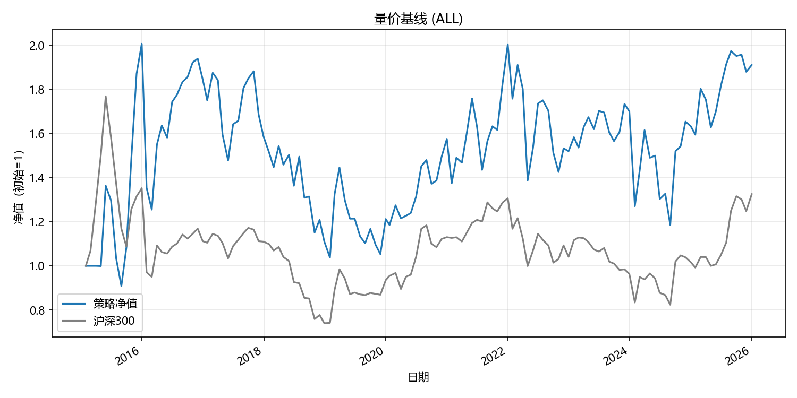
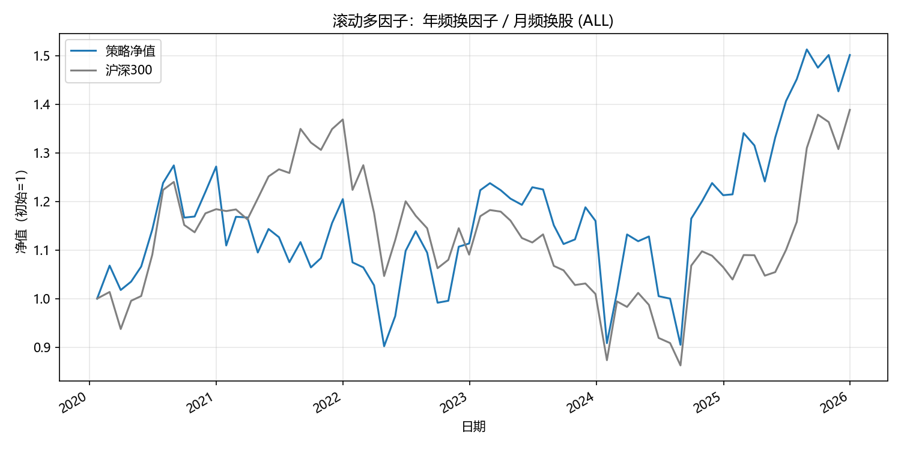

# A 股多因子选股与市场中性策略

策略以量价因子为 alpha 来源，组合层面分为主动管理与市场中性两条分支：主动管理保留基准 Beta，追求相对沪深 300 的超额；市场中性用股指期货对冲系统性 Beta，只保留因子收益。两条分支共用同一套因子与合成结果。

本仓库当前实现的是**主动管理（多头）分支**的数据管线、因子检验、单因子基线与滚动多因子（年频换因子 + 月频换股）；优化器搜索与市场中性分支仍在开发中。

## 目录

- [结果摘要](#结果摘要)
- [项目结构](#项目结构)
- [快速开始](#快速开始)
- [数据说明](#数据说明)
- [策略要点](#策略要点)
- [已知限制](#已知限制)
- [进度](#进度)

## 结果摘要

回测区间 2015-01-01 至 2025-12-31，月末调仓，单边费率 0.002，基准为沪深 300 价格指数。

### 单因子 IC

38 个量价因子的 RankIC 与 ICIR，下表按 |ICIR| 排序取前 10，完整结果见 [`results/baseline/factor_summary.csv`](results/baseline/factor_summary.csv)。

| 因子 | 含义 | RankIC | ICIR | IC>0 占比 |
| --- | --- | ---: | ---: | ---: |
| `turnover_std_3m` | 3 月换手率波动 | -0.0851 | -0.591 | 29.8% |
| `Alpha13` | 收盘价与成交量秩协方差取反 | 0.0410 | 0.548 | 71.0% |
| `Alpha16` | 高价与成交量秩协方差取反 | 0.0418 | 0.538 | 69.5% |
| `turnover_mean_3m` | 3 月平均换手率 | -0.0939 | -0.530 | 29.0% |
| `volatility_3m` | 3 月收益率波动 | -0.0619 | -0.516 | 26.7% |
| `Alpha12` | 成交量变化 × 价格反向变化 | 0.0383 | 0.510 | 71.0% |
| `Alpha4` | 低价时序排名取反 | 0.0666 | 0.476 | 66.9% |
| `return_3m` | 3 个月动量 | -0.0662 | -0.454 | 32.8% |
| `return_1m` | 1 个月动量 | -0.0608 | -0.440 | 32.1% |
| `Alpha34` | 短长波动比与价格变化取反 | 0.0456 | 0.414 | 62.6% |

换手与波动类因子 IC 为负，说明低换手、低波动的股票表现更好；Alpha 反转类为正、动量类为负，A 股在该区间内短期反转强于动量。

### 基线组合表现

38 个因子先做单因子检验，按 |ICIR| ≥ 0.2 保留 20 个（上限 20），方向校准后等权合成，每期取分数最高的 10 只等权持有：

| 指标 | 量价基线（Top 10） | 沪深 300 |
| --- | ---: | ---: |
| 累计收益 | 91.13% | 32.54% |
| 年化收益 | 6.11% | 2.61% |
| 年化波动 | 36.26% | 24.68% |
| 夏普比率 | 0.17 | 0.11 |
| 最大回撤 | -48.34% | -58.18% |
| 年化换手 | 10.98 倍 | — |



接入行业中性化后，基线由负转正：累计 +91.13%、年化 +6.11%，跑赢沪深 300 的 +32.54%。改善主要来自去掉行业暴露后，选股从“押行业”变成“行业内选最强的股票”，而不是因子本身变强了。但 36.26% 的年化波动、-48.34% 的最大回撤和 10.98 倍换手说明组合仍缺风险控制，这是后续优化器二要解决的问题。

### 滚动多因子（样本外）

年频换因子 + 月频换股，2020-01-23 至 2025-12-31，共 72 期：

| 指标 | 滚动多因子 | 沪深 300 |
| --- | ---: | ---: |
| 累计收益 | 50.11% | 38.82% |
| 年化收益 | 7.08% | 5.68% |
| 年化波动 | 25.08% | 20.69% |
| 夏普比率 | 0.28 | 0.27 |
| 最大回撤 | -29.19% | -36.96% |
| 年化换手 | 10.69 倍 | — |



样本外跑赢基准约 11 个百分点，回撤比基准小 7.8 个百分点。滚动版与基线区间不同，不能直接比数值，但波动从基线的 36% 降到 25%、回撤从 -48% 收窄到 -29%，说明年度重训确实压住了一部分因子失效的风险。

## 项目结构

```
.
├── baseline/                  单因子基线、多空诊断与滚动多因子
│   ├── price_volume_baseline.py
│   ├── factor_longshort.py
│   └── rolling_multifactor.py
├── data/                      行情数据（不纳入版本管理）
│   └── raw/                   每只股票一个长表 CSV
├── data_io/                   宽表读取
├── docs/
│   └── strategy.md            策略设计文档
├── results/
│   ├── baseline/              基线回测产物
│   │   ├── factor_summary.csv
│   │   ├── longshort.csv
│   │   ├── performance.csv
│   │   └── nav.png
│   └── rolling/               滚动多因子产物
│       ├── factor_selection.csv
│       ├── composite_factor.csv
│       ├── performance.csv
│       └── nav.png
├── scripts/                   数据下载与宽表转换
│   ├── 00_auto_resume_download.py
│   ├── 01_download_a_share.py
│   ├── 01a_download_sh.py
│   ├── 01b_download_sz.py
│   ├── 02_pivot_to_wide.py
│   ├── 02a_pivot_sh.py
│   ├── 02b_pivot_sz.py
│   ├── 03_download_index_aux.py
│   ├── _baostock_common.py
│   └── _pivot_common.py
└── utils/                     因子检验、选股与净值计算
```

## 快速开始

环境要求 Python 3.9+。

```bash
pip install -r requirements.txt
```

### 1. 下载数据

先取辅助数据（沪深 300、交易日历、行业分类、上市退市日期），约 1 分钟：

```bash
python scripts/03_download_index_aux.py
```

再下载全市场日线、复权因子与季度股本。默认 2 进程；Baostock 请求频率过高会临时封禁，脚本内置黑名单熔断，检测到封禁立即退出，已下载文件自动跳过：

```bash
python scripts/01_download_a_share.py
```

如果封禁频繁，可以挂自动续传守护，封了等、解除后续，无需人工值守：

```bash
python scripts/00_auto_resume_download.py
```

只想跑单个市场：

```bash
python scripts/01a_download_sh.py    # 沪市
python scripts/01b_download_sz.py    # 深市
```

### 2. 转宽表

```bash
python scripts/02_pivot_to_wide.py
```

输出 `close_sh.csv`、`adj_factor_sz.csv` 等宽表，以及派生的 `adj_close_*.csv`、`total_mv_*.csv`、`circ_mv_*.csv`。

### 3. 跑基线

```bash
python baseline/price_volume_baseline.py
```

结果写入 `results/baseline/`。

## 数据说明

行情数据体积较大，不放入仓库，需要按上面的步骤重新下载。Baostock 对请求频率和累计请求量都有限制，4 进程左右会触发黑名单（错误码 `10001011`），封禁通常 1 小时到 12 小时不等，切换网络可以更换出口 IP。脚本默认 2 进程并带熔断，重跑会自动续传。

每只股票的长表字段：

```
date, code, open, high, low, close, preclose, volume, amount,
turn, tradestatus, pctChg, isST, peTTM, pbMRQ,
backAdjustFactor, totalShare, liqaShare
```

## 策略要点

完整设计见 [`docs/strategy.md`](docs/strategy.md)。

- 全链路只用一套后复权价格，因子、收益与净值同口径；
- 股票池在数据清洗阶段就做 ADV 20% 分位筛选，容量约束前置；
- 因子做 MAD 去极值、Z-score 标准化、行业中性化；
- 因子权重取训练窗口内 ICIR 归一化，不使用时序模型预测因子收益；
- 5 年训练窗口、1 年滚动步长，样本外 2020–2025；
- 调仓用漂移后权重计算换手，避免高估成本；
- 资金配置覆盖等权、逆波动率、逆方差、最小方差、等风险贡献、风险预算、最大分散化、最大去相关八种方法。

## 已知限制

1. 基准为沪深 300 价格指数，不含分红再投；个股后复权收益含分红，超额口径偏保守。
2. Baostock 无法获取已退市股票的日线，2015–2025 年退市的约 241 只标的缺失，回测存在幸存者偏差，收益略偏乐观。
3. 行业分类只有当期快照，早期年份的行业中性化存在轻微偏差。
4. 股本为季度快照，市值计算无法精确到日。
5. Baostock 不支持北交所，本文「全 A」指沪市 + 深市。

## 进度

- [x] 沪深 A 股数据下载与宽表转换
- [x] 后复权价格、月频面板、股票池与容量筛选
- [x] 38 个量价因子与单因子检验
- [x] 38 个因子的多空收益诊断
- [x] 单因子基线回测
- [x] 滚动多因子（年频换因子、月频换股，ICIR 降级筛选）
- [ ] 优化器一：因子搜索与权重收缩
- [ ] 优化器二：八种资金配置方法对比
- [ ] 收益归因
- [ ] Fama-French 三因子对比
- [ ] 市场中性分支（股指期货对冲、净 Beta 约束、对冲成本）
- [ ] 雪球模拟盘跟踪
