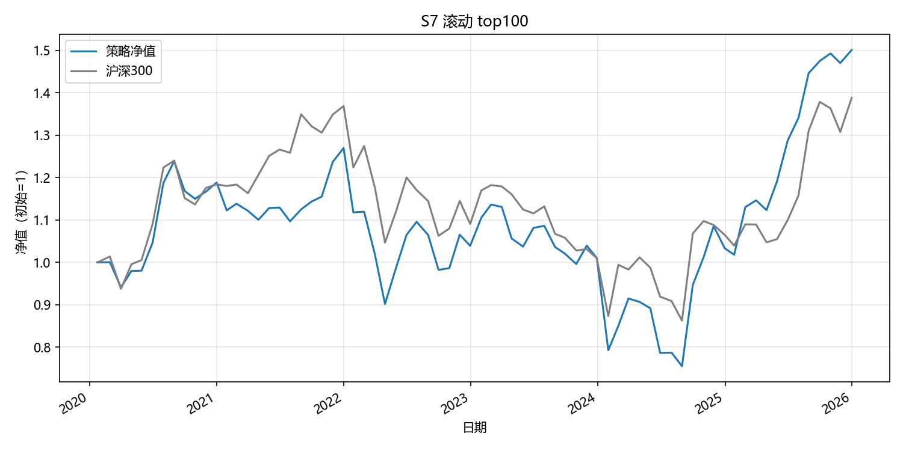

# A-Share Multi-Factor Stock Selection and Market-Neutral Strategy

**English** | [中文](README.zh-CN.md)

The strategy uses price-volume factors as its alpha source. At the portfolio level it has two branches: active management, which keeps benchmark beta and targets excess return over the CSI 300; and market neutral, which hedges systematic beta with index futures and keeps only factor return. Both branches share the same factors and composite scores.

This repository currently implements the **active (long-only) branch**: the data pipeline, factor tests, single-factor baseline, rolling multi-factor model (annual factor re-selection + monthly rebalancing), and a partial Optimizer 1 (long-side gate + long-side t weighting, S7). Full optimizer search and the market-neutral branch are still under development.

## Contents

- [Results Summary](#results-summary)
- [Project Structure](#project-structure)
- [Quick Start](#quick-start)
- [Data Notes](#data-notes)
- [Strategy Highlights](#strategy-highlights)
- [Known Limitations](#known-limitations)
- [Progress](#progress)

## Results Summary

Backtest period 2015-01-01 to 2025-12-31, monthly rebalancing, one-way cost 0.002, benchmark is the CSI 300 price index.

### Single-Factor IC

RankIC and ICIR of the 38 price-volume factors. The table shows the top 10 by |ICIR|; full results are in [`results/baseline/factor_summary.csv`](results/baseline/factor_summary.csv).

| Factor | Description | RankIC | ICIR | Share of IC > 0 |
| --- | --- | ---: | ---: | ---: |
| `turnover_std_3m` | 3-month turnover volatility | -0.0703 | -0.720 | 20.6% |
| `turnover_mean_3m` | 3-month average turnover | -0.0798 | -0.657 | 23.7% |
| `volatility_3m` | 3-month return volatility | -0.0503 | -0.600 | 26.7% |
| `return_1m` | 1-month momentum | -0.0644 | -0.589 | 26.7% |
| `Alpha20` | Rank of open relative to previous close | 0.0547 | 0.565 | 65.6% |
| `wgt_return_1m` | Turnover-weighted 1-month return | -0.0591 | -0.559 | 26.7% |
| `Alpha12` | Volume change × reversed price change | 0.0308 | 0.536 | 69.5% |
| `Alpha9` | One-period difference correlation of price and volume | 0.0476 | 0.531 | 71.0% |
| `volatility_6m` | 6-month return volatility | -0.0535 | -0.494 | 30.5% |
| `Alpha13` | Negated rank covariance of close and volume | 0.0361 | 0.486 | 68.7% |

Turnover, volatility, and reversal factors have negative IC: low-turnover, low-volatility, recently fallen stocks do better. Alpha reversal factors are positive. Absolute IC is only 0.03–0.08, but ICIR reaches 0.49–0.72, so the direction is stable and the signal-to-noise ratio is acceptable.

### Baseline Portfolio

All 38 factors are tested individually; those with |ICIR| ≥ 0.2 are kept (capped at 20), sign-adjusted, and equal-weighted into a composite. Each month the top 10 stocks are held with equal weights:

| Metric | Price-Volume Baseline (Top 10) | CSI 300 |
| --- | ---: | ---: |
| Cumulative return | -28.62% | 32.54% |
| Annualized return | -3.04% | 2.61% |
| Annualized volatility | 33.91% | 24.68% |
| Sharpe ratio | -0.09 | 0.11 |
| Maximum drawdown | -70.58% | -58.18% |
| Annualized turnover | 10.43x | — |


After adding capacity constraints (ADV above the 20th percentile, at least 120 trading days since IPO) and using the same neutralized factors for testing and composition, the baseline turns negative: -28.62% cumulative, -3.04% annualized. The gap versus the previous +91.13% shows that the earlier excess return came mainly from illiquid small caps and is not reproducible once the ADV filter is applied. Annualized turnover of 10.43x costs about 2.1% per year, which does not explain the whole loss; the core issue remains stock-selection style and the long-only structure.

### Rolling Multi-Factor (Out-of-Sample)

Annual factor re-selection + monthly rebalancing, 2020-01-23 to 2025-12-31, 72 periods. The original ICIR-weighted Top-10 model is kept as the control. The **S7** variant adds a long-side gate (training-window long-side excess return > 0 with t ≥ 1) and long-side t-stat weights, and holds the Top 100 names:

| Metric | Original Rolling (Top 10) | S7 Rolling (Top 100) | CSI 300 |
| --- | ---: | ---: | ---: |
| Cumulative return | -6.40% | +50.10% | 38.82% |
| Annualized return | -1.11% | +7.08% | 5.68% |
| Annualized volatility | 26.38% | 22.75% | 20.69% |
| Sharpe ratio | -0.04 | 0.31 | 0.27 |
| Maximum drawdown | -41.31% | -40.53% | -36.96% |
| Annualized turnover | 10.68x | 9.07x | — |



S7 beats the benchmark out of sample (+50.10% vs +38.82%, Sharpe 0.31 vs 0.27). The improvement decomposes into **diversification** (largest), **long-side t weighting**, and the **long-side gate**. Two honest caveats: the excess return is **concentrated in 2025** (the strategy lagged the benchmark through 2020-2024 and only overtook it in the 2025 rally), and the drawdown around the **February 2024 small-cap liquidity crisis** (-40.53%) is deeper than the benchmark's -36.96%. See `docs/strategy.md` section 11 for the full ablation and the config-by-holdings scan.

### Attribution: Why the Baseline Turned Negative

A 2x2 ablation (capacity filter on/off x unified/split factor pipeline) isolates the cause of the +91.13% to -28.62% flip. Toggling the **capacity filter** moves cumulative return by 91-145 percentage points; toggling the **pipeline** moves it by only 25-29 points. The capacity filter (ADV 20th percentile + 120 listed days) is the dominant cause: the earlier +91.13% came almost entirely from illiquid small caps and recent IPOs that cannot absorb real capital. Results are in [`results/ablation/comparison.csv`](results/ablation/comparison.csv).

## Project Structure

```
.
├── baseline/                  Baseline, diagnosis, rolling models, optimizer experiments
│   ├── price_volume_baseline.py
│   ├── factor_longshort.py
│   ├── rolling_multifactor.py
│   ├── rolling_top_weighted.py     S7 rolling (long-side gate + t weights)
│   ├── optimizer_factor_selection.py
│   └── ablation_attribution.py
├── data/                      Market data (not versioned)
│   └── raw/                   One long-table CSV per stock
├── data_io/                   Wide-table readers
├── docs/
│   └── strategy.md            Strategy design document (Chinese)
├── results/
│   ├── baseline/              Baseline outputs
│   │   ├── factor_summary.csv
│   │   ├── longshort.csv
│   │   ├── performance.csv
│   │   └── nav.png
│   ├── rolling/               Original rolling model outputs
│   ├── rolling_top/           S7 rolling outputs (top10/50/100)
│   ├── optimizer/             Factor selection and holdings scans
│   └── ablation/              2x2 attribution outputs
├── scripts/                   Data download and wide-table conversion
│   ├── 00_auto_resume_download.py
│   ├── 01_download_a_share.py
│   ├── 01a_download_sh.py
│   ├── 01b_download_sz.py
│   ├── 02_pivot_to_wide.py
│   ├── 02a_pivot_sh.py
│   ├── 02b_pivot_sz.py
│   ├── 03_download_index_aux.py
│   ├── _baostock_common.py
│   └── _pivot_common.py
└── utils/                     Factor tests, stock selection, NAV calculation
```

## Quick Start

Python 3.9+ is required.

```bash
pip install -r requirements.txt
```

### 1. Download Data

The repo ships a split data archive `data_archive/data.zip.001`–`.005` (about 416 MB total, split because of GitHub's 100 MB per-file limit). To restore it, put the five parts in one directory and run

```bat
copy /b data.zip.001 + data.zip.002 + data.zip.003 + data.zip.004 + data.zip.005 data.zip
```

Then unzip `data.zip` into `data/`. You can also skip the archive and re-download the data with the scripts below.

First fetch auxiliary data (CSI 300, trading calendar, industry classification, IPO/delisting dates), about one minute:

```bash
python scripts/03_download_index_aux.py
```

Then download market-wide daily bars, adjustment factors, and quarterly share counts. Two processes by default. Baostock temporarily bans frequent requests; the scripts include a circuit breaker that exits on a ban and skips files already downloaded:

```bash
python scripts/01_download_a_share.py
```

If bans are frequent, run the auto-resume daemon, which waits out the ban and continues without supervision:

```bash
python scripts/00_auto_resume_download.py
```

To download a single market only:

```bash
python scripts/01a_download_sh.py    # Shanghai
python scripts/01b_download_sz.py    # Shenzhen
```

### 2. Convert to Wide Tables

```bash
python scripts/02_pivot_to_wide.py
```

This writes wide tables such as `close_sh.csv` and `adj_factor_sz.csv`, plus derived `adj_close_*.csv`, `total_mv_*.csv`, and `circ_mv_*.csv`.

### 3. Run the Baseline

```bash
python baseline/price_volume_baseline.py
```

Results are written to `results/baseline/`.

## Data Notes

Market data is large and is not committed, so re-download it as described above. Baostock limits both request rate and cumulative request count; around four processes trigger the blacklist (error code `10001011`). Bans usually last from one to twelve hours, and switching networks changes the outbound IP. The scripts default to two processes with a circuit breaker and resume automatically on rerun.

Fields in each per-stock long table:

```
date, code, open, high, low, close, preclose, volume, amount,
turn, tradestatus, pctChg, isST, peTTM, pbMRQ,
backAdjustFactor, totalShare, liqaShare
```

## Strategy Highlights

The full design is in [`docs/strategy.md`](docs/strategy.md) (Chinese).

- One back-adjusted price series end to end, so factors, returns, and NAV share the same basis;
- The universe excludes ST stocks, recent IPOs (less than 120 trading days), and the bottom 20% by ADV; capacity screening happens before factor tests;
- No initial capital is assumed; NAV is computed from portfolio weights, and ADV is only a liquidity constraint;
- Factors are winsorized with MAD, industry-demeaned, and Z-scored; tests and composition use the same version;
- Factor weights are normalized |ICIR| over the training window in the baseline; the S7 variant uses long-side t-stat weights behind a long-side gate; no time-series model forecasts factor returns;
- Five-year training window, one-year rolling step, out-of-sample 2020–2025;
- Turnover is computed from drifted weights to avoid overstating costs;
- Capital allocation will cover eight methods: equal weight, inverse volatility, inverse variance, minimum variance, equal risk contribution, risk budgeting, maximum diversification, and maximum decorrelation (planned; V1 is equal weight).

## Known Limitations

1. The benchmark is the CSI 300 price index without dividends, while stock returns are back-adjusted and include dividends, so the excess-return basis is conservative.
2. Baostock does not provide daily bars for delisted stocks; about 241 names delisted during 2015–2025 are missing, so the backtest has survivorship bias and returns are slightly optimistic.
3. Industry classification is a current snapshot only, so industry neutralization in early years is slightly biased.
4. Share counts are quarterly snapshots, so market cap cannot be computed exactly by day.
5. Baostock does not cover the Beijing Stock Exchange; "all A-shares" here means Shanghai + Shenzhen.

## Progress

- [x] Shanghai/Shenzhen A-share download and wide-table conversion
- [x] Back-adjusted prices, monthly panel, universe and capacity filters
- [x] 38 price-volume factors and single-factor tests
- [x] Long-short return diagnosis for the 38 factors
- [x] Single-factor baseline backtest
- [x] Rolling multi-factor model (annual factor re-selection, monthly rebalancing, ICIR fallback rule)
- [x] Optimizer 1 (partial): long-side gate + long-side t weighting (S7), validated out of sample
- [x] Return attribution (capacity x pipeline 2x2 ablation)
- [ ] Optimizer 1: full heuristic factor search and weight shrinkage
- [ ] Optimizer 2: comparison of eight capital allocation methods
- [ ] Fama-French three-factor comparison
- [ ] Market-neutral branch (index futures hedge, net-beta constraint, hedge cost)
- [ ] Xueqiu paper-trading tracking
