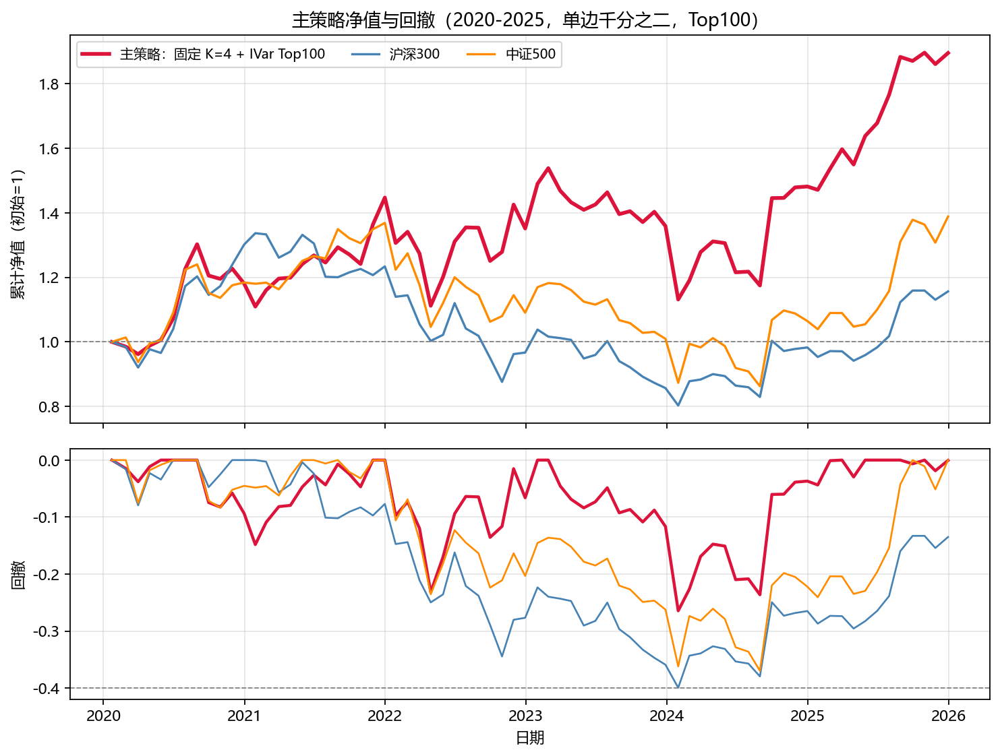
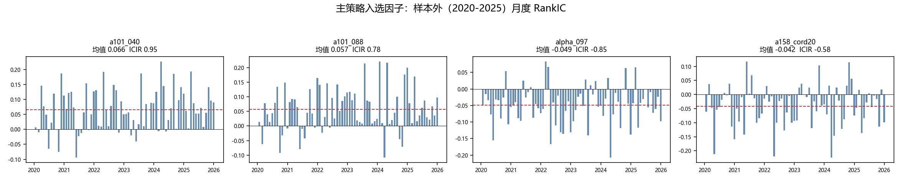
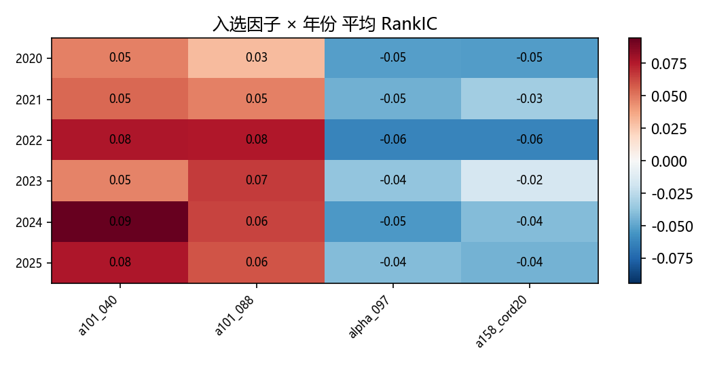
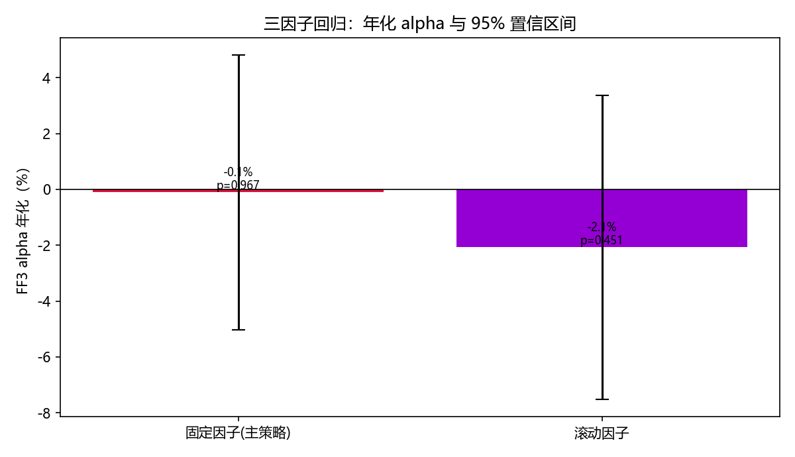
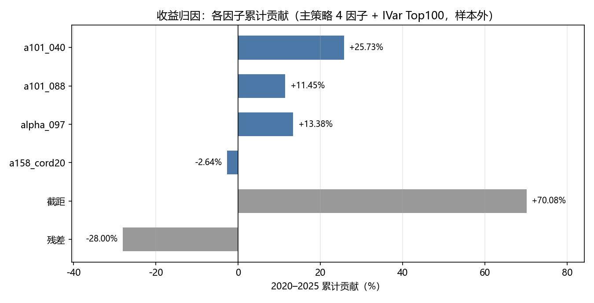
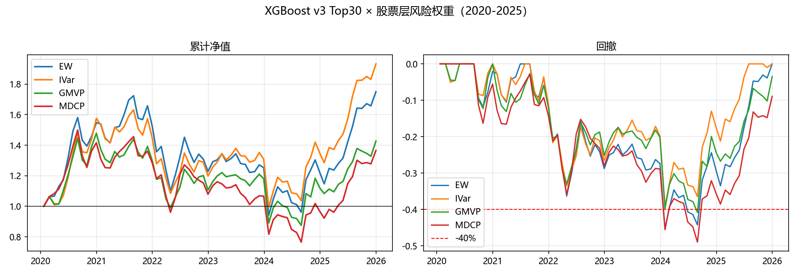

# A-Share Multi-Factor Stock Selection Strategy

**English** | [中文](README.zh-CN.md) | [Changelog](CHANGELOG.md)

The strategy uses price-volume factors as its alpha source and runs a **long-only active** book that keeps benchmark beta and targets excess return over the CSI 300 (with the CSI 500 as a comparison benchmark). A market-neutral branch was fully evaluated but not adopted: hedging removes only about 16% of the variance, and a 4% annual basis consumes the remaining return (see docs/strategy.md section 14.4).

This repository implements the data pipeline, factor tests, single-factor baseline, fixed/rolling multi-factor models, Optimizer 1's heuristic screening with λ shrinkage, and Optimizer 2's eight capital-allocation methods.

> **2026-11 main strategy (Plan A): 470 factors → screened to 40 → Optimizer 1 (|ICIR|≥0.5, K=4 best) → fixed factor set → Optimizer 2 IVar → Top 100.** Out-of-sample 2020–2025: cumulative +89.46%, annualized **11.24%**, Sharpe **0.543**, max drawdown **-26.43%** (much better than CSI 300 -39.9% / CSI 500 -37.0%), excess +8.75% vs CSI 300 and +5.54% vs CSI 500; FF3 alpha -0.10% (p=0.967, not significant, R²=0.916), so returns are explained mostly by market/size style. Drawdown and benchmark-beating targets are met; the 15% annualized target is not. The factor-count sweep shows K=4 is best and K>10 is worse; relaxing the "≤10 factors" constraint to a 40-factor XGBoost reaches 11.61% with deeper drawdown (Appendix, Section 15). Factor-count and holdings-count sensitivity is in Section 12.4; holdings are in `results/main_strategy/holdings_main.xlsx` (no heatmap).

## Contents

- [Changelog](CHANGELOG.md)
- [Results Summary](#results-summary)
- [Project Structure](#project-structure)
- [Quick Start](#quick-start)
- [Data Notes](#data-notes)
- [Strategy Highlights](#strategy-highlights)
- [Known Limitations](#known-limitations)
- [Progress](#progress)

## Results Summary

> **Current main strategy: fixed K=4 + ICIR factor weights + IVar stock weights + Top 100.** This section presents only the final configuration and its direct controls. Earlier 38-factor, Top 10, S7, WorldQuant-only Top 30 and similar results are historical experiments, not current performance.

Common backtest conventions: factors are selected on 2015–2019 and then frozen; the out-of-sample window is 2020-01-23 to 2025-12-31 (72 periods). Rebalancing is monthly, transaction cost is 0.002 one-way, positions are long-only, and every strategy uses the same tradable universe. CSI 300 and CSI 500 are both comparison benchmarks. See [`results/main_strategy/final_compare.csv`](results/main_strategy/final_compare.csv) for full metrics and [`results/main_strategy/holdings_main.xlsx`](results/main_strategy/holdings_main.xlsx) for monthly holdings.

### Main Strategy Performance (Out-of-Sample, 2020–2025)

| Portfolio | Cumulative | Annualized | Annualized vol | Sharpe | Max drawdown | Excess vs CSI 300 | Excess vs CSI 500 |
| --- | ---: | ---: | ---: | ---: | ---: | ---: | ---: |
| **Fixed K=4 + IVar Top 100 (main)** | **+89.46%** | **11.24%** | 20.71% | **0.543** | **-26.43%** | **+8.75pp** | **+5.54pp** |
| Rolling K=4 + IVar Top 100 | +63.13% | 8.50% | 20.21% | 0.420 | -33.48% | +6.01pp | +2.80pp |
| CSI 300 | +15.64% | 2.49% | 18.37% | 0.135 | -39.92% | — | — |
| CSI 500 | +38.82% | 5.70% | 20.69% | 0.275 | -36.96% | — | — |



> This chart directly corresponds to the result table above and contains only the **fixed K=4 + ICIR + IVar Top 100 main strategy**, CSI 300 and CSI 500. See `nav_compare.png` and `drawdown.png` for the fixed/rolling control. All Top 30 NAV/drawdown charts in Section 15 belong to the XGBoost appendix, not the main strategy.

The fixed factor set beats annual rolling reselection on return, Sharpe and drawdown, suggesting that frequent reselection tends to chase decayed signals. The main strategy beats both benchmarks with a smaller drawdown, but **does not reach the 15% annualized-return target**.

### The Four Selected Factors

The candidate pool contains 470 factors from Alpha191, Alpha158, Alpha101 and the Tsinghua price-volume library. The full-sample screen requires |mean IC|≥0.05 and |ICIR|≥0.5, leaving 40 factors. Optimizer 1 then uses training-window gates, collinearity constraints and the K sensitivity test to select four. The table reports raw out-of-sample RankIC; negative-IC factors are sign-reversed during composition, so a negative value does not make them unusable.

| Factor | Type | Mean RankIC | ICIR | Composition sign |
| --- | --- | ---: | ---: | ---: |
| `a101_040` | Alpha101 price-volume signal | +0.066 | +0.95 | +1 |
| `a101_088` | Alpha101 price-volume signal | +0.057 | +0.78 | +1 |
| `alpha_097` | Alpha191 price-volume signal | -0.049 | -0.85 | -1 |
| `a158_cord20` | 20-day price-volume correlation | -0.042 | -0.58 | -1 |





### Sensitivity to Factor Count K and Holdings TopN

With fixed factors, ICIR weights and IVar Top 100, K=4 delivers the highest return and Sharpe. Expanding to ten factors dilutes useful information with weaker signals and collinearity. K=20 has only 15 factors passing the gates and therefore duplicates K=15.

| K | Actual count | Annualized | Sharpe | Max drawdown |
| ---: | ---: | ---: | ---: | ---: |
| **4** | **4** | **11.24%** | **0.543** | **-26.43%** |
| 5 | 5 | 9.92% | 0.494 | -25.66% |
| 6 | 6 | 8.06% | 0.389 | -30.14% |
| 8 | 8 | 6.22% | 0.313 | -29.55% |
| 10 | 10 | 6.25% | 0.305 | -29.40% |
| 15 / 20 | 15 | 8.68% | 0.427 | -24.36% |


With K=4 and IVar fixed, Top 100 has the highest annualized return. Top 200 has a slightly higher Sharpe and shallower drawdown but lower absolute return, so the main strategy uses Top 100.

| TopN | 20 | 30 | 50 | **100** | 150 | 200 |
| --- | ---: | ---: | ---: | ---: | ---: | ---: |
| Annualized | 4.86% | 5.74% | 7.18% | **11.24%** | 10.42% | 10.97% |
| Sharpe | 0.235 | 0.276 | 0.354 | **0.543** | 0.510 | 0.546 |
| Max drawdown | -28.48% | -29.10% | -27.73% | **-26.43%** | -26.68% | -25.37% |


### FF3 Attribution: Beating Benchmarks Does Not Imply Significant Alpha

The main strategy has annualized FF3 alpha of **-0.10%**, with t=-0.04, p=0.967, a 95% confidence interval of approximately [-5.03%, +4.82%], and R²=0.916. The correct conclusion is: **there is no evidence of significant pure alpha; returns come mainly from market and small-cap exposures, making this a small-cap style-enhanced β+ portfolio**. FF3 is an attribution benchmark, not another tradable portfolio; insignificant alpha does not mean the strategy underperforms CSI 300 or CSI 500.



### Return Attribution from Actual Holdings

Monthly cross-sectional regressions on actual holdings decompose portfolio returns into an intercept, four factor contributions and a residual. Values below are arithmetic sums of monthly contributions, not compounded NAV. Factor contributions can be positive or negative; a negative value is a drag over the corresponding period.

| Component | Cumulative contribution | t-stat |
| --- | ---: | ---: |
| `a101_040` | +25.73% | 3.74 |
| `a101_088` | +11.45% | 1.14 |
| `alpha_097` | +13.38% | 2.26 |
| `a158_cord20` | -2.64% | -0.28 |
| Intercept | +70.08% | 1.32 |
| Residual | -28.00% | -2.28 |

The negative contribution from `a158_cord20` is small and statistically insignificant, mainly reflecting decay after 2023. The fixed-factor design does not remove it mid-sample. Full outputs are in [`results/attribution_main/`](results/attribution_main/).




### Transaction Costs and Strategy Capacity

Annualized one-way turnover is approximately **22.2x**, so a 0.002 one-way fee reduces annual return by about **4.44%**. Under a square-root market-impact model with k=10bp, robust capacity is approximately **RMB 100–300 million**: estimated net annualized return is 6.56% at RMB 300 million AUM and 2.70% at RMB 1 billion. The strategy is therefore not a scalable public-fund-style product; increasing capacity requires lower turnover rather than more factors.


### Appendix: 40-Factor XGBoost (Not the Main Strategy)

XGBoost uses the 40 screened factors to capture nonlinear interactions. Because this violates the final limit of ten factors, it remains an appendix. Its raw label predicts next-month returns directly. Squared error gives extreme-return samples larger losses and gradients, while Top 30 selection by predicted return does not directly penalize volatility; the high-score portfolio can therefore concentrate in high-beta names. This does not mean the model unconditionally prefers every high-volatility stock. Concentrated Top 30 holdings and small/mid-cap exposure are also important drawdown sources.

| Configuration | Input factors | Holdings | Annualized | Sharpe | Max drawdown | FF3 alpha (p) |
| --- | ---: | ---: | ---: | ---: | ---: | ---: |
| Main: linear ICIR + IVar | 4 | Top 100 | **11.24%** | **0.543** | **-26.43%** | -0.10% (0.967) |
| XGBoost raw + EW | 40 | Top 30 | 9.78% | 0.397 | -45.38% | +7.09% (0.107) |
| XGBoost raw + IVar | 40 | Top 30 | 11.61% | 0.486 | -39.13% | +7.90% (0.110) |

These configurations differ in holdings and factor constraints and are not fully matched comparisons. IVar only down-weights high-variance stocks after XGBoost selects the list; it does not change the selected names. Positive XGBoost alpha remains insignificant at the 5% level.


**Why does the figure say “Linear N=5 / N=10” instead of 4?** It is a historical Top 30 comparison created before the final main strategy was selected. Five and ten are the factor counts of two earlier linear controls, not current main-strategy parameters. The current main strategy remains K=4 and Top 100. Throughout the text, **K denotes factor count and N denotes holdings count**. Adding K=4 to this figure requires a new matched Top 30 backtest; the five-factor curve cannot simply be relabelled as four.



### Historical Experiment Index

The legacy 38-factor Top 10 baseline, S7 rolling portfolio, WorldQuant-only Top 30, 40-factor-pool Top 50, market-neutral test, seven-sins audit and drawdown audit remain in the evolution chapters of [`docs/strategy.md`](docs/strategy.md). They document the research process and are no longer mixed with the current K=4, IVar, Top 100 results.

Reproduce the main strategy and appendix with:

```bash
python baseline/main_strategy_a.py
python baseline/attribution_main.py
python baseline/capacity_analysis.py

# Appendix: 40-factor XGBoost, not the main strategy
python baseline/xgb_strategy.py
python baseline/xgb_riskweight.py
```

## Project Structure

```
.
├── baseline/                     Strategy, optimizer and audit scripts
│   ├── main_strategy_a.py        Current K=4 + IVar Top 100 strategy
│   ├── attribution_main.py       Return attribution from actual holdings
│   ├── capacity_analysis.py      Fees, market impact and capacity
│   ├── xgb_strategy.py           40-factor XGBoost appendix
│   ├── xgb_riskweight.py         XGBoost stock-level risk weights
│   ├── factor_lib/               Vectorized implementations of 470 candidates
│   └── ...                       Baseline, rolling and historical controls
├── data/                         Market data (not versioned)
│   └── raw/                      One long-table CSV per stock
├── data_io/                      Wide-table readers
├── docs/
│   ├── strategy.md               Full Chinese strategy document
│   └── strategy.en.md            English strategy document
├── results/
│   ├── main_strategy/            Main metrics, IC, NAV, sensitivity and holdings
│   ├── attribution_main/         Main factor contributions and exposures
│   ├── capacity/                 Capacity estimates
│   ├── final/                    Top 30 appendix candidate comparison
│   ├── xgb_strategy/             XGBoost predictions and performance
│   ├── xgb_riskweight/           XGBoost risk weights and holdings
│   └── ...                       Historical experiments and audits
├── scripts/                      Data download and wide-table conversion
└── utils/                        Factor tests, stock selection and NAV calculation
```

## Quick Start

Python 3.9+ is required.

```bash
pip install -r requirements.txt
```

### 1. Download Data

The repo ships a split data archive `data_archive/data.zip.001`–`.005` (about 416 MB total, split because of GitHub's 100 MB per-file limit). To restore it, put the five parts in one directory and run

```bat
copy /b data.zip.001 + data.zip.002 + data.zip.003 + data.zip.004 + data.zip.005 data.zip
```

Then unzip `data.zip` into `data/`. You can also skip the archive and re-download the data with the scripts below.

First fetch auxiliary data (CSI 300, trading calendar, industry classification, IPO/delisting dates), about one minute:

```bash
python scripts/03_download_index_aux.py
```

Then download market-wide daily bars, adjustment factors, and quarterly share counts. Two processes by default. Baostock temporarily bans frequent requests; the scripts include a circuit breaker that exits on a ban and skips files already downloaded:

```bash
python scripts/01_download_a_share.py
```

If bans are frequent, run the auto-resume daemon, which waits out the ban and continues without supervision:

```bash
python scripts/00_auto_resume_download.py
```

To download a single market only:

```bash
python scripts/01a_download_sh.py    # Shanghai
python scripts/01b_download_sz.py    # Shenzhen
```

### 2. Convert to Wide Tables

```bash
python scripts/02_pivot_to_wide.py
```

This writes wide tables such as `close_sh.csv` and `adj_factor_sz.csv`, plus derived `adj_close_*.csv`, `total_mv_*.csv`, and `circ_mv_*.csv`.

### 3. Run the Current Main Strategy

```bash
python baseline/main_strategy_a.py
python baseline/attribution_main.py
python baseline/capacity_analysis.py
```

Main metrics, charts and monthly holdings are written to `results/main_strategy/`; attribution and capacity outputs go to `results/attribution_main/` and `results/capacity/`. The legacy 38-factor baseline can still be reproduced with `python baseline/price_volume_baseline.py`, but it is not the current main strategy.

## Data Notes

Market data is large and is not committed, so re-download it as described above. Baostock limits both request rate and cumulative request count; around four processes trigger the blacklist (error code `10001011`). Bans usually last from one to twelve hours, and switching networks changes the outbound IP. The scripts default to two processes with a circuit breaker and resume automatically on rerun.

Fields in each per-stock long table:

```
date, code, open, high, low, close, preclose, volume, amount,
turn, tradestatus, pctChg, isST, peTTM, pbMRQ,
backAdjustFactor, totalShare, liqaShare
```

## Strategy Highlights

The full design is available in [English](docs/strategy.en.md) and [Chinese](docs/strategy.md).

- One back-adjusted price series end to end, so factors, returns and NAV share the same basis;
- The daily tradable universe excludes ST and suspended stocks, listings younger than 120 trading days, and stocks whose 60-day ADV is below the cross-sectional 20th percentile; liquidity screening occurs before factor tests;
- All 470 candidates use the same MAD winsorization, industry demeaning and Z-score pipeline; 40 pass the initial screen and four are fixed in the main strategy, with identical factor versions for testing and composition;
- Optimizer 1 combines |ICIR| gates, long-side tests, collinearity constraints and λ=0.3 shrinkage; the main strategy freezes its factors, while annual rolling reselection is only a control;
- Optimizer 2 implements all eight long-only allocation methods; the current strategy uses normalized IVar weights within Top 100;
- Rebalancing is monthly and the out-of-sample window is 2020–2025; turnover uses drifted weights, and the 0.002 one-way fee is deducted only at the NAV stage;
- Outputs include NAV, drawdown, IC, K/TopN sensitivity, FF3, actual-holdings attribution, capacity charts and monthly Excel holdings; no holdings-weight heatmap is generated.

## Known Limitations

1. CSI 300 and CSI 500 are price indices without dividend reinvestment, while back-adjusted stock returns include dividend effects; benchmark-relative returns must be interpreted with this mismatch in mind.
2. Baostock does not provide daily bars for delisted stocks; about 241 names delisted during 2015–2025 are missing, so the backtest has survivorship bias and returns are slightly optimistic.
3. Industry classification is a current snapshot only, so industry neutralization in early years is slightly biased.
4. Share counts are quarterly snapshots, so market cap cannot be computed exactly by day.
5. Baostock does not cover the Beijing Stock Exchange; "all A-shares" here means Shanghai + Shenzhen.
6. Limited capacity: the main strategy turns over 22.2x per year (one-way); under a square-root impact model, robust capacity is about RMB 100–300 million (see [docs/strategy.md section 11.5](docs/strategy.md)).

## Progress

- [x] Shanghai/Shenzhen data download, back-adjusted wide tables, dynamic universe and liquidity filters
- [x] 470 candidates from four factor libraries, with 40 passing the IC/ICIR initial screen
- [x] Optimizer 1 gates, collinearity control and λ shrinkage; all eight Optimizer 2 weighting methods
- [x] Current main strategy: fixed K=4 + ICIR + IVar + Top 100, with monthly Excel holdings
- [x] Out-of-sample sensitivity tests for factor count K and holdings count TopN
- [x] Matched fixed-versus-rolling and CSI 300/CSI 500 comparisons
- [x] FF3 attribution and significance tests, identifying the strategy as a style-enhanced β+ portfolio
- [x] Four-factor contribution and exposure attribution from actual holdings
- [x] Fee sensitivity, market-impact and strategy-capacity analysis
- [x] Appendix for 40-factor XGBoost, raw/rank labels and stock-level risk weights
- [x] Seven-sins, drawdown and market-neutral audits; neutral version not adopted
- [ ] Xueqiu paper-trading tracking
