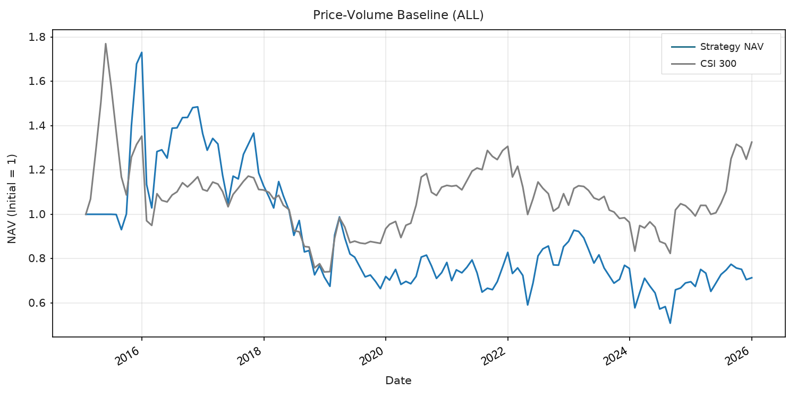
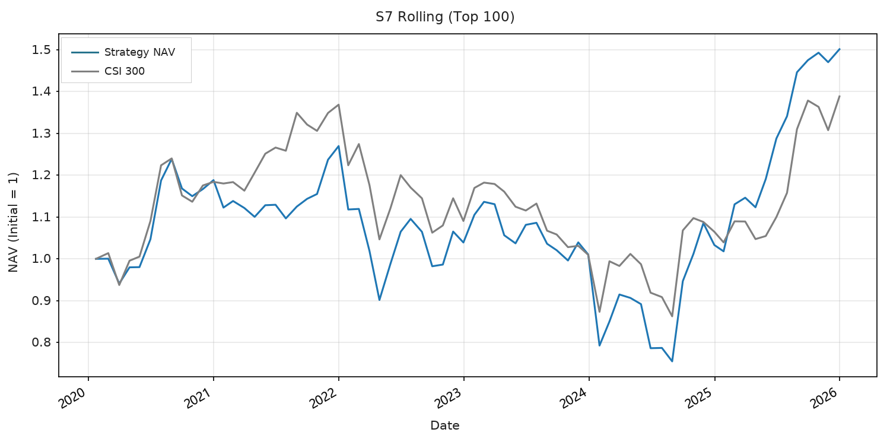
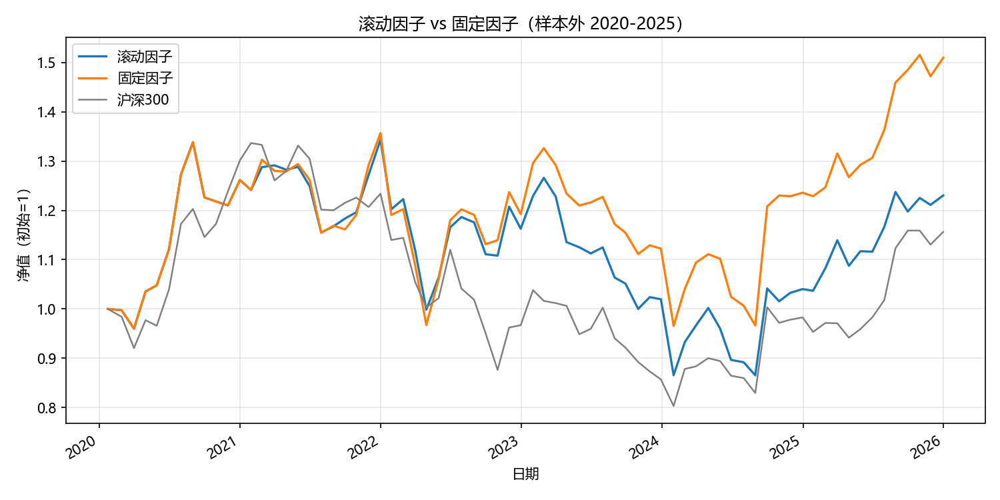
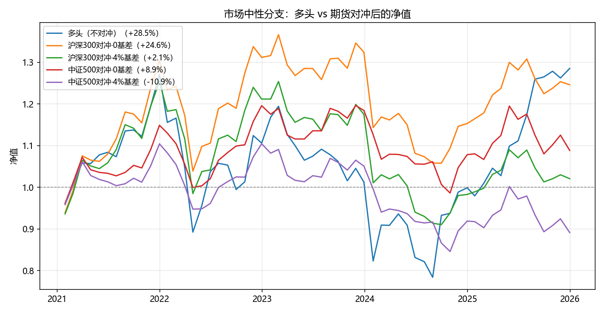

# A-Share Multi-Factor Stock Selection and Market-Neutral Strategy

**English** | [中文](README.zh-CN.md)

The strategy uses price-volume factors as its alpha source. At the portfolio level it has two branches: active management, which keeps benchmark beta and targets excess return over the CSI 300; and market neutral, which hedges systematic beta with index futures and keeps only factor return. Both branches share the same factors and composite scores.

This repository implements the **active (long-only) branch**: the data pipeline, factor tests, single-factor baseline, rolling multi-factor model (annual factor re-selection + monthly rebalancing), Optimizer 1's full heuristic screening with λ shrinkage, and Optimizer 2's eight capital-allocation methods. The market-neutral branch was evaluated but not adopted: hedging removes only about 16% of the variance, and a 4% annual basis consumes the remaining return.

## Contents

- [Results Summary](#results-summary)
- [Project Structure](#project-structure)
- [Quick Start](#quick-start)
- [Data Notes](#data-notes)
- [Strategy Highlights](#strategy-highlights)
- [Known Limitations](#known-limitations)
- [Progress](#progress)

## Results Summary

Backtest period 2015-01-01 to 2025-12-31, monthly rebalancing, one-way cost 0.002, benchmark is the CSI 300 price index.

### Single-Factor IC

RankIC and ICIR of the 38 price-volume factors. The table shows the top 10 by |ICIR|; full results are in [`results/baseline/factor_summary.csv`](results/baseline/factor_summary.csv).

| Factor | Description | RankIC | ICIR | Share of IC > 0 |
| --- | --- | ---: | ---: | ---: |
| `turnover_std_3m` | 3-month turnover volatility | -0.0703 | -0.720 | 20.6% |
| `turnover_mean_3m` | 3-month average turnover | -0.0798 | -0.657 | 23.7% |
| `volatility_3m` | 3-month return volatility | -0.0503 | -0.600 | 26.7% |
| `return_1m` | 1-month momentum | -0.0644 | -0.589 | 26.7% |
| `Alpha20` | Rank of open relative to previous close | 0.0547 | 0.565 | 65.6% |
| `wgt_return_1m` | Turnover-weighted 1-month return | -0.0591 | -0.559 | 26.7% |
| `Alpha12` | Volume change × reversed price change | 0.0308 | 0.536 | 69.5% |
| `Alpha9` | One-period difference correlation of price and volume | 0.0476 | 0.531 | 71.0% |
| `volatility_6m` | 6-month return volatility | -0.0535 | -0.494 | 30.5% |
| `Alpha13` | Negated rank covariance of close and volume | 0.0361 | 0.486 | 68.7% |

Turnover, volatility, and reversal factors have negative IC: low-turnover, low-volatility, recently fallen stocks do better. Alpha reversal factors are positive. Absolute IC is only 0.03–0.08, but ICIR reaches 0.49–0.72, so the direction is stable and the signal-to-noise ratio is acceptable.

### Baseline Portfolio

All 38 factors are tested individually; those with |ICIR| ≥ 0.2 are kept (capped at 20), sign-adjusted, and equal-weighted into a composite. Each month the top 10 stocks are held with equal weights:

| Metric | Price-Volume Baseline (Top 10) | CSI 300 |
| --- | ---: | ---: |
| Cumulative return | -28.62% | 32.54% |
| Annualized return | -3.04% | 2.61% |
| Annualized volatility | 33.91% | 24.68% |
| Sharpe ratio | -0.09 | 0.11 |
| Maximum drawdown | -70.58% | -58.18% |
| Annualized turnover | 10.43x | — |



After adding capacity constraints (ADV above the 20th percentile, at least 120 trading days since IPO) and using the same neutralized factors for testing and composition, the baseline turns negative: -28.62% cumulative, -3.04% annualized. The gap versus the previous +91.13% shows that the earlier excess return came mainly from illiquid small caps and is not reproducible once the ADV filter is applied. Annualized turnover of 10.43x costs about 2.1% per year, which does not explain the whole loss; the core issue remains stock-selection style and the long-only structure.

### Rolling Multi-Factor (Out-of-Sample)

Annual factor re-selection + monthly rebalancing, 2020-01-23 to 2025-12-31, 72 periods. The original ICIR-weighted Top-10 model is kept as the control. The **S7** variant adds a long-side gate (training-window long-side excess return > 0 with t ≥ 1) and long-side t-stat weights, and holds the Top 100 names:

| Metric | Original Rolling (Top 10) | S7 Rolling (Top 100) | CSI 300 |
| --- | ---: | ---: | ---: |
| Cumulative return | -6.40% | +50.10% | 15.64% |
| Annualized return | -1.11% | +7.08% | 2.45% |
| Annualized volatility | 26.38% | 22.75% | 18.24% |
| Sharpe ratio | -0.04 | 0.31 | 0.13 |
| Maximum drawdown | -41.31% | -40.53% | -39.92% |
| Annualized turnover | 10.68x | 9.07x | — |



S7 beats the benchmark out of sample (+50.10% vs +15.64%, Sharpe 0.31 vs 0.13). The improvement decomposes into **diversification** (largest), **long-side t weighting**, and the **long-side gate**. Two honest caveats: the excess return is **concentrated in 2025** (the strategy lagged the benchmark through 2020-2024 and only overtook it in the 2025 rally), and the drawdown around the **February 2024 small-cap liquidity crisis** (-40.53%) is deeper than the benchmark's -39.92%. For reference, the CSI 500 returned +38.82% over the same window (Sharpe 0.27). See `docs/strategy.md` section 11 for the full ablation and the config-by-holdings scan.

### Fama-French Three-Factor (Out-of-Sample)

Within the same tradable universe, independent 2x3 sorts on total market cap and B/M produce MKT, SMB, and HML. All three long-only strategies have insignificant FF3 alpha; returns are mainly market beta plus small-cap exposure. Top 100 portfolios have R² of 0.89–0.91, while GMVP Top 10 has R² of only 0.30, leaving about 70% as idiosyncratic risk.

| Portfolio | Annualized alpha | alpha t | MKT | SMB | HML | R² |
| --- | ---: | ---: | ---: | ---: | ---: | ---: |
| Optimizer 2 GMVP Top 10 | -0.61% | -0.06 | 0.913 | 0.532 | 0.029 | 0.298 |
| Optimizer 1 Top 100 | -3.00% | -0.85 | 1.202 | 0.553 | -0.074 | 0.886 |
| S7 Top 100 | -1.80% | -0.60 | 1.091 | 0.571 | -0.059 | 0.906 |
| CSI 300 | -3.74% | -2.43 | 1.103 | -0.279 | 0.042 | 0.960 |
| CSI 500 | -1.21% | -0.54 | 1.112 | 0.136 | -0.115 | 0.918 |

The full construction, Newey-West standard errors, and charts are in `docs/strategy.md` section 8 and [`results/ff3/`](results/ff3/).

### Attribution: Why the Baseline Turned Negative

A 2x2 ablation (capacity filter on/off x unified/split factor pipeline) isolates the cause of the +91.13% to -28.62% flip. Toggling the **capacity filter** moves cumulative return by 91-145 percentage points; toggling the **pipeline** moves it by only 25-29 points. The capacity filter (ADV 20th percentile + 120 listed days) is the dominant cause: the earlier +91.13% came almost entirely from illiquid small caps and recent IPOs that cannot absorb real capital. Results are in [`results/ablation/comparison.csv`](results/ablation/comparison.csv).

### 2026-11 Re-screening: WorldQuant-Only Pool + Top 30 (Current Main Configuration)

To address the old main strategy's large drawdown and low annualized return, the factor pool was rebuilt as suggested by the supervisor: only the 21 WorldQuant Alpha101 factors; Huatai and extension factors leave the main pool. The overlap audit finds no formula-identical pair, but Huatai `return_Nm` vs `wgt_return_Nm` / `exp_wgt_return_Nm` correlates 0.87–0.98 and cross-pool `return_1m` vs `Alpha9` is -0.80, so adding Huatai back mainly double-counts the same effect. Factors are ranked by |ICIR| (monthly IC is only 0.02–0.08, so |IC|>0.5 is not executable; |ICIR|≥0.5 is used), with an ex-ante fallback to 0.3 for 4–5 factors; Optimizer 1 uses `K_MIN=3`, `K_MAX=5`; holdings rise to 30.

| Configuration | Cumulative | Annualized | Sharpe | Max drawdown | Annual turnover |
| --- | ---: | ---: | ---: | ---: | ---: |
| Old: 38-factor pool → Top 10 GMVP | +33.01% | 4.92% | 0.149 | -38.17% | 11.18 |
| New: WQ 4–5 factors → Top 30 equal weight | +49.65% | 7.02% | 0.274 | -42.58% | 10.76 |
| **New: WQ 4–5 factors → Top 30 IVar** | **+75.38%** | **9.92%** | **0.407** | **-37.25%** | **10.80** |

Among the eight Top 30 weighting methods, IVar has both the highest Sharpe and the lowest drawdown; GMVP returns +73.68% / 0.394 / -40.38% and RB +70.24% / 0.383 / -38.76%, effectively the same level. The strict |ICIR|≥0.5 version keeps only 1–3 factors and returns +14.72%, Sharpe 0.102, drawdown -46.01%, worse than the old configuration, confirming that the fallback is a necessary ex-ante rule.

Seven-sins audit (`results/audit/seven_sins_summary.md`): survivorship bias exists (delisted stocks cannot be restored); shifting the signal forward one period gives -99.39%, showing extreme timing sensitivity; 2022–2023 annual returns are -19.00% / -3.28% and are not hidden; 504 searches give a Bonferroni-corrected p=1.0, so the null cannot be rejected; annual turnover is about 10.8×, with annualized 9.82% at 0.2% and 12.19% at zero fees; the best five months contribute 101% of total return, and excluding them gives -12.86%; the long-only structure bears no borrow cost but gives up short-leg alpha. Drawdown improves only from -38.17% to -37.25% and is not fundamentally solved. See Section 13 of [`docs/strategy.md`](docs/strategy.md) for details.

Drawdown is further tested with the Chapter 9 methods (`results/audit/drawdown/`): daily max drawdown -39.90% (monthly -37.25%), 704 days underwater; across 40 random backtests IVar's median max drawdown is -29.35% versus -32.19% for equal weight, a 90% paired win rate (+2.26 pp); in stress scenarios the 2022 drawdown is -31.62% (deeper than all-A equal weight at -28.75%), while the 2024Q1 micro-cap crisis is -24.32% (shallower than -30.01%). The strategy is not defensive, and its absolute drawdown is still not presentable to clients.

### 2026-11 Factor Library Expansion: Alpha191 / Alpha158 / Alpha101 / Tsinghua 22

The factor pool is rebuilt from four libraries, all implemented as vectorised month-end panels (`baseline/factor_lib/`): Alpha191 (189 usable formulas; `alpha030`/`alpha149` need external data), QLib Alpha158 (158), WorldQuant Alpha101 (101) and 22 price-volume factors from the Minsheng white paper. Total **470 factors**.

Single-factor screen: monthly RankIC over 2015–2025, cross-sectionally winsorised / industry-neutralised / z-scored, with **|IC| ≥ 0.05 and |ICIR| ≥ 0.5**. **40 factors pass** (Alpha191 14, Alpha158 17, Alpha101 2, Tsinghua 7); three pairs are formula duplicates (`alpha_042`=`a101_040`, `a158_roc20`=`alpha_088`, `a158_ma30`=`-a158_resi30`). Each survivor is backtested Top 30 equal weight: 17 of 40 are positive, the best is `alpha_097` at 8.8% annualised / Sharpe 0.335 / max drawdown -54.3%.

Optimizer 1 on the 40-factor pool (`K=3..5`, `|ICIR|≥0.5`, λ=0.3) and Optimizer 2 with eight weighting schemes:

| Configuration | Cumulative | Annualized | Sharpe | Max drawdown | Annual turnover |
| --- | ---: | ---: | ---: | ---: | ---: |
| Optimizer 1, Top 30 EW | +41.03% | 5.96% | 0.272 | -51.58% | 11.05 |
| Optimizer 1, Top 50 EW | +69.65% | 9.31% | 0.422 | -43.86% | 10.95 |
| Optimizer 1, Top 50 long-t weights | +99.58% | 12.34% | 0.566 | -42.37% | — |
| **Optimizer 2, Top 50 IVar** | **+77.27%** | **10.12%** | **0.500** | **-38.33%** | **10.87** |
| Optimizer 2, Top 50 GMVP (24m cov) | +87.12% | 11.01% | 0.575 | -37.24% | — |

Rolling vs fixed factor strategies (`results/rolling_vs_fixed/`), both Top 30 EW, same universe and fee, 2020–2025 out-of-sample:

| Strategy | Cumulative | Annualized | Sharpe | Max drawdown | Annual turnover |
| --- | ---: | ---: | ---: | ---: | ---: |
| Rolling (retrain every year) | +23.03% | 3.55% | 0.182 | -35.59% | 11.02 |
| **Fixed (select 2015–2019, freeze)** | **+50.96%** | **7.18%** | **0.344** | **-28.85%** | **11.16** |

The fixed set wins on return, Sharpe and drawdown: yearly re-selection chases factors that decayed out of sample, while the 2015–2019 winners (turnover/reversal/correlation family) stayed effective.



Market-neutral comparison (`results/neutral_pool/`, 2021-01 to 2025-12): IF hedge at zero basis lifts Sharpe from 0.248 to 0.306 and cuts max drawdown from -38.33% to -22.59%, but at a realistic 4% annual basis the annualised return falls to 0.41%. IC hedging is worse (-17.58% max drawdown but only 1.71% annualised at zero basis). Neutral is therefore **not** adopted by default.



Honest note: none of these configurations reaches the 15% annualised target; the best pool-based result is 10.12% (12.34% with long-t weights), only marginally above the previous 9.92%. The factor library mainly improves breadth and drawdown control rather than raw return.

```bash
python baseline/factor_screen.py --backtest          # compute, screen and single-factor backtests
set FACTOR_SOURCE=factor_pool
set OPT1_OUTPUT=optimizer1_pool& set OPT1_ICIR_MIN=0.5& set OPT1_K_MIN=3& set OPT1_K_MAX=5& set OPT1_TOP_N=10,30,50
python baseline/optimizer1_heuristic.py
set OPT2_OUTPUT=optimizer2_pool& set OPT2_COMPOSITE=optimizer1_pool/composite_factor.csv& set OPT2_TOP_N=10,30,50
python baseline/optimizer2_weights.py
set RM_OUTPUT=rolling_pool& set RM_TOP_N=30& python baseline/rolling_multifactor.py
set FIXED_OUTPUT=fixed_pool& python baseline/fixed_factor.py
python baseline/compare_rolling_fixed.py
```

## Project Structure

```
.
├── baseline/                  Baseline, diagnosis, rolling models, optimizer experiments
│   ├── price_volume_baseline.py
│   ├── factor_longshort.py
│   ├── rolling_multifactor.py
│   ├── rolling_top_weighted.py     S7 rolling (long-side gate + t weights)
│   ├── optimizer_factor_selection.py
│   └── ablation_attribution.py
├── data/                      Market data (not versioned)
│   └── raw/                   One long-table CSV per stock
├── data_io/                   Wide-table readers
├── docs/
│   └── strategy.md            Strategy design document (Chinese)
├── results/
│   ├── baseline/              Baseline outputs
│   │   ├── factor_summary.csv
│   │   ├── longshort.csv
│   │   ├── performance.csv
│   │   └── nav.png
│   ├── rolling/               Original rolling model outputs
│   ├── rolling_top/           S7 rolling outputs (top10/50/100)
│   ├── optimizer/             Factor selection and holdings scans
│   └── ablation/              2x2 attribution outputs
├── scripts/                   Data download and wide-table conversion
│   ├── 00_auto_resume_download.py
│   ├── 01_download_a_share.py
│   ├── 01a_download_sh.py
│   ├── 01b_download_sz.py
│   ├── 02_pivot_to_wide.py
│   ├── 02a_pivot_sh.py
│   ├── 02b_pivot_sz.py
│   ├── 03_download_index_aux.py
│   ├── _baostock_common.py
│   └── _pivot_common.py
└── utils/                     Factor tests, stock selection, NAV calculation
```

## Quick Start

Python 3.9+ is required.

```bash
pip install -r requirements.txt
```

### 1. Download Data

The repo ships a split data archive `data_archive/data.zip.001`–`.005` (about 416 MB total, split because of GitHub's 100 MB per-file limit). To restore it, put the five parts in one directory and run

```bat
copy /b data.zip.001 + data.zip.002 + data.zip.003 + data.zip.004 + data.zip.005 data.zip
```

Then unzip `data.zip` into `data/`. You can also skip the archive and re-download the data with the scripts below.

First fetch auxiliary data (CSI 300, trading calendar, industry classification, IPO/delisting dates), about one minute:

```bash
python scripts/03_download_index_aux.py
```

Then download market-wide daily bars, adjustment factors, and quarterly share counts. Two processes by default. Baostock temporarily bans frequent requests; the scripts include a circuit breaker that exits on a ban and skips files already downloaded:

```bash
python scripts/01_download_a_share.py
```

If bans are frequent, run the auto-resume daemon, which waits out the ban and continues without supervision:

```bash
python scripts/00_auto_resume_download.py
```

To download a single market only:

```bash
python scripts/01a_download_sh.py    # Shanghai
python scripts/01b_download_sz.py    # Shenzhen
```

### 2. Convert to Wide Tables

```bash
python scripts/02_pivot_to_wide.py
```

This writes wide tables such as `close_sh.csv` and `adj_factor_sz.csv`, plus derived `adj_close_*.csv`, `total_mv_*.csv`, and `circ_mv_*.csv`.

### 3. Run the Baseline

```bash
python baseline/price_volume_baseline.py
```

Results are written to `results/baseline/`.

## Data Notes

Market data is large and is not committed, so re-download it as described above. Baostock limits both request rate and cumulative request count; around four processes trigger the blacklist (error code `10001011`). Bans usually last from one to twelve hours, and switching networks changes the outbound IP. The scripts default to two processes with a circuit breaker and resume automatically on rerun.

Fields in each per-stock long table:

```
date, code, open, high, low, close, preclose, volume, amount,
turn, tradestatus, pctChg, isST, peTTM, pbMRQ,
backAdjustFactor, totalShare, liqaShare
```

## Strategy Highlights

The full design is available in [English](docs/strategy.en.md) and [Chinese](docs/strategy.md).

- One back-adjusted price series end to end, so factors, returns, and NAV share the same basis;
- The universe excludes ST stocks, recent IPOs (less than 120 trading days), and the bottom 20% by ADV; capacity screening happens before factor tests;
- No initial capital is assumed; NAV is computed from portfolio weights, and ADV is only a liquidity constraint;
- Factors are winsorized with MAD, industry-demeaned, and Z-scored; tests and composition use the same version;
- Factor weights are normalized |ICIR| over the training window in the baseline; the S7 variant uses long-side t-stat weights behind a long-side gate; no time-series model forecasts factor returns;
- Five-year training window, one-year rolling step, out-of-sample 2020–2025;
- Turnover is computed from drifted weights to avoid overstating costs;
- Capital allocation will cover eight methods: equal weight, inverse volatility, inverse variance, minimum variance, equal risk contribution, risk budgeting, maximum diversification, and maximum decorrelation (planned; V1 is equal weight).

## Known Limitations

1. The benchmark is the CSI 300 price index without dividends, while stock returns are back-adjusted and include dividends, so the excess-return basis is conservative.
2. Baostock does not provide daily bars for delisted stocks; about 241 names delisted during 2015–2025 are missing, so the backtest has survivorship bias and returns are slightly optimistic.
3. Industry classification is a current snapshot only, so industry neutralization in early years is slightly biased.
4. Share counts are quarterly snapshots, so market cap cannot be computed exactly by day.
5. Baostock does not cover the Beijing Stock Exchange; "all A-shares" here means Shanghai + Shenzhen.

## Progress

- [x] Shanghai/Shenzhen A-share download and wide-table conversion
- [x] Back-adjusted prices, monthly panel, universe and capacity filters
- [x] 38 price-volume factors and single-factor tests
- [x] Long-short return diagnosis for the 38 factors
- [x] Single-factor baseline backtest
- [x] Rolling multi-factor model (annual factor re-selection, monthly rebalancing, ICIR fallback rule)
- [x] Optimizer 1: strict gates + heuristic factor search + λ weight shrinkage
- [x] Return attribution (capacity x pipeline 2x2 ablation)
- [x] Optimizer 2: comparison of eight capital allocation methods
- [x] Fama-French three-factor comparison (`results/ff3/`)
- [x] Factor-pool re-screening (WorldQuant only + ICIR ranking + overlap audit)
- [x] Optimizer 1 with 4–5 factors and Top 30 main configuration
- [x] Seven-sins audit (`results/audit/`)
- [x] Multi-method drawdown tests (metrics + 40 random backtests + stress scenarios, `results/audit/drawdown/`)
- [x] Market-neutral feasibility test (hedge return/variance, basis sensitivity); not adopted as the main strategy
- [ ] Xueqiu paper-trading tracking
