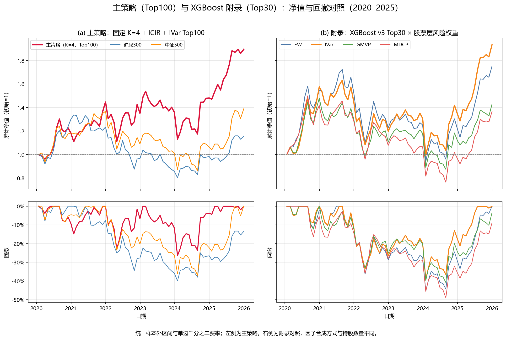
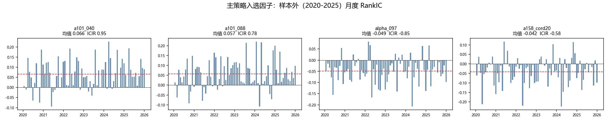
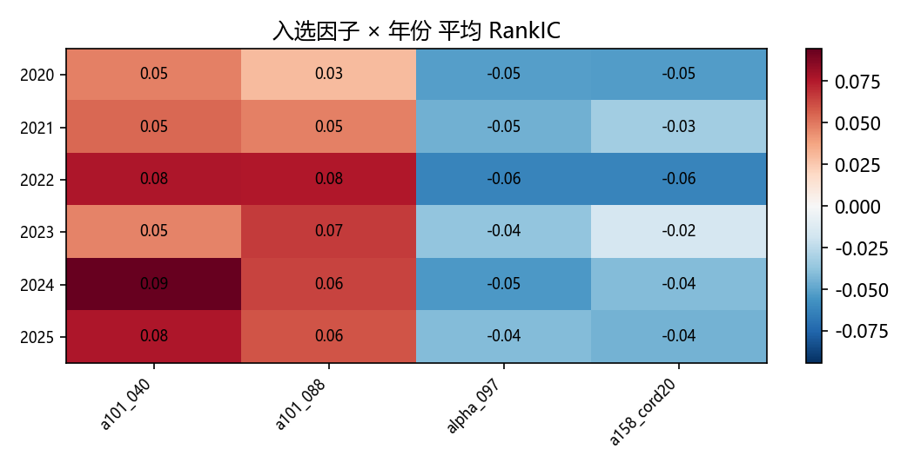
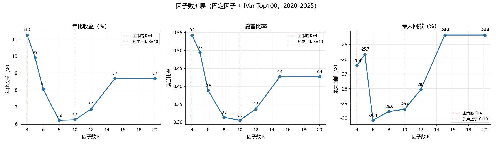
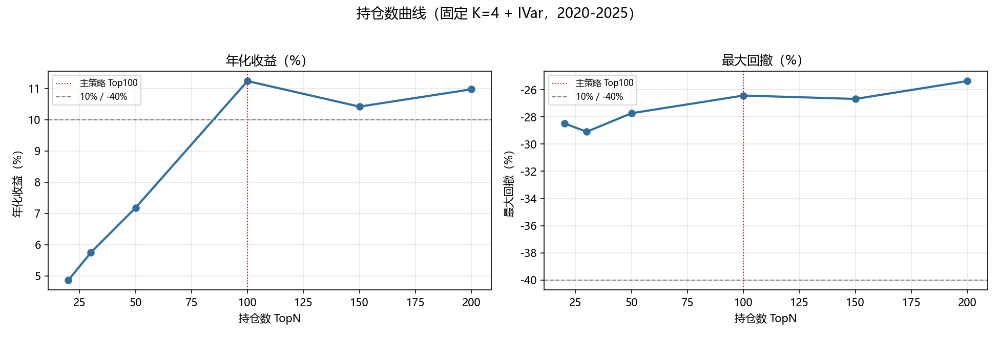
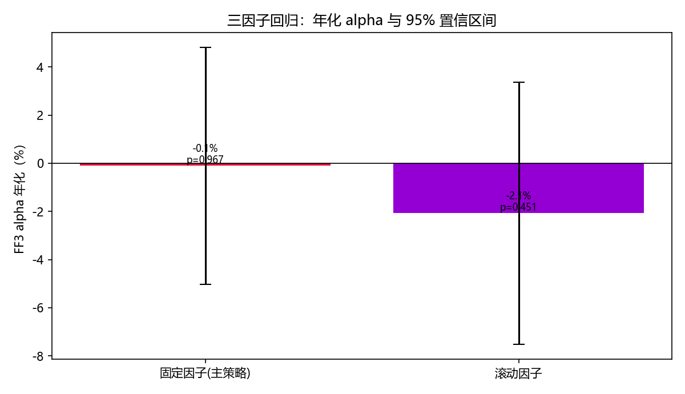
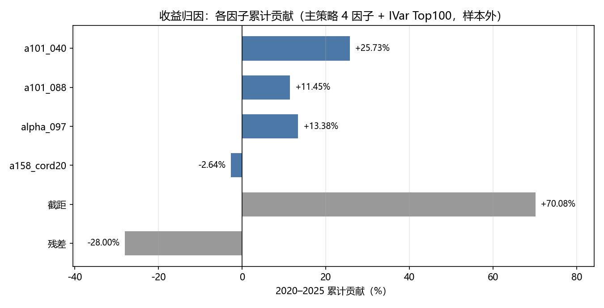
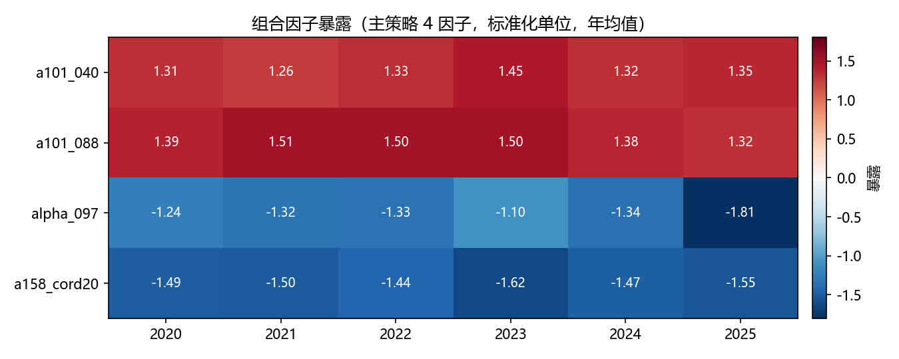
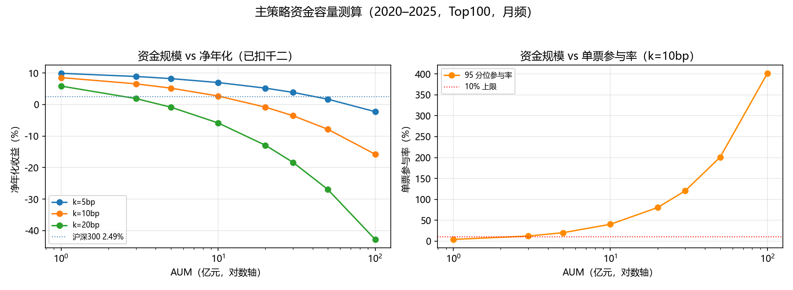
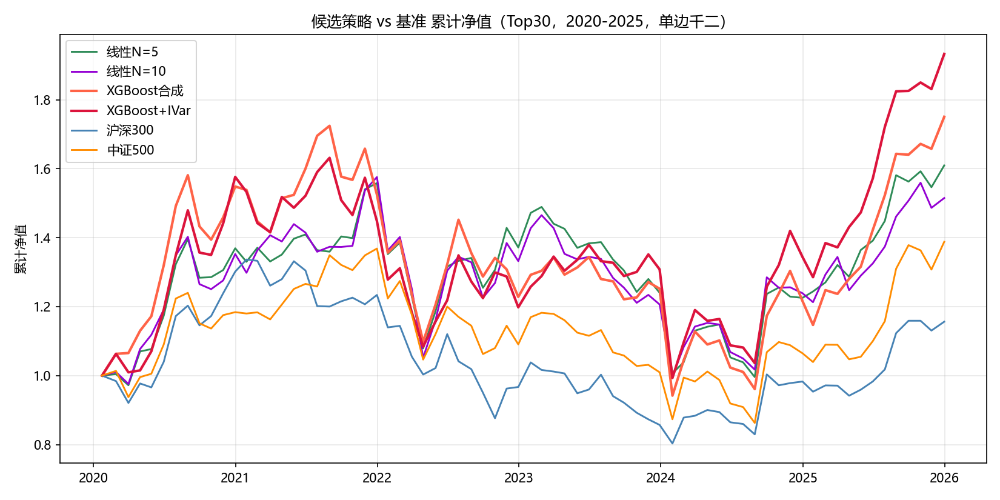

# A 股多因子选股策略

[English](README.md) | **中文** | [更新日志](CHANGELOG.zh-CN.md)

策略以量价因子为 alpha 来源，采用**只做多主动管理**，保留基准 Beta，追求相对沪深 300 的超额（中证 500 为对照基准）。市场中性分支做过完整可行性测算但未采用：对冲只能压掉约 16% 的方差，4% 年化基差会吞噬剩余收益（原因见 docs/strategy.md 14.4 节）。

本仓库实现的数据管线、因子检验、单因子基线、固定/滚动多因子、优化器一的启发式筛选与 λ 权重收缩，以及优化器二的八种资金权重配置。

> **2026-11 主策略（方案 A）：470 因子 → 初筛 40 → 优化器一（|ICIR|≥0.5，K=4 最优）→ 固定因子 → 优化器二 IVar → Top100。** 2020–2025 样本外：累计 +89.46%、年化 **11.24%**、夏普 **0.543**、最大回撤 **-26.43%**（远小于沪深300 -39.9% / 中证500 -37.0%）、相对沪深 300 超额 +8.75%、相对中证 500 超额 +5.54%；FF3 alpha -0.10%（p=0.967，不显著，R²=0.916），收益主要由市场/规模风格解释。回撤与跑赢基准达标，年化未达 15%。因子数扩展测试显示 K=4 最优、K>10 反而更差；若放宽"因子数≤10"改用 40 因子 XGBoost 宽特征，年化 11.61% 但回撤更深（附录第 15 章）。因子数 K 与持仓数 TopN 敏感性见 [docs/strategy.md 12.4 节](docs/strategy.md)，持仓明细见 `results/main_strategy/holdings_main.xlsx`（不再画权重热力图）。

## 目录

- [更新日志](CHANGELOG.zh-CN.md)
- [结果摘要](#结果摘要)
- [项目结构](#项目结构)
- [快速开始](#快速开始)
- [数据说明](#数据说明)
- [策略要点](#策略要点)
- [已知限制](#已知限制)
- [进度](#进度)

## 结果摘要

> **当前主策略：固定 K=4 + ICIR 因子权重 + IVar 股票权重 + Top100。** 本节只展示这一最终口径及其直接对照；早期 38 因子、Top10、S7、WorldQuant 单池 Top30 等结果均为历史实验，不再作为当前业绩展示。

统一回测口径：2015–2019 年选定并冻结因子，2020-01-23 至 2025-12-31 为样本外区间，共 72 期；月末调仓、单边千分之二、只做多，所有策略使用相同的可交易股票池。沪深300与中证500均为对照基准。完整结果见 [`results/main_strategy/final_compare.csv`](results/main_strategy/final_compare.csv)，逐月持仓见 [`results/main_strategy/holdings_main.xlsx`](results/main_strategy/holdings_main.xlsx)。

### 主策略表现（2020–2025 样本外）

| 组合 | 累计收益 | 年化收益 | 年化波动 | 夏普 | 最大回撤 | 超额沪深300 | 超额中证500 |
| --- | ---: | ---: | ---: | ---: | ---: | ---: | ---: |
| **固定 K=4 + IVar Top100（主策略）** | **+89.46%** | **11.24%** | 20.71% | **0.543** | **-26.43%** | **+8.75pp** | **+5.54pp** |
| 滚动 K=4 + IVar Top100 | +63.13% | 8.50% | 20.21% | 0.420 | -33.48% | +6.01pp | +2.80pp |
| 沪深300 | +15.64% | 2.49% | 18.37% | 0.135 | -39.92% | — | — |
| 中证500 | +38.82% | 5.70% | 20.69% | 0.275 | -36.96% | — | — |



> **读图口径：**左栏为主结果表中的**固定 K=4 + ICIR + IVar Top100 主策略**及沪深300、中证500；右栏为 **40 因子 XGBoost + Top30** 的四种股票层权重附录。两栏统一使用 2020–2025 样本外区间和单边千分之二费率，但因子合成方式与持股数量不同，不构成同一模型的单变量消融。固定/滚动方案对照另见 `nav_compare.png` 和 `drawdown.png`。

固定因子在年化、夏普和回撤上均优于年度滚动重选，说明频繁追逐近期有效因子容易拟合已经衰减的信号。主策略跑赢两条基准且回撤更小，但**尚未达到年化 15% 的目标**。

### 主策略的 4 个因子

候选池由 Alpha191、Alpha158、Alpha101 与清华量价因子组成，共 470 个；按全样本 |平均 IC|≥0.05、|ICIR|≥0.5 初筛得到 40 个，再由优化器一结合训练期门控、共线性约束和 K 敏感性检验确定 4 个。下表为样本外原始 RankIC；负 IC 因子在合成时取反，因此负值不代表无效。

| 因子 | 类型 | 平均 RankIC | ICIR | 合成方向 |
| --- | --- | ---: | ---: | ---: |
| `a101_040` | Alpha101 量价信号 | +0.066 | +0.95 | +1 |
| `a101_088` | Alpha101 量价信号 | +0.057 | +0.78 | +1 |
| `alpha_097` | Alpha191 量价信号 | -0.049 | -0.85 | -1 |
| `a158_cord20` | 20 日量价相关性 | -0.042 | -0.58 | -1 |





### 因子数 K 与持仓数 TopN 敏感性

在固定因子、ICIR 权重和 IVar Top100 口径下，K=4 的收益与夏普最高；增加至 10 个因子后，弱信号与共线性稀释了有效信息。K=20 时实际只有 15 个因子通过门控，因此与 K=15 相同。

| K | 实际入池 | 年化收益 | 夏普 | 最大回撤 |
| ---: | ---: | ---: | ---: | ---: |
| **4** | **4** | **11.24%** | **0.543** | **-26.43%** |
| 5 | 5 | 9.92% | 0.494 | -25.66% |
| 6 | 6 | 8.06% | 0.389 | -30.14% |
| 8 | 8 | 6.22% | 0.313 | -29.55% |
| 10 | 10 | 6.25% | 0.305 | -29.40% |
| 15 / 20 | 15 | 8.68% | 0.427 | -24.36% |



固定 K=4 与 IVar 后，Top100 的年化收益最高；Top200 的夏普略高、回撤略浅，但绝对收益低于 Top100，因此主策略选择 Top100。

| TopN | 20 | 30 | 50 | **100** | 150 | 200 |
| --- | ---: | ---: | ---: | ---: | ---: | ---: |
| 年化收益 | 4.86% | 5.74% | 7.18% | **11.24%** | 10.42% | 10.97% |
| 夏普 | 0.235 | 0.276 | 0.354 | **0.543** | 0.510 | 0.546 |
| 最大回撤 | -28.48% | -29.10% | -27.73% | **-26.43%** | -26.68% | -25.37% |



### FF3 归因：跑赢基准不等于显著 alpha

主策略 FF3 年化 alpha 为 **-0.10%**，t=-0.04、p=0.967，95% 置信区间约为 [-5.03%, +4.82%]，R²=0.916。正确结论是：**没有证据表明存在显著纯 alpha，收益主要来自市场与小盘风格暴露，属于小盘风格增强的 β+ 组合**。FF3 是归因基准，不是另一个可交易组合；alpha 不显著也不等于策略跑输沪深300或中证500。



### 基于真实持仓的收益归因

对每月真实持仓暴露做截面回归，将组合收益拆为截距、4 个因子贡献和残差。下表为月度贡献的算术累计，并非复利净值；因子贡献可正可负，负值表示该因子在对应时期形成拖累。

| 成分 | 累计贡献 | t 值 |
| --- | ---: | ---: |
| `a101_040` | +25.73% | 3.74 |
| `a101_088` | +11.45% | 1.14 |
| `alpha_097` | +13.38% | 2.26 |
| `a158_cord20` | -2.64% | -0.28 |
| 截距 | +70.08% | 1.32 |
| 残差 | -28.00% | -2.28 |

`a158_cord20` 的负贡献较小且统计上不显著，主要来自 2023 年后的阶段性失效；固定因子方案不会在样本外中途剔除它。完整数据见 [`results/attribution_main/`](results/attribution_main/)。





### 交易成本与策略容量

主策略年化单边换手约 **22.2 倍**，单边千分之二对应年费率拖累约 **4.44%**。在平方根市场冲击模型、k=10bp 下，稳健容量约为 **1–3 亿元**：AUM 3 亿元时，计入冲击后的净年化约 6.56%；AUM 10 亿元时约 2.70%。因此当前策略不是可大规模扩张的公募级产品，提高容量需要先降低换手，而不是继续增加因子。



### 附录：40 因子 XGBoost（非主策略）

XGBoost 使用初筛的 40 个因子捕捉非线性交互，因违反最终“不超过 10 个因子”的约束，只作为附录。其 raw 标签直接预测下月收益率；平方误差使极端收益样本具有更大的损失与梯度，而 Top30 按预测收益排序时不直接惩罚波动，因此高分组合可能集中于高弹性股票。这并不意味着模型无条件偏好所有高波动股票，Top30 集中持仓与中小盘暴露同样是回撤来源。

| 配置 | 输入因子数 | 持仓 | 年化收益 | 夏普 | 最大回撤 | FF3 alpha（p） |
| --- | ---: | ---: | ---: | ---: | ---: | ---: |
| 主线：线性 ICIR + IVar | 4 | Top100 | **11.24%** | **0.543** | **-26.43%** | -0.10%（0.967） |
| XGBoost raw + 等权 | 40 | Top30 | 9.78% | 0.397 | -45.38% | +7.09%（0.107） |
| XGBoost raw + IVar | 40 | Top30 | 11.61% | 0.486 | -39.13% | +7.90%（0.110） |

这些组合的持仓数和因子约束不同，不能视作完全同配置比较。IVar 只在 XGBoost 完成选股后低配高方差股票，不改变股票名单；XGBoost 的正 alpha 在 5% 水平下仍不显著。



**图中为什么是“线性 N=5 / N=10”而不是 4？** 这是最终确定主策略之前的 Top30 历史对照图，5 和 10 是当时两条线性基线的因子个数，不是当前主策略参数。当前主策略始终为 K=4、Top100；正文统一以 **K 表示因子数、N 表示持股数**。若要在该图加入 K=4，必须按相同 Top30 口径重新回测，不能直接把 5 因子曲线改名为 4。

XGBoost Top30 四种股票层权重的净值与回撤已并入[上方主策略—附录合并图](results/main_strategy/main_vs_xgb_top30.png)右栏，此处不再重复贴图；单独附录图仍保存在 `results/xgb_riskweight/riskweight_compare.png`。

### 历史实验索引

旧版 38 因子 Top10 基线、S7 滚动组合、WorldQuant 单池 Top30、40 因子池 Top50，以及市场中性、七宗罪和回撤审计，均保留在 [`docs/strategy.md`](docs/strategy.md) 的演进章节中，用于说明策略改进过程；它们不再与当前 K=4、IVar、Top100 的主结果混列。

主策略及附录复现命令：

```bash
python baseline/main_strategy_a.py
python baseline/attribution_main.py
python baseline/capacity_analysis.py

# 附录：40 因子 XGBoost，不属于主策略
python baseline/xgb_strategy.py
python baseline/xgb_riskweight.py

# 根据已保存的月度收益生成主策略—附录合并图，不重复回测
python baseline/plot_main_xgb_compare.py
```

## 项目结构

```
.
├── baseline/                     策略、优化器与审计脚本
│   ├── main_strategy_a.py        当前 K=4 + IVar Top100 主策略
│   ├── attribution_main.py       主策略真实持仓收益归因
│   ├── capacity_analysis.py      费率、冲击成本与容量分析
│   ├── xgb_strategy.py           40 因子 XGBoost 附录
│   ├── xgb_riskweight.py         XGBoost 股票层风险权重
│   ├── plot_main_xgb_compare.py  主策略与 XGBoost 附录合并图
│   ├── factor_lib/               470 个候选因子的向量化实现
│   └── ...                       基线、滚动与历史对照脚本
├── data/                         行情数据（不纳入版本管理）
│   └── raw/                      每只股票一个长表 CSV
├── data_io/                      宽表读取
├── docs/
│   ├── strategy.md               中文完整策略文档
│   └── strategy.en.md            英文策略文档
├── results/
│   ├── main_strategy/            主策略指标、IC、净值、敏感性与持仓
│   ├── attribution_main/         主策略因子贡献与暴露
│   ├── capacity/                 容量测算
│   ├── final/                    Top30 附录候选策略对比
│   ├── xgb_strategy/             XGBoost 预测与绩效
│   ├── xgb_riskweight/           XGBoost 风险权重与持仓
│   └── ...                       历史实验与审计结果
├── scripts/                      数据下载与宽表转换
└── utils/                        因子检验、选股与净值计算
```

## 快速开始

环境要求 Python 3.9+。

```bash
pip install -r requirements.txt
```

### 1. 下载数据

仓库已附带打包好的数据分卷 `data_archive/data.zip.001`–`.005`（共约 416 MB，因 GitHub 单文件 100 MB 限制拆分）。恢复方式：把 5 个分卷放在同一目录，执行

```bat
copy /b data.zip.001 + data.zip.002 + data.zip.003 + data.zip.004 + data.zip.005 data.zip
```

再把 `data.zip` 解压到 `data/` 即可。也可以跳过压缩包，直接运行下面的下载脚本重新取数。

先取辅助数据（沪深 300、交易日历、行业分类、上市退市日期），约 1 分钟：

```bash
python scripts/03_download_index_aux.py
```

再下载全市场日线、复权因子与季度股本。默认 2 进程；Baostock 请求频率过高会临时封禁，脚本内置黑名单熔断，检测到封禁立即退出，已下载文件自动跳过：

```bash
python scripts/01_download_a_share.py
```

如果封禁频繁，可以挂自动续传守护，封了等、解除后续，无需人工值守：

```bash
python scripts/00_auto_resume_download.py
```

只想跑单个市场：

```bash
python scripts/01a_download_sh.py    # 沪市
python scripts/01b_download_sz.py    # 深市
```

### 2. 转宽表

```bash
python scripts/02_pivot_to_wide.py
```

输出 `close_sh.csv`、`adj_factor_sz.csv` 等宽表，以及派生的 `adj_close_*.csv`、`total_mv_*.csv`、`circ_mv_*.csv`。

### 3. 运行当前主策略

```bash
python baseline/main_strategy_a.py
python baseline/attribution_main.py
python baseline/capacity_analysis.py
```

主策略指标、图表和逐月持仓写入 `results/main_strategy/`，归因与容量结果分别写入 `results/attribution_main/` 和 `results/capacity/`。旧版 38 因子基线仍可通过 `python baseline/price_volume_baseline.py` 复现，但不属于当前主策略。

## 数据说明

行情数据体积较大，不放入仓库，需要按上面的步骤重新下载。Baostock 对请求频率和累计请求量都有限制，4 进程左右会触发黑名单（错误码 `10001011`），封禁通常 1 小时到 12 小时不等，切换网络可以更换出口 IP。脚本默认 2 进程并带熔断，重跑会自动续传。

每只股票的长表字段：

```
date, code, open, high, low, close, preclose, volume, amount,
turn, tradestatus, pctChg, isST, peTTM, pbMRQ,
backAdjustFactor, totalShare, liqaShare
```

## 策略要点

完整设计见 [`docs/strategy.md`](docs/strategy.md)，英文版见 [`docs/strategy.en.md`](docs/strategy.en.md)。

- 全链路只使用后复权价格，因子、收益与净值保持同一口径；
- 日频可投池剔除 ST、停牌、上市不足 120 个交易日及 60 日 ADV 低于截面 20% 分位的股票，流动性筛选前置；
- 470 个候选因子经统一 MAD 去极值、行业去均值和 Z-score 标准化，初筛 40 个，最终固定 4 个；因子检验与合成使用完全相同的数据版本；
- 优化器一结合 |ICIR| 门控、多头检验、共线性约束和 λ=0.3 权重收缩；主策略采用固定因子，年度滚动重选仅作对照；
- 优化器二已完整实现八种只做多权重方法，当前主策略采用 IVar 逆方差权重，在 Top100 内归一化配权；
- 月末调仓，样本外为 2020–2025；按漂移后权重计算换手，单边千分之二仅在净值阶段扣除；
- 输出主策略净值、回撤、IC、K/TopN 敏感性、FF3、真实持仓归因、容量图表及逐月 Excel 持仓，不生成持仓权重热力图。

## 已知限制

1. 沪深300与中证500均使用不含分红再投的价格指数，而个股后复权收益包含分红影响，因此超额收益口径存在差异，需结合该限制解读。
2. Baostock 无法获取已退市股票的日线，2015–2025 年退市的约 241 只标的缺失，回测存在幸存者偏差，收益略偏乐观。
3. 行业分类只有当期快照，早期年份的行业中性化存在轻微偏差。
4. 股本为季度快照，市值计算无法精确到日。
5. Baostock 不支持北交所，本文「全 A」指沪市 + 深市。
6. 容量有限：主策略年化单边换手 22 倍，按平方根冲击模型测算稳健容量约 1–3 亿元（[docs/strategy.md 11.5 节](docs/strategy.md)）。

## 进度

- [x] 沪深 A 股数据下载、后复权宽表、动态股票池与流动性筛选
- [x] 四个因子库共 470 个候选因子，完成 IC/ICIR 初筛并保留 40 个
- [x] 优化器一门控、共线性控制与 λ 权重收缩，优化器二八种权重方法
- [x] 当前主策略：固定 K=4 + ICIR + IVar + Top100，输出逐月 Excel 持仓
- [x] 因子数 K 与持仓数 TopN 全样本外敏感性检验
- [x] 固定因子与滚动因子、沪深300与中证500的统一口径对比
- [x] FF3 归因与显著性检验，明确主策略为风格增强 β+ 组合
- [x] 基于真实持仓的 4 因子收益贡献与暴露归因
- [x] 费率敏感性、市场冲击与策略容量分析
- [x] 40 因子 XGBoost、raw/rank 标签和股票层风险权重附录
- [x] 七宗罪、回撤与市场中性审计；中性方案未采用
- [ ] 雪球模拟盘跟踪
