# A-Share Multi-Factor Stock Selection Strategy

## 1. Overview

The strategy uses pure price-volume factors as its source of alpha. At the portfolio level, it has two branches—active management and market-neutral—which share the same factor calculations, factor tests, and composite results:

- **Active management**: long-only, retains benchmark beta, uses the CSI 300 Price Index as the primary benchmark and the CSI 500 as the comparison benchmark, and seeks relative excess returns;
- **Market-neutral**: combines a long portfolio with short stock index futures to reduce net beta to approximately zero, retaining only factor returns.

The two branches differ only in portfolio construction and hedging, not in their factors. Factor efficacy must therefore be tested independently before the branches diverge; otherwise, it is impossible to determine whether portfolio returns come from the factors or from beta exposure.

The repository currently implements the active-management branch's data pipeline, factor tests, single-factor baseline, rolling multi-factor model (annual factor rotation + monthly stock rotation), Optimizer 1's full heuristic screening with λ weight shrinkage, and Optimizer 2's eight capital-allocation methods. The market-neutral branch was evaluated but not adopted as the main strategy: hedging removes only about 16% of the variance, and a 4% annual basis consumes the remaining return (see 12.2).

> **2026-11 main strategy (Plan A): 470 factors → 40 after screening → Optimizer 1 (|ICIR|≥0.5, K=4 best) → fixed factor set → Optimizer 2 IVar → Top 100.** Out-of-sample 2020–2025: cumulative +89.46%, annualized **11.24%**, Sharpe **0.543**, max drawdown **-26.43%** (vs CSI 300 -39.9% / CSI 500 -37.0%), excess +8.75% vs CSI 300 and +5.54% vs CSI 500; FF3 alpha -0.10% (p=0.967, not significant, R²=0.916), so returns are explained mostly by market/size style. Drawdown control and benchmark beating are met, but neither the 15% annualized target nor a significant alpha is. The factor-count sweep shows K=4 is best and K>10 is worse; a 40-factor XGBoost model reaches 11.61% but violates the ≤10-factor constraint, so it is kept as an appendix (Section 15 of the Chinese document). Factor-count and holdings-count sensitivity is documented in Section 12.4. This English document keeps the historical record below.

The strategy factors use only back-adjusted OHLCV, turnover rates, and trading value; the FF3 comparison additionally uses PB and total market cap, but only for performance attribution and never for stock selection. Factors can therefore be recomputed at each month-end using market data known at that time, with no look-ahead problem caused by financial-report disclosure lags.

Core settings:

| Item | Setting |
| --- | --- |
| Stock universe | Shanghai and Shenzhen A-shares (excluding the Beijing Stock Exchange) |
| Backtest period | 2015-01-01 ~ 2025-12-31 |
| Training window | 5 years, rolled annually |
| Out-of-sample period | 2020-2025, 6 years in total |
| Factor rotation frequency | Annual, on the first rebalancing date of each year |
| Stock rotation / rebalancing frequency | Monthly, on the last trading day of each month |
| Benchmark | CSI 300 (sh.000300, primary); CSI 500 (sh.000905, comparison) |
| Transaction cost | 0.002 one-way |
| Position direction | Long-only |
| Number of holdings per period | Main configuration: 100 stocks (2026-11 Plan A, see Section 12.4); historical comparisons: Top 10 / 30 / 50 |

The development sequence is to complete the single-factor baseline first, then add multi-factor combination, factor selection, and capital-allocation optimization. Each step is compared with the preceding step in the same environment and retained only after its incremental contribution is confirmed. Single-factor baseline results are available in `results/baseline/`.

The 2026-11 revision changes the main configuration to "WorldQuant Alpha101 only → IC/ICIR ranking → Optimizer 1 with 4–5 factors → Top 30 → Optimizer 2". The previous Top 10 results are retained as a comparison. Motivation, screening conventions, and the seven-sins audit are in Section 13.

## 2. Data and Preprocessing

### 2.1 Data Sources

Daily market data, adjustment factors, quarterly share capital, and auxiliary data all come from Baostock:

| Data | API | Purpose |
| --- | --- | --- |
| Unadjusted daily OHLCV, turn, pctChg, isST | `query_history_k_data_plus` | Price-volume factors |
| peTTM, pbMRQ | `query_history_k_data_plus` | Valuation grouping and neutralization |
| backAdjustFactor | `query_adjust_factor` | Back-adjusted prices |
| totalShare, liqaShare | `query_profit_data` (four quarters) | Market capitalization |
| ipoDate, outDate | `query_stock_basic` | Exclusion of recently listed stocks |
| Industry classification | `query_stock_industry` | Industry neutralization |
| CSI 300 | `sh.000300` | Primary benchmark |
| CSI 500 | `sh.000905` | Comparison benchmark |

### 2.2 Back-Adjusted Prices

The entire strategy maintains only one price series, with factor calculations, return accounting, and net asset value calculations all using the same convention:

$$
P^{adj}_{i,t} = close_{i,t} \times f_{i,t}
$$

Here, f_i,t is the back-adjustment factor returned by Baostock. Back adjustment uses the start of the sample as its base and adjusts forward from there; historical values do not change when new data are added, making rolling backtests reproducible.

Forward-adjusted and back-adjusted prices produce the same two-day returns over the same period, so there is no need to maintain a separate forward-adjusted series. What must be avoided is mixing the two price series.

Market capitalization must be calculated using the **unadjusted** closing price; otherwise, it will be inflated by the adjustment factor:

$$
MV_{i,t} = close_{i,t} \times totalShare_{i,t}
$$

### 2.3 Individual Stock Volatility

No forecasting models such as EWMA or GARCH are used. Instead, individual stock volatility is the rolling standard deviation of back-adjusted daily returns:

$$
σ_{i,t} = \sqrt{252} \times std\left(r_{i,t-19}, \dots, r_{i,t}\right)
$$

Both 20-day and 60-day windows are retained for capital allocation and risk constraints, respectively.

### 2.4 Monthly Panel

The last trading day of each month is selected to sample the daily data into a monthly panel, which provides the rebalancing decision points. Factor values are calculated at month-end, positions are held for the following month, and returns are calculated over that following month.

### 2.5 Stock Universe

At each month-end, stocks are filtered according to the following conditions:

1. Not ST (`is_st = 0`);
2. Traded on that day (`volume > 0`);
3. Listed for at least 120 trading days, excluding recently listed stocks;
4. Positive trading value (`amount > 0`, used only to confirm that the stock is not suspended);
5. ADV no lower than the 20th percentile of the current cross-section.

Condition 4 does not impose a capital-size threshold: the strategy has no initial capital setting, the backtest calculates net asset value from weights, and ADV serves only as a liquidity and capacity constraint, independent of capital size.

Capacity screening is moved forward to the data-cleaning stage rather than evaluated separately after the backtest. At each month-end, average trading value over the preceding 60 trading days is calculated as:

$$
ADV_{i,t} = \frac{1}{60}\sum_{k=1}^{60} amount_{i,t-k}
$$

Stocks whose ADV falls in the bottom 20% of the current cross-section are removed. This eliminates capacity bottlenecks before factor testing and stock selection, preventing illiquid stocks from contributing spurious excess returns.

## 3. Factor Framework

### 3.1 Factor Sources

Candidate factors come from two categories of public price-volume factors:

- Huatai Financial Engineering price-volume factors: momentum, turnover-weighted momentum, exponentially decaying turnover-weighted momentum, and HAlpha;
- WorldQuant Alpha101 and the World_Quant_Alphas reproduction library: formulas related to momentum and reversal selected ex ante on the basis of economic logic, without exhaustively implementing all 101 formulas.

Both categories depend only on back-adjusted OHLC, volume, trading value, and turnover rate. The vwap and adv fields required by Alpha101 can be derived directly from local data.

**Window convention**: The time windows in the original Alpha101 formulas are measured in trading days. This project implements them on the monthly panel by shifting in months (1 month ≈ 21 trading days). This is a monthly approximation, not a day-by-day reproduction of the original formulas. The window units for this group of factors are uniformly “months”; daily and monthly conventions are not mixed.

#### Factor Lookback Windows

“Window” has three distinct meanings in this strategy, with different lengths and update frequencies that must not be conflated:

| Level | Length | Purpose | Update frequency |
| --- | --- | --- | --- |
| Factor lookback window | 1–32 months | Historical period used to calculate each factor observation; window length is fixed | Recalculated monthly; window unchanged |
| Training window | 5 years | Estimate IC / ICIR, select factors, and determine weights | Rolled once per year |
| Rebalancing period | 1 month | Rotate stocks and reallocate individual stock weights | Each month-end |

Factor lookback windows by factor family are as follows:

| Factor family | Lookback window (months) | Description |
| --- | --- | --- |
| `return_Nm` | 1 / 3 / 6 / 12 | Simple interval returns |
| `wgt_return_Nm` | 1 / 3 / 6 / 12 | Return window N + average turnover window N |
| `exp_wgt_return_Nm` | 3 / 6 / 12 | Exponentially decaying turnover weights, with decay coefficient e^-k/(N/4) |
| `HAlpha` | 12 | Intercept from a rolling regression; output requires a full 12 observations |
| Selected `Alpha101` | 1–32 | Short end: 1–3 (Alpha12/14/15/20/33/34); medium end: 5–10 (Alpha4/6/9/13/16/18/26/38/40/53); long end: 16–32 (Alpha30/35/43) |
| Price-volume extensions | 3 / 6 | `volatility_3m/6m`, `turnover_mean_3m`, `turnover_std_3m`, `amihud_3m` |

The window rules are fixed as follows:

1. All windows are measured in months. No daily windows are used, avoiding a mixture of two time conventions on the monthly panel;
2. Windows are not extrapolated when data are insufficient: a factor value is produced only from the earliest month permitted by `min_periods`, and the corresponding return must also be available. Missing values are directly set to `NaN` and excluded from cross-sectional ranking for that period, preventing factors with incomplete windows from entering stock selection;
3. Window length is part of a factor's definition. Annual factor rotation changes only “which factors to use and their weights,” not the lookback length of individual factors; otherwise, cross-year comparisons would lose meaning.

Because the longest long-end factors require 32 months and `HAlpha` requires 12 months, 2015 data are used mainly to warm up the factors. Accordingly, the training window starts in 2015 and the out-of-sample period starts in 2020.

### 3.2 Implemented Factors

The baseline implements 38 price-volume factors; see `baseline/price_volume_baseline.py`:

| Category | Count | Factors |
| --- | ---: | --- |
| Interval returns | 4 | `return_1m` / `3m` / `6m` / `12m` |
| Turnover-weighted returns | 4 | `wgt_return_1m` / `3m` / `6m` / `12m` |
| Exponentially decaying weights | 3 | `exp_wgt_return_3m` / `6m` / `12m` |
| Benchmark regression | 1 | `HAlpha` |
| Selected Alpha101 | 21 | `Alpha4` / `6` / `9` / `12` / `13` / `14` / `15` / `16` / `18` / `20` / `23` / `26` / `30` / `33` / `34` / `35` / `38` / `40` / `43` / `53` / `101` |
| Price-volume extensions | 5 | `volatility_3m` / `6m`, `turnover_mean_3m`, `turnover_std_3m`, `amihud_3m` |

The candidate pool contains 38 factors, within the 30–40 range. `exp_wgt_return_1m` and `wgt_return_1m` have identical degenerate weights when N=1 and have therefore been deduplicated. The screening rule is `|ICIR| ≥ 0.2`, followed by truncation to 20 factors in descending order of |ICIR|.

### 3.3 Factor Preprocessing

Three cross-sectional steps are performed in the following fixed order:

1. MAD winsorization: centered on the median, values beyond median ± 3 × 1.4826 × MAD are clipped;
2. Industry neutralization: subtract the cross-sectional mean of stocks in the same industry for the current period, equivalent to taking residuals from a regression on industry dummy variables; stocks without an industry classification are assigned to the same group;
3. Z-score standardization: subtract the cross-sectional mean and divide by the cross-sectional standard deviation.

Neutralization precedes standardization to ensure consistent units when factors are combined. The implementation is in `utils/data_standardize.py`, and industry classifications come from Baostock's CSRC industry snapshot. Factor tests (IC, grouping, and long-short) and factor combination use the same preprocessed factors, eliminating the methodological split in which “raw factors are used for selection while neutralized factors are used for portfolio construction.”

$$
z_{i,k} = \frac{x_{i,k} - μ_k}{σ_k}
$$

### 3.4 Single-Factor Tests: IC and ICIR

Factor testing is a prerequisite for the entire strategy. Its purpose is to determine, before trading, whether each factor predicts next-period returns, whether its direction is positive or negative, and whether its predictions are stable. **IC is a correlation statistic, not a backtest; it involves neither trading nor costs.**

#### IC (Information Coefficient)

At each month-end t, within the investable universe for that period, the cross-sectional correlation between factor values f_i,t and individual stock returns in the next period r_i,t+1 is calculated:

$$
IC_t = corr\left(f_{i,t},\ r_{i,t+1}\right)
$$

- IC_t ranges from [-1, 1]; a larger absolute value indicates stronger explanatory power for next-period returns;
- The sign indicates factor direction: IC > 0 means larger factor values are associated with higher returns (positive direction), while IC < 0 means larger factor values are associated with lower returns (negative direction; the factor must be reversed when combined);
- In practice, a mean |IC| of 0.05 is usable, while a value above 0.10 indicates a very strong factor.

To reduce the effects of extreme values and nonlinearity, **RankIC** is also calculated: both factor values and returns are converted into cross-sectional ranks before calculating correlation, using the same formula as above. RankIC is more robust to outliers and is the primary basis for factor selection.

#### ICIR (Information Coefficient Information Ratio)

Treating monthly IC over the full sample (or training window) as a time series, ICIR measures the stability of mean IC relative to its volatility:

$$
ICIR = \frac{\overline{IC}}{std(IC)} = \frac{\frac{1}{T}\sum_{t=1}^{T} IC_t}{\sqrt{\frac{1}{T-1}\sum_{t=1}^{T}(IC_t - \overline{IC})^2}}
$$

- ICIR accounts for both predictive power (numerator) and stability (denominator), making it a more robust measure of factor quality than IC alone;
- The basic threshold for factor inclusion is:

$$
| \mathrm{ICIR}_k | \geq 0.2
$$

- The original rolling model normalized | ICIR_k | to determine factor weights. S7 uses ICIR only as a preliminary screening threshold; its final weights instead use the t-statistics of long-side excess returns. The two approaches must not be conflated.

### 3.5 Single-Factor Long-Short Diagnostics and Long-Side Excess Returns

In addition to IC/ICIR, the single-factor tests output the IC hit rate, quintile returns, monotonicity, annual performance, and turnover, as well as the long-short and long-side excess-return diagnostics described in this section. **These diagnostics determine whether factor returns come from the long side or the short side; they do not imply that the actual current portfolio takes short positions.**

At each month-end, stocks are divided into quintiles according to their preprocessed factor scores, with Q_1 the lowest group and Q_5 the highest. Factor direction is determined by the sign of mean RankIC. The static experiment `optimizer_factor_selection.py` uses full-sample RankIC, whereas `rolling_top_weighted.py` uses only RankIC from the current year's training window:

$$
s_k = \mathrm{sign}\left(\overline{\mathrm{RankIC}}_k\right) \in \{-1,+1\}
$$

The direction-adjusted single-factor long-short return is:

$$
R^{LS}_{k,t+1}
= s_k\left(\overline r_{Q_{5},t+1}-\overline r_{Q_{1},t+1}\right)
$$

A long-only portfolio cannot use the short leg, so the excess return of the long group relative to the equal-weighted return of the entire current universe is also calculated. If s_k=+1, the long group is Q_5; if s_k=-1, the long group is Q_1:

$$
Q^L_{k,t}=
\begin{cases}
Q_{5}, & s_k=+1,\\
Q_{1}, & s_k=-1,
\end{cases}
\qquad
R^L_{k,t+1}
= \overline r_{Q^L_{k,t},t+1}-\overline r_{𝓤_t,t+1}
$$

The t-statistic of long-side excess returns is calculated as follows; both S7's gating and its weights are derived from it:

$$
t^L_k = \frac{\overline R^L_k}{\mathrm{std}(R^L_k)}\sqrt{T}
$$

The long-short diagnostics do not deduct actual securities-borrowing costs or consider the availability of shares to borrow; they are used only for factor research. The current backtest portfolio is always long-only and holds Top N stocks at equal weights.

For this strategy, **the long-short diagnostic asks whether the factor works across both tails, while long-side excess return asks whether the tail the strategy can actually buy outperforms the universe**. Suppose a reversal factor has negative mean RankIC, so s_k=-1 and its investable long group is the original Q_1. If Q_1 earns 1% next month, Q_5 earns -8%, and the equal-weighted universe earns 5%, the direction-adjusted long-short return is 1%-(-8%)=9%, but long-side excess return is only 1%-5%=-4%. The factor looks strong on a long-short basis, yet all of that strength depends on declines in Q_5. A long-only portfolio cannot capture that short-leg return. If this relationship persists over the sample, S7's long-side gate will reject the factor.

In the static script, S1 adds “annualized long-short return >0 and long-short t≥2” to the basic ICIR screen, and S2 additionally requires “annualized long-side return >0 and long-side t>0.” S4/S7 do not use long-short significance as a selection gate; they instead require “annualized long-side return >0 and long-side t>1.” S7 differs from S4 only in factor weighting. In other words, long-short diagnostics support factor research and controlled comparisons; they are not short-selling rules in the current S7 portfolio.

## 4. Optimizer 1: Factor Selection and Combination

### 4.1 Role and Target

Optimizer 1 optimizes **factors**, answering “which factors to use and how much weight to assign to each.” Its output is a selected factor set and corresponding factor weights, which are then used to combine individual stock expected-return scores. It is independent of the subsequent stock-selection and capital-allocation layers: these are three separate optimization problems with different variables and objectives:

| Optimizer | Optimization target | Question answered |
| --- | --- | --- |
| Optimizer 1 (this chapter) | Factors | Which factors to use and how much weight to assign to each |
| Stock selection (5.1) | Stocks | Which stocks to buy |
| Optimizer 2 (5.2) | Individual stock weights | How much capital to allocate to each stock |

The candidate factor pool is controlled at 30–40 factors, with no more than 20 ultimately selected, to avoid collinearity and overfitting caused by stacking weak factors.

### 4.2 Inputs and Outputs

- **Inputs**: the factor exposure matrix Z (stocks × time × factors) after winsorization, standardization, and industry neutralization; monthly IC/ICIR and factor return series for each factor over the training window; and current benchmark returns;
- **Outputs**: the selected factor set 𝓚 (containing K=|𝓚| factors) and the weight ω_k of each selected factor in the composite score.

### 4.3 Target Loss Function (Implemented)

The target version optimizes the predictive power and stability of the composite factor, with penalty terms for collinearity, factor count, and direction reversals. **This loss function is now solved numerically in `baseline/optimizer1_heuristic.py`; S7 remains a fixed-rule comparison.**

$$
𝓛=-α\overline{\mathrm{IC}}_{\mathrm{composite}}-β\mathrm{ICIR}_{\mathrm{composite}}+γ\max_{i\lt j}|ρ_{ij}|+δ| K-K_{\mathrm{target}}|+η N_{\mathrm{flip}}
$$

The composite factor's IC in period t is:

$$
\mathrm{IC}_{\mathrm{composite},t}
= \mathrm{corr}\left(S_{i,t},r_{i,t+1}\right),
\qquad
S_{i,t}=\sum_{k\in𝓚}ω_k
\mathrm{sign}(\mathrm{IC}_k)z_{i,k,t}
$$

The terms have the following meanings:

| Term | Purpose | Tuning direction |
| --- | --- | --- |
| -IC_composite | Higher mean IC of the composite factor is better (negated for inclusion in the minimization) | α > 0 |
| -ICIR_composite | More stable composite-factor IC is better | β > 0 |
| max_i<j|ρ_ij| | Maximum pairwise correlation among distinct selected factors, penalizing collinearity; excludes self-correlation with i=j | γ > 0 |
| | K-K_target| | Penalty for deviation of the factor count from its target (e.g., K_target=10) | δ > 0 |
| N_flip | Number of factors requiring direction reversal, penalizing excessive reversals | η ≥ 0 |

### 4.4 Target Constraints and Parameter Values (Implemented)

The target version of Optimizer 1 searches factor sets subject to the following four constraints:

1. Number of selected factors K≥3; too few factors cannot provide diversification;
2. Historical return volatility of each individual factor must not exceed a specified threshold, removing unstable factors with excessive volatility;
3. Exposures to style, size, and other factors must not exceed upper limits (Active Management V1 has no industry exposure constraint);
4. Pairwise factor correlations must not exceed a threshold; among collinear factors, only the one with higher ICIR is retained.

Specific values for constraints and penalty terms are determined by “using data-driven initial values and out-of-sample sensitivity analysis for final values”:

| Constraint / parameter | Recommended value | Basis |
| --- | --- | --- |
| Number of selected factors K_target | 10 (lower bound 3, upper bound 20) | K<5 provides insufficient diversification; K>20 makes collinearity difficult to control and produces diminishing marginal IC |
| Annualized volatility cap on single-factor long-short returns | 70th percentile of the candidate pool (approximately 25% for A-share price-volume factors) | Uses a percentile of the candidate-pool distribution to remove unstable tail factors |
| Pairwise correlation cap max_{i<j} ρ_{ij} | 0.7 | Common practice in the literature: ρ>0.7 indicates high collinearity and >0.8 severe collinearity |
| Style / size exposure cap | \|β\|≤0.30 after neutralization | Monthly cross-sectional regression; the slope is the standardized exposure. With ~3000 stocks per cross-section the t-stat is almost always significant, so the economic magnitude β is binding and t is reported for diagnostics only |
| Predictive-power and stability weights α,β | 1, 1 | Standardize the two terms to comparable scales first |
| Collinearity / count / reversal penalties γ,δ,η | Start at 0.1–0.5 | Enable one at a time and use out-of-sample performance to assess marginal contributions |

The values follow three principles:

1. **Distributional thresholds use candidate-pool statistics**: the volatility cap is a candidate-pool percentile rather than an arbitrary value;
2. **Structural thresholds follow common practice in the literature**: collinearity at 0.7 and exposure at | t|<2 are commonly used standards;
3. **Final values rely on out-of-sample sensitivity analysis**: compare out-of-sample Sharpe ratios and maximum drawdowns, and choose the midpoint of a stable region rather than the best-performing point, avoiding overfitted spikes. The target grid is:

$$
K_{\mathrm{target}}\in\{5,10,15,20\},
\qquad
ρ_{\max}\in\{0.6,0.7,0.8\}
$$

The five penalty coefficients α,β,γ,δ,η should not all be tuned simultaneously. The target process should first use preliminary ICIR screening and collinearity removal as the baseline, then enable constraints one at a time. The currently implemented basic ICIR threshold alone is:

$$
|\mathrm{ICIR}_k|\geq0.2
$$

**The correspondence between the current code and the above principles is as follows, with `baseline/optimizer1_heuristic.py` as the reference; `optimizer_factor_selection.py` is a full-sample static comparison and `rolling_top_weighted.py` is the S7 fixed-rule comparison:**

| Principle / component | Current implementation status |
| --- | --- |
| Preliminary ICIR screening | Implemented: \|ICIR_k\|≥0.2 |
| Factor-count control | Implemented: 3≤K≤20, K_target=10, with δ\|K-K_target\| in the loss |
| 70th-percentile volatility cap | Implemented: single-factor long-short annualized volatility ≤ candidate-pool 70th percentile |
| Collinearity threshold of 0.7 | Implemented: average cross-sectional correlation over the training window; hard constraint max ρ≤0.7 in the search |
| Style / size exposure | Implemented: monthly cross-sectional regression, \|β\|≤0.30; t reported for diagnostics |
| Full loss function and heuristic search | Implemented: α=β=1, γ=δ=0.1, η=0.05; add/remove/swap local search |
| K_target grid | Not implemented: fixed at 10, K∈[3,20]; the 0.6/0.7/0.8 correlation grid is not expanded |
| 5-year training window and annual rolling out-of-sample validation | Implemented in `optimizer1_heuristic.py` and `rolling_top_weighted.py` |

### 4.5 Target Solution Method (Implemented)

Factor subset selection is a combinatorial optimization problem. Optimizer 1 uses heuristic iteration:

1. **Initialization**: greedily add factors that pass all gates in descending order of training-window |ICIR|, skipping any factor with |ρ|>0.7 against the current set, until at most K_target factors are selected;
2. **Perturbation**: each round randomly attempts to add one factor, remove one factor, or replace one factor, then recalculates the loss; candidate sets must satisfy 3≤K≤20 and max|ρ|≤0.7;
3. **Acceptance criterion**: accept only if the new loss is strictly lower; no probabilistic acceptance is used; the historical best is recorded;
4. **Termination**: stop after 200 iterations or 40 consecutive rounds without improvement, and output the best factor set.

If the solver fails or candidate factors are insufficient, the fallback is: first keep |ICIR|≥0.2 and |size exposure|≤0.30, rank by long-side t descending, remove collinear factors and cap at K_target; if fewer than 3 remain, gradually relax the ICIR and size constraints to retain at least 3 factors. **In 2024 and 2025 fewer than 3 factors passed all strict gates in the training window, so this fallback branch was actually triggered.**

### 4.6 Current Factor Weights and Composite Score

The current code has four explicit factor-weighting schemes: equal weights for the static baseline, ICIR weights for the original rolling model, long-side t weights for S7, and λ-shrunk weights for Optimizer 1:

$$
ω_k^{EW}=\frac{1}{K},
\qquad
ω_k^{ICIR}
=\frac{|\mathrm{ICIR}_k|}
{\sum_{j\in𝓚}|\mathrm{ICIR}_j|},
\qquad
ω_k^{S7}
=\frac{t^L_k}{\sum_{j\in𝓚}t^L_j},
\qquad
ω_k^{opt1}
=(1-λ)ω_k^{ICIR}+\frac{λ}{K}
$$

The main Optimizer 1 configuration uses λ=0.3, with sensitivity comparisons at 0.2 / 0.3 / 0.5 and long-side t weights.

All four schemes share the same direction-adjustment and combination formulas:

$$
S_{i,t}
=\sum_{k\in𝓚}ω_k s_k z_{i,k,t},
\qquad
s_k=\mathrm{sign}\left(\overline{\mathrm{RankIC}}_k\right)
$$

Factors with s_k=-1 are first reversed so that the composite direction is consistently “higher score, higher expected return.” S_i,t is an individual stock ranking score, not an unbiased numerical forecast of return. All weights are determined solely by training-window statistics; no AR, VAR, EWMA, GARCH, LSTM, or other models are used to forecast factor returns.

Therefore, **S7 is not a tool specifically for testing single-factor IC**: IC/RankIC are upstream diagnostics and direction inputs, while S7's task is to select multiple factors, allocate factor weights, and generate a multi-factor composite score.

### 4.7 Regularization and Overfitting Control

Current factor weights are not fitted by regression, and classical Ridge / Lasso has not yet been used. Overfitting control requires distinguishing implemented structural constraints from target-version weight shrinkage.

**Layer 1: Structural constraints (implemented)**

The candidate pool is fixed at 38 factors, the selected count is limited to 3–20, and annual rolling out-of-sample validation reduces overfitting. Optimizer 1 adds the hard collinearity constraint |ρ|≤0.7, the δ|K-K_target| count penalty, and the size-exposure constraint; these structural constraints act similarly to sparse regularization, but do not amount to actually solving an L_1 optimization problem.

**Layer 2: Weight shrinkage (implemented)**

Pure ICIR weights may concentrate on a small number of factors with coincidentally high in-sample ICIR. Optimizer 1 shrinks weights toward equal weights:

$$
ω_k^{\mathrm{reg}}
=(1-λ)ω_k^{ICIR}+λ\frac{1}{K},
\qquad λ\in[0,1]
$$

λ=0 reduces to pure ICIR weights, while λ=1 reduces to full equal weights. The objective function consistent with the above equation is:

$$
\min_{ω}\;
(1-λ)\sum_{k\in𝓚}
\left(ω_k-ω_k^{ICIR}\right)^2
+λ\sum_{k\in𝓚}
\left(ω_k-\frac{1}{K}\right)^2
$$

The first-order condition with respect to ω_k yields the shrunk weights in the preceding equation. The larger λ is, the closer the weights are to equal weights, but this does not directly guarantee lower turnover. The main configuration uses λ=0.3, with sensitivity tests at 0.2 / 0.3 / 0.5 and a long-side t weight comparison; S7 does not use λ.

**Layer 3: Rolling retraining + out-of-sample validation (implemented)**

Optimizer 1 and S7 both determine factor sets, directions, and weights using only the training window; the test year does not participate in that year's factor fitting (see Section 4.8). λ can likewise only be selected within the training window.

If factor weights are instead fitted directly by cross-sectional regression in the future, i.e., min_ω r-Zω^2, standard Ridge or Lasso would then be used, choosing either that approach or ICIR / long-side t normalization rather than stacking two sources of weights.

### 4.8 Rolling Retraining

Factor sets and weights are updated on an annual rolling basis, with a 5-year training window and a 1-year step:

| Training window | Out of sample |
| --- | --- |
| 2015–2019 | 2020 |
| 2016–2020 | 2021 |
| 2017–2021 | 2022 |
| 2018–2022 | 2023 |
| 2019–2023 | 2024 |
| 2020–2024 | 2025 |

In each round, only data within the current training window are used to repeat factor testing, selection, and weighting; the test year is entirely excluded.

### 4.9 Monthly Stock Rotation and Annual Factor Rotation

The strategy has only two decision frequencies, each responsible for one task:

| Level | Frequency | What changes | Basis |
| --- | --- | --- | --- |
| Factor layer | Annual | Factor set 𝓚 and weights ω_k | IC / ICIR over the preceding 5 years; S7 additionally uses long-side excess returns |
| Portfolio layer | Monthly | The N stocks held and individual stock weights | Current factor values × fixed weights for the year |

The specific rules are:

1. **Annual factor rotation**: on the first rebalancing date of each year, repeat factor testing using the preceding 5 years, reselect the factor set, and recalculate weights and directions. The original rolling model uses ICIR weights, while S7 uses long-side t weights, all held fixed within the year;
2. **Monthly stock rotation**: at each month-end, multiply current factor values by the fixed weights for the year to obtain S_i, rerank, and select the top N stocks; all current versions use equal weights;
3. Within a year, therefore, “only stocks change, not factors”; both factors and stocks change only at the cross-year transition point;
4. The transition point uses only data before the transition date, and the test year does not participate in factor selection, consistent with Section 4.8.

Taking the two out-of-sample years 2020 and 2021 as examples:

| Time point | Factor set and weights | Stock selection and rebalancing |
| --- | --- | --- |
| End of 2019-12 | Complete retraining using 2015–2019 | — |
| End of 2020-01 | Switch to the factor set trained on 2015–2019 | Score using the new factor set and establish positions |
| End of 2020-02 ~ 2020-12 | Remain unchanged | Only recalculate scores and rotate stocks each month |
| End of 2021-01 | Switch after retraining on 2016–2020 | Score using the new factor set and rotate stocks |
| End of 2021-02 ~ 2021-12 | Remain unchanged | Only recalculate scores and rotate stocks each month |

The two layers are separated because IC / ICIR are low-frequency statistics: monthly factor reselection would treat noise as signal and concentrate trading at year-end, increasing turnover. In contrast, price and volume changes at the individual stock level are monthly and require monthly stock rotation. Factors determine “what to watch,” while monthly data determine “whom to select.”

Current implementation status: both frequency layers have been implemented. The script is `baseline/rolling_multifactor.py`, with outputs in `results/rolling/`.

- Annual retraining: 6 folds (2015–2019→2020, 2016–2020→2021 … 2020–2024→2025). Each fold estimates ICIR using only RankIC within the training window, screens at |ICIR|≥0.2, applies an upper limit of 20 and a lower limit of 3 factors, normalizes |ICIR| for weights, and takes the sign of mean IC for direction. Each fold selects 20 factors, with different factor sets and weights each year; see `factor_selection.csv`;
- Monthly stock rotation: at each month-end, recalculate S_i using the factor set and weights determined for that year, rerank, and hold the top 10 stocks at equal weights;
- Out-of-sample 72 periods (2020-01-23 ~ 2025-12-31): cumulative return -6.40%, annualized return -1.11%, annualized volatility 26.38%, Sharpe ratio -0.042, maximum drawdown -41.31%, and annualized turnover 10.68x; over the same period, the CSI 300 returned +15.64% cumulatively, with a Sharpe ratio of 0.134 and maximum drawdown of -39.92% (CSI 500: +38.82% / 0.273 / -36.96%);
- The baseline script `price_volume_baseline.py` retains one-time full-sample factor selection as a static control group. After adding capacity constraints (bottom 20% ADV percentile and at least 120 trading days since listing) and unifying testing and combination on the same neutralized factors, the baseline over the full period (2015–2025) has cumulative return -28.62%, annualized return -3.04%, Sharpe ratio -0.090, and maximum drawdown -70.58%, underperforming the benchmark's +32.54% over the same period. The rolling version covers only out-of-sample 2020–2025; because these periods differ, their numerical results cannot be compared directly.
- Optimizer 1 (`optimizer1_heuristic.py`) also uses annual factor rotation and monthly stock rotation; only the factor layer differs: each year it applies the gates in the training window, minimizes the Section 4.3 loss via heuristic search, and shrinks weights toward equal weights with λ=0.3. Monthly holdings are exported to `holdings.csv` (rebalance date / stock code / weight), `holdings_wide.csv` (one row per month) and `holdings.xlsx` under `results/optimizer1/top10|top50|top100/`.

### 4.10 Optimizer 1 Out-of-Sample Results (2020–2025)

Main configuration λ=0.3, equal-weighted Top N, one-way cost 0.002:

| Holdings | Cumulative | Annualized | Annualized vol | Sharpe | Max drawdown | Annualized turnover |
| --- | --- | --- | --- | --- | --- | --- |
| Top10 | +16.96% | 2.67% | 28.51% | 0.094 | -44.67% | 11.01 |
| Top50 | +22.43% | 3.47% | 25.11% | 0.138 | -47.42% | 10.34 |
| Top100 | +41.26% | 5.99% | 24.71% | 0.242 | -44.33% | 9.83 |

Top100 weight sensitivity (same factor subsets, only the weighting scheme changes):

| Weighting scheme | Cumulative | Annualized | Sharpe | Max drawdown |
| --- | --- | --- | --- | --- |
| λ=0.2 | +45.90% | 6.57% | 0.265 | -44.00% |
| λ=0.3 (main) | +41.26% | 5.99% | 0.242 | -44.33% |
| λ=0.5 | +42.38% | 6.13% | 0.247 | -44.00% |
| Long-side t weights | +38.48% | 5.63% | 0.228 | -44.54% |
| S7 comparison | +50.10% | 7.08% | 0.311 | -40.53% |

Conclusion: after adding strict gates, collinearity constraints, the count penalty and λ shrinkage, Optimizer 1 still does not beat S7 out of sample. The main reason is that fewer than 3 factors passed all gates in the 2024 and 2025 training windows, triggering the fallback; the strict gates also remove some factors with strong long-side performance. The sensitivity results show that λ=0.2 (+45.90%) beats λ=0.3 and λ=0.5, implying that milder shrinkage is more suitable for the current factor pool; long-side t weights are the weakest (+38.48%), because the degraded-year subsets already have low long-side t and reweighting by long-side t cannot restore the signal.

## 5. Portfolio Construction

Portfolio construction proceeds serially in two steps: first determine the holdings list from the composite score (stock selection), then determine individual stock weights among the selected stocks (Optimizer 2). The two steps have independent objectives and are not merged into a single optimization problem.

### 5.1 Stock Selection: Determining Which Stocks to Buy

The sole input to stock selection is the individual stock expected-return ranking score S_i output by Optimizer 1.

Monthly rebalancing rotates stocks only, not factors: the factor set and weights used during the year are determined at the annual transition point as described in Sections 4.8 / 4.9 and remain unchanged within the year. At each month-end, only current factor values and S_i are recalculated. Within the current investable universe (already filtered according to Section 2.5: non-ST, not suspended, listed for at least 120 trading days, and meeting the ADV requirement):

1. Calculate the current composite score S_i for each stock;
2. Sort by S_i from high to low and select the top N stocks as the current holdings list;
3. Output the N stock codes and pass them to Optimizer 2 for weights; equal weights (EW) are retained as the baseline method.

**Top N refers to the number of holdings, not the number of factors or the rolling-window length.** The baseline uses N=10; the full-sample scan compares N=10 / 20 / 50 / 100, and the S7 rolling out-of-sample test compares N=10 / 50 / 100. A smaller N makes the portfolio more concentrated and increases single-stock impact; a larger N provides more diversification but dilutes marginal signals.

### 5.2 Optimizer 2: Capital Weight Allocation (How Much to Allocate to Each Stock)

Optimizer 2 optimizes **the weights of selected stocks**, answering “how much capital to allocate to each of the N stocks.” Within the fixed list provided by stock selection, the eight weight-allocation methods from the course notes generate individual stock weights separately, compared under the same training window, covariance matrix, and out-of-sample period. It is implemented in `baseline/optimizer2_weights.py`, with outputs under `results/optimizer2/`; the list is read directly from Optimizer 1's `composite_factor.csv` so that the specification matches its backtest.

#### Inputs and Constraints

- **Inputs**: back-adjusted daily return series for the N selected stocks, individual historical rolling volatility (Section 2.3), and the covariance matrix Σ estimated over the training window;
- **Constraints**: fully invested Σ_iw_i=1 and long-only w_i≥0; the original Top 10 design additionally imposes a 20% single-stock weight cap, i.e., no more than twice the equal weight.

#### Eight Methods

| Method | Weight rule | Description |
| --- | --- | --- |
| EW equal weight | w_i = 1/N | Baseline method |
| IV inverse volatility | w_i ∝ 1/σ_i | Allocates more to lower-volatility stocks |
| IVar inverse variance | w_i ∝ 1/σ_i^2 | More sensitive to volatility differences |
| GMVP global minimum variance | min w^ Σ w | Minimizes portfolio variance |
| ERC equal risk contribution | Equal risk contribution across stocks, RRC_i = 1/N | Uses the full covariance matrix |
| RB risk budgeting | RRC_i = b_i, with b_i set by market capitalization or inverse volatility | ERC is the special case b_i=1/N |
| MDP maximum diversification | Maximize the diversification ratio (weighted average volatility / portfolio volatility) | Converted into quadratic programming |
| MDCP maximum decorrelation | min w^ C w, where C is the correlation matrix | Reduces to equal weights when C=I |

ERC / RB are solved through risk-budgeting convex optimization:

$$
\min_x \ \tfrac{1}{2} x^\top \Sigma x - \sum_i b_i \log x_i,
\qquad b_i = \frac{1}{N} \ (\text{ERC})
$$

After solving, normalize w = x / 1^ x. Constrained methods (GMVP, MDP, MDCP, RB) are all solved using `scipy.optimize.minimize` (SLSQP), and all methods share the same training-period covariance matrix to ensure comparability.

#### Selection Criteria and V1 Conventions

The selection criterion is fixed before reviewing results: over the same out-of-sample period, the method with the **highest terminal net asset value and the lowest maximum drawdown** wins.

Implementation details (V1):

- The list is read from Optimizer 1 `results/optimizer1/composite_factor.csv`; each month takes the N highest-scoring stocks with no second screen;
- Σ is estimated from the 36 monthly returns before each rebalance date, missing returns are treated as zero, and the matrix is shrunk 0.2 toward its diagonal (avoiding singularity when N=100 > T=36);
- The single-stock cap is 2/N: 20% for Top10, 4% / 2% for Top50 / Top100, consistent with “no more than twice the equal weight”;
- All methods share the same Σ and the same list; only the weight-generation function changes, so the stock-selection, backtest, and attribution interfaces stay unchanged.

Out-of-sample comparison results are in Section 5.3.

### 5.3 Optimizer 2 Out-of-Sample Results (2020–2025)

Under the selection criterion fixed in Section 5.2, **GMVP Top10** wins among 24 configurations (8 methods × 3 holding counts), ranking first on both the highest terminal NAV and the lowest maximum drawdown.

Top10 detail (same list, only the weights change):

| Method | Cumulative | Annualised | Annual vol | Sharpe | Max drawdown | Annual turnover |
| --- | --- | --- | --- | --- | --- | --- |
| EW equal weight | +16.96% | 2.67% | 28.51% | 0.094 | -44.67% | 11.01 |
| IV inverse volatility | +31.76% | 4.75% | 28.34% | 0.168 | -37.61% | 10.98 |
| IVar inverse variance | +47.71% | 6.79% | 28.70% | 0.237 | -33.07% | 10.98 |
| **GMVP minimum variance** | **+65.05%** | **8.80%** | 32.63% | **0.270** | **-28.69%** | 11.15 |
| ERC equal risk contribution | +27.57% | 4.19% | 29.27% | 0.143 | -40.46% | 11.01 |
| RB risk budgeting | +43.20% | 6.23% | 29.41% | 0.212 | -35.36% | 11.00 |
| MDP maximum diversification | +14.88% | 2.36% | 32.63% | 0.072 | -46.60% | 11.26 |
| MDCP maximum decorrelation | -0.07% | -0.01% | 33.69% | -0.000 | -52.05% | 11.25 |

Other holding counts:

- **Top50**: equal weight is best (+22.43%) and all eight risk-based schemes underperform; with 50 names the volatility differences average out and the noise of a 36-month covariance estimate dominates.
- **Top100**: IVar is best (+52.88%, Sharpe 0.318, drawdown -41.30%); IV (+47.50%) and RB (+44.06%) also beat equal weight (+41.26%), but the maximum drawdown stays near -41%.

Cumulative-return increments over the equal-weight baseline: Top10 gives IV +14.80pp, IVar +30.75pp, GMVP +48.09pp, ERC +10.61pp, RB +26.25pp, MDP -2.08pp, MDCP -17.03pp; every Top50 increment is negative; for Top100 only IV +6.23pp, IVar +11.61pp and RB +2.79pp are positive.

Conclusions:

1. **The more concentrated the portfolio, the more valuable risk-based weighting is.** GMVP keeps the list unchanged and only down-weights high-volatility names, cutting the maximum drawdown from -44.67% to -28.69% and lifting the cumulative return from +16.96% to +65.05%.
2. **With 50 names, equal weight is already close to risk parity**, so estimation error in the 36-month covariance damages returns.
3. **MDP / MDCP are consistently the worst**: they only handle correlation and ignore the expected-return information in the score ranking, effectively diluting alpha.
4. **GMVP can assign zero weights.** In 2025-12 there are only 9 effective holdings, with the top three each at the 20% cap, i.e. 60% concentration, still bounded by the single-stock cap.
5. **Scope limitation**: the main configuration fixes a 36-month covariance window with 0.2 diagonal shrinkage; the window sensitivity is below, while the shrinkage strength stays at 0.2 without sensitivity.

**Covariance window sensitivity (GMVP Top10)**

| Σ estimation window | Cumulative | Annualised | Annual vol | Sharpe | Max drawdown | Annual turnover |
| --- | ---: | ---: | ---: | ---: | ---: | ---: |
| 24 months | +27.52% | 4.18% | 30.01% | 0.139 | -44.55% | 11.06 |
| 36 months (main) | +65.05% | 8.80% | 32.63% | 0.270 | -28.69% | 11.15 |
| 60 months | +115.47% | 13.80% | 32.85% | 0.420 | -25.36% | 11.21 |

The 36-month row matches the main table exactly and serves as a consistency check. Three observations:

1. **The 24-month window clearly fails** (+27.52%, drawdown -44.55%, close to equal weight): with too short a window the covariance is noise-dominated and the GMVP weights are nearly random.
2. **Results improve monotonically with the window**: 60 months is best (+115.47%, Sharpe 0.420, drawdown -25.36%), so GMVP relies on the slow-moving volatility structure rather than recent volatility.
3. **But the sensitivity is large**: from 24 to 60 months the cumulative return spans 88pp (+27.52% to +115.47%). Therefore the window is not insensitive; 36 months is an a-priori setting rather than a tuned optimum (it is worse than 60), so the main-table +65.05% is relatively conservative, but the GMVP conclusion must carry this sensitivity caveat and should not be presented as a single authoritative number.

**Annual returns (%)**

| Year | 24 months | 36 months | 60 months |
| --- | ---: | ---: | ---: |
| 2020 (from end of January) | 3.96 | -1.21 | 13.35 |
| 2021 | 12.19 | 4.64 | 7.38 |
| 2022 | -6.35 | -0.94 | 5.23 |
| 2023 | -11.70 | 2.28 | 2.06 |
| 2024 | 32.02 | 51.91 | 51.69 |
| 2025 | 0.15 | 3.73 | 8.66 |

Year by year, the 24-month drag is **not in 2024** but in the 2022–2023 style switches: 2023 returns -11.70% versus +2.28%/+2.06% for 36/60 months, a gap of about 14pp in one year, and 2022 is 11.6pp behind the 60-month version. Another point that must be stated: 2024 is strongly profitable for all three windows (+32.0%/+51.9%/+51.7%), and 51.91pp of the 36-month +65.05% total comes from 2024 alone, so the conclusion depends heavily on a single year and should not be reported as the cumulative figure only.

The final main configuration is **GMVP Top10**; the corresponding return attribution is in Section 7.1.

### 5.4 Portfolio Process and Weight Figures (`results/optimizer2/extras/`)

All are produced by `python baseline/report_extras.py`, which only reads the cached monthly returns and holdings under `results/optimizer2` and never recomputes factors (runs in seconds).

| File | Content | Course counterpart |
| --- | --- | --- |
| `nav_drawdown.png` | Strategy/dual-benchmark NAV with the maximum-drawdown span shaded, plus the drawdown curve | NAV and drawdown |
| `rebalance_counts.png` | Monthly number of names bought and sold | NAV and holdings adjustment (lower panel) |
| `weight_heatmap.png` | Date × stock weight heatmap, all 72 periods in one figure | Weights over time |
| `weights_latest.png` | Latest-period GMVP versus equal-weight bars | “Different objectives, different weights” |
| `weights_rolling.gif` | Rolling monthly weight bars (12 main holdings) | Month-by-month weight changes |
| `perf_bars.png` | Annual return / volatility / Sharpe panels for the eight methods | Reference result bars |
| `efficient_frontier.png` | Random-portfolio scatter for the last list (36-month estimate) with GMVP and equal weight | Mean–variance and the efficient frontier |

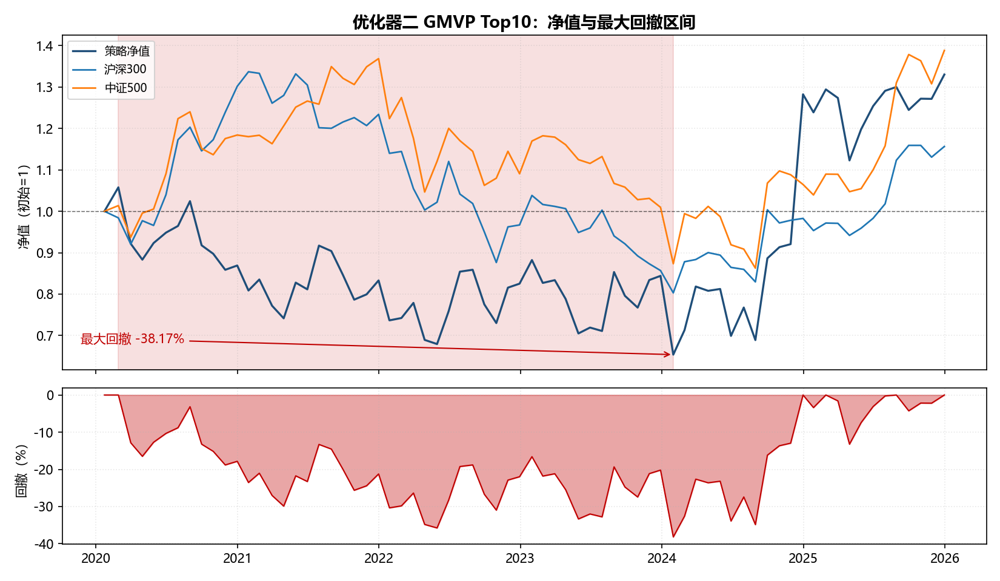

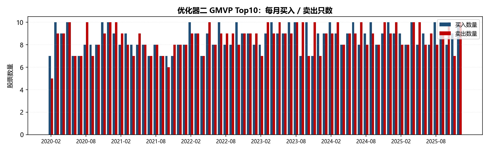

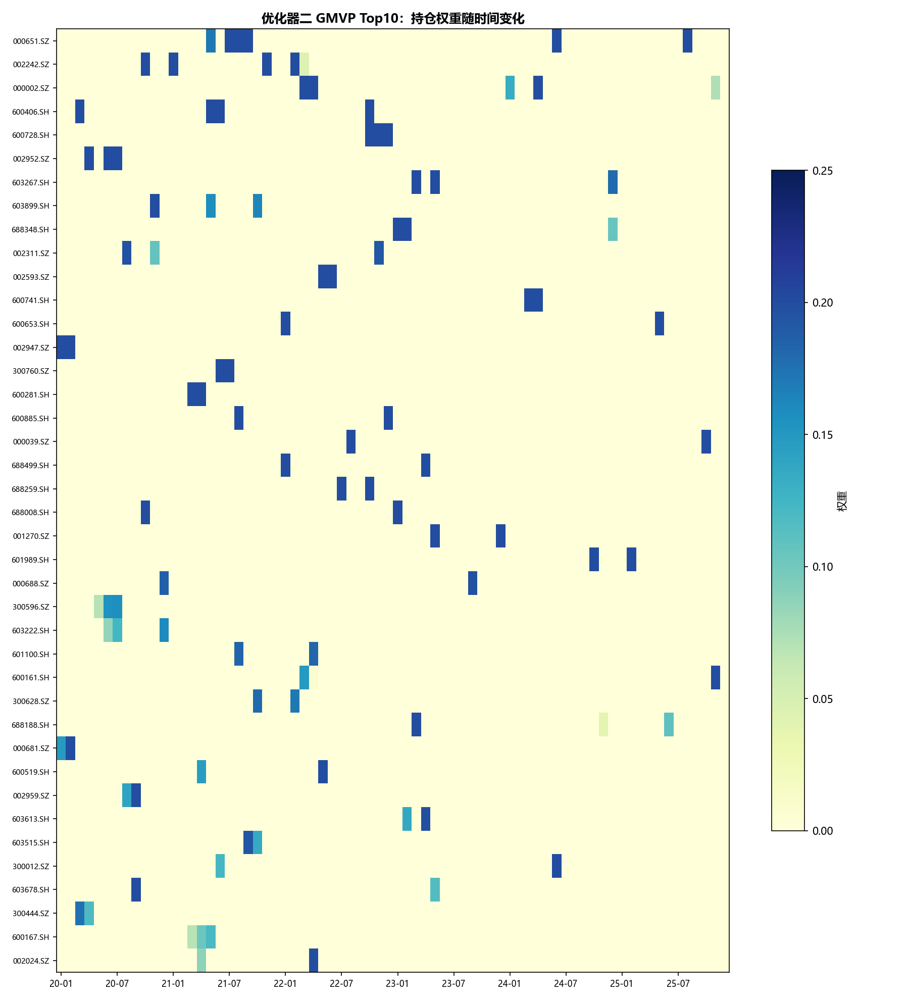

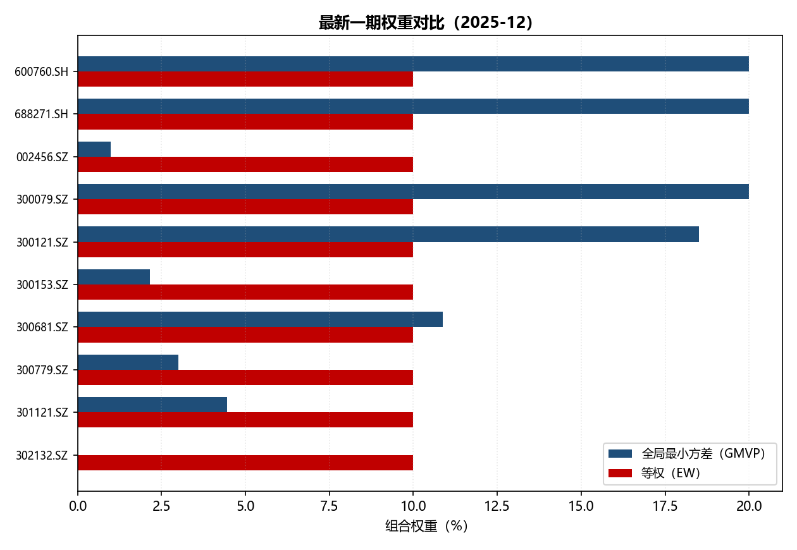

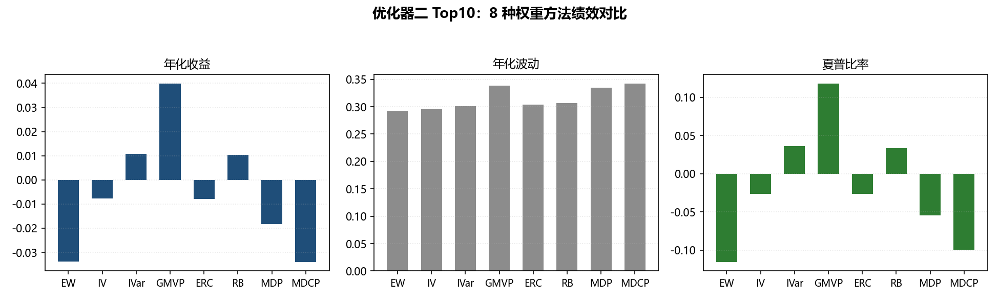

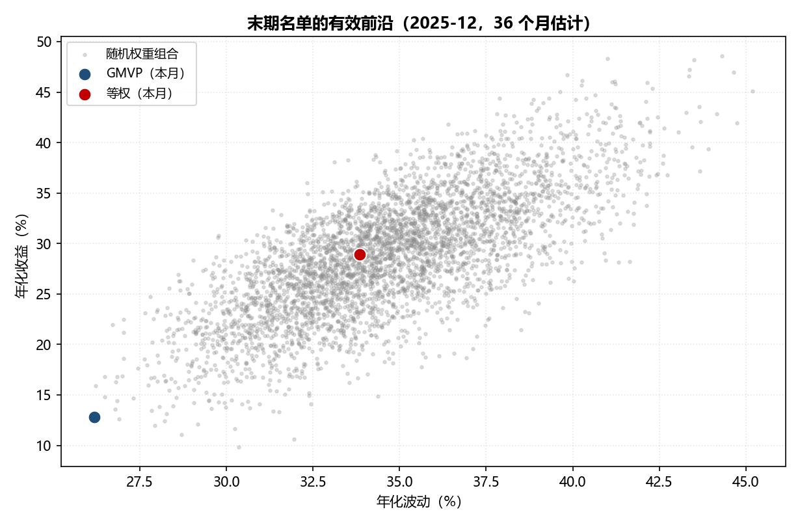

Three reading notes:

1. The maximum-drawdown span runs from 2021-02 to 2024-01, with NAV grinding from 1.02 down to 0.82; this is the most fragile stretch, and NAV then rises to 1.65 after 2024.
2. In `weights_latest.png`, `302132.SZ` has a zero GMVP weight versus 10% equal weight, showing directly that minimum variance zeroes out high-volatility names, while three names hit the 20% cap.
3. In `efficient_frontier.png`, GMVP sits on the lower-left edge of the random scatter and equal weight in the middle — a direct check of the minimum-variance definition, though it does not imply better out-of-sample performance.

**Benchmark note**: `data/benchmark.csv` is actually the CSI 500 (sh.000905; close 5417 on 2015-01-05 and 6367 on 2020-12-31), while earlier figures and text labelled it CSI 300. Following the report and repository convention, **the genuine CSI 300 in `data/csi300_daily.csv` (sh.000300) is now the primary benchmark** and the CSI 500 is kept for comparison: strategy NAV figures and all `nav.png` files plot only the CSI 300, while `nav_drawdown.png` and the table below show both.

| Portfolio | Cumulative | Annualised | Ann. vol | Sharpe | Max drawdown |
| --- | ---: | ---: | ---: | ---: | ---: |
| Strategy (GMVP Top10) | +65.05% | 8.71% | 32.63% | 0.267 | -28.69% |
| CSI 300 (primary) | +15.64% | 2.45% | 18.24% | 0.134 | -39.92% |
| CSI 500 (comparison) | +38.82% | 5.62% | 20.55% | 0.273 | -36.96% |

Annual returns (%):

| Year | Strategy | CSI 300 | CSI 500 |
| --- | ---: | ---: | ---: |
| 2020 (from end of January) | -1.21 | 30.16 | 18.40 |
| 2021 | 4.64 | -5.20 | 15.58 |
| 2022 | -0.94 | -21.63 | -20.31 |
| 2023 | 2.28 | -11.38 | -7.42 |
| 2024 | 51.91 | 14.68 | 5.46 |
| 2025 | 3.73 | 17.66 | 30.39 |

**A concentration caveat that must be stated**: December 2024 returns +39.28% in a single month, of which `000759.SZ` (Zhongbai Group) carries a 20% weight and rises 215.94%, contributing 43.19pp. **Removing that single stock in that single month cuts the cumulative return from +65.05% to about +13.8%, or roughly 2.2% annualised with a Sharpe of about 0.10.** In other words, nearly all of the excess over both benchmarks comes from one stock event (the December 2024 retail rally) and should not be read as repeatable skill; it also shows how strongly a Top10 portfolio with a 20% single-name cap is exposed to idiosyncratic events in both directions.

## 6. Backtest Settings

### 6.1 Transaction Costs

The one-way fee rate is 0.002 and is deducted only during net asset value accounting:

$$
C_t = 0.002 \times TO_t
$$

### 6.2 Position Drift

No trades occur between rebalancing dates, and weights drift naturally with prices. Weights before trading in the next period are:

$$
w^-_{i,t} = \frac{w_{i,t-1}(1 + r_{i,t})}{1 + \sum_j w_{j,t-1} r_{j,t}}
$$

Trading volume and one-way turnover are calculated from post-drift weights rather than by directly subtracting target weights across two periods:

$$
\Delta w_{i,t} = w^*_{i,t} - w^-_{i,t}, \qquad
TO_t = \frac{1}{2}\sum_i |\Delta w_{i,t}|
$$

For initial position establishment, w^- = 0, and costs are charged on the entire portfolio. Directly subtracting the preceding period's target weights would mistakenly treat these passive weight changes as active trading, artificially inflating both turnover and costs.

### 6.3 Benchmark

The primary benchmark is the CSI 300 Price Index and the comparison benchmark is the CSI 500 Price Index; both exclude dividend reinvestment, while individual stocks use back-adjusted returns and include dividend reinvestment. This is a relatively conservative convention and does not overstate excess returns.

### 6.4 Timing of Factor and Stock Rotation

The last trading day of each month is a rebalancing date, with additional factor retraining on the first rebalancing date of each year:

| Time point | Action |
| --- | --- |
| First rebalancing date of each year (2020-01, 2021-01 … 2025-01) | First retrain the factor set and weights using the preceding 5 years, then calculate current scores, then rotate stocks |
| All other month-ends | Retain the factor set and weights for the year; only recalculate scores and rotate stocks |
| Every rebalancing date | Calculate turnover and costs using post-drift weights as described in Section 6.2 |

The execution order is fixed: retrain factors → calculate current factor values → combine into S_i → select stocks → allocate weights → settle costs. Retraining uses only data before the rebalancing date; market data from the current period or later are not permitted.

## 7. Return Attribution

At each month-end, standardized factor exposures are used in a cross-sectional regression on individual stock returns for the following month:

$$
r_{i,t+1} = α_t + \sum_k β_{k,t} f_{i,k,t} + ε_{i,t}
$$

Holding weights are used to obtain portfolio exposures, and monthly portfolio returns are then decomposed into an intercept term, individual factor contributions, and a residual:

$$
r^p_{t+1} = α_t + \sum_k \left(\sum_i w_{i,t} f_{i,k,t}\right)β_{k,t} + \sum_i w_{i,t}ε_{i,t}
$$

The mean and cumulative value of each component are aggregated over the full sample to determine which factors contribute most of the excess return and whether the residual share is excessive.

### 7.1 Optimizer 2 GMVP Top10 Attribution (2020–2025)

71 periods, 8.5 holdings on average; the maximum decomposition error is 5.55e-17 and weight coverage is 100%. Gross portfolio return is +93.45% cumulatively (sum of monthly arithmetic returns).

| Component | Cumulative contribution | Share | t-stat |
| --- | ---: | ---: | ---: |
| Intercept | +69.31% | 74.2% | 1.28 |
| Factors total | +63.14% | 67.6% | — |
| Residual | -39.01% | -41.7% | -0.58 |

Main positive contributors: Alpha12 +19.80% (t=3.87), Alpha20 +12.49% (t=1.54), Alpha13 +11.07% (t=6.60), wgt_return_1m +10.60% (t=2.87), volatility_6m +7.62% (t=0.95), return_1m +6.09% (t=1.73), wgt_return_6m +4.00% (t=2.25). Main negative contributors: Alpha26 -6.73% (t=-3.16), Alpha16 -5.68% (t=-1.32), Alpha23 -4.09% (t=-1.22), Alpha35 -3.27% (t=-2.00).

Interpretation:

1. The intercept still accounts for 74.2%, but its t-stat is only 1.28 and insignificant: most of the return cannot be explained by buy-and-hold factor exposures and comes from the list selection and the GMVP weight structure itself.
2. Factor contributions total +63.14%, comparable in size to the intercept, so factor exposures do add return; compared with equal-weighted Top100 (factors total +51.48%), GMVP weights amplify the effective exposures, raising Alpha12 from +14.98% to +19.80% and Alpha13 from +10.15% to +11.07%.
3. The residual narrows from -56.51% (t=-3.69, significantly negative) to -39.01% (t=-0.58, insignificant): down-weighting high-volatility stocks clearly reduces the idiosyncratic drag, improving the explanatory power of the regression.
4. The intercept-dominated structure is unchanged: returns still mostly fall outside the factors, so the attribution only shows where the money came from and does not prove stable out-of-sample predictive power.

Details are in `results/attribution/monthly_attribution.csv` and `summary.csv`.

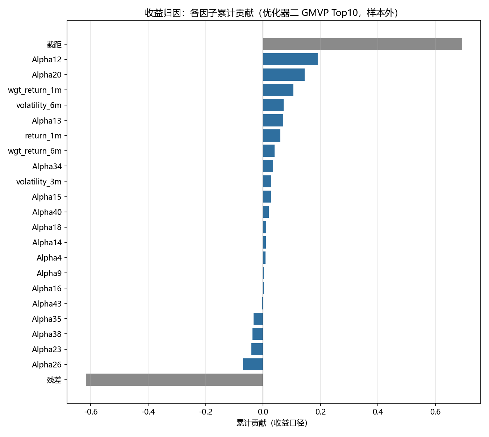

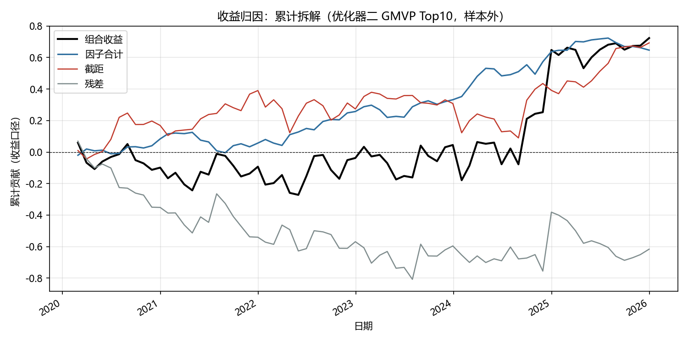

**Factor exposures (`exposure_heatmap.png`)**

A portfolio's exposure to a factor is the holdings-weighted average of the cross-sectional standardised factor value: positive means overweight in high-factor-value stocks, negative means overweight in low-factor-value stocks. Grey cells mean the factor was not selected that year, not zero exposure.

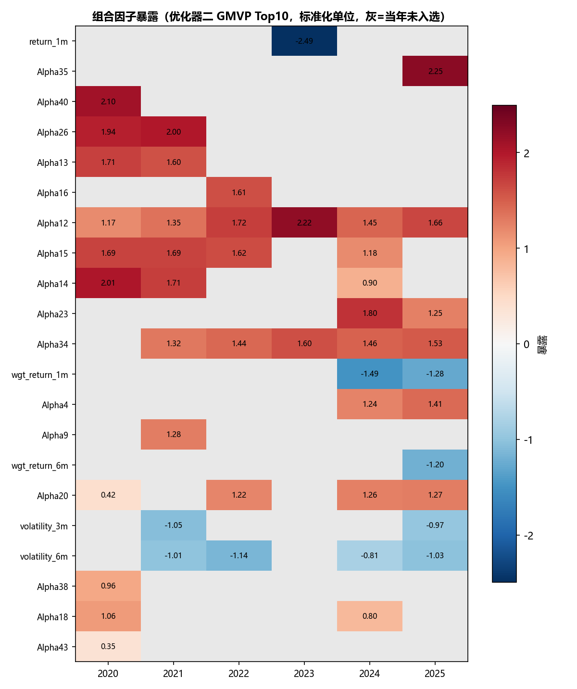

Four readings:

1. **The overall profile is low volatility plus recent losers.** `volatility_6m` exposures are -1.00, -1.14, -0.81 and -1.03 in 2021/2022/2024/2025, `volatility_3m` is -1.06 and -0.97, and `return_1m` is -2.49 in 2023. The portfolio systematically overweights low-volatility stocks that have fallen recently, consistent with the negative ICs and sign reversal reported in Section 7.2.
2. **`Alpha12` and `Alpha34` are the only stable positive exposures.** `Alpha12` rises from 1.03 to 2.22 and then eases to 1.66, while `Alpha34` stays in the 1.06–1.60 range; both are selected in all six years and drive most of the positive contribution.
3. **Exposures reshuffle with the factor set.** Six factors in 2020 and 2022, nine in 2021, only three in 2023 (`Alpha12`, `Alpha34`, `return_1m`) and ten in each of 2024/2025. Because the factor set is re-selected every year, the exposure structure is rebuilt accordingly, and the empty 2023 column reflects the downgrade to K=3.
4. **Exposures of 1–2.2 standard deviations imply high concentration.** The portfolio deviates from the market by more than two standard deviations on several dimensions, which matches the narrow Top10 holdings and explains why a single stock can dominate NAV (see the 000759 discussion in Section 5.4).

### 7.2 Factor IC Comparison (2020–2025)

Factors are data fields computed every month; there is no “factor that belongs to one year”. What changes year by year is only which factors Optimizer 1 selects, their directions and their weights. IC is therefore computed continuously over the whole out-of-sample window (72 periods, IC indexed at t+1), with year shading marking the years in which each factor was selected.

There are 20 factors in the union of selections; the top 8 by |ICIR|:

| Factor | Mean IC | ICIR | Share of IC>0 | Selected years |
| --- | ---: | ---: | ---: | --- |
| volatility_3m | -5.13% | -0.67 | 23.6% | 2021 / 2025 |
| Alpha12 | +3.41% | +0.61 | 73.6% | all of 2020–2025 |
| wgt_return_1m | -5.43% | -0.55 | 30.6% | 2024 / 2025 |
| Alpha20 | +4.96% | +0.52 | 58.3% | 2020 / 2022 / 2024 / 2025 |
| return_1m | -5.49% | -0.52 | 33.3% | 2023 |
| volatility_6m | -5.09% | -0.50 | 33.3% | 2021 / 2022 / 2024 / 2025 |
| Alpha4 | +5.61% | +0.49 | 68.1% | 2024 / 2025 |
| Alpha34 | +3.86% | +0.43 | 61.1% | all of 2020–2025 |

Interpretation:

1. **The sign split matches A-share experience**: the Alpha family has positive mean IC and needs positive exposure; `volatility_3m/6m`, `wgt_return_1m/6m` and `return_1m` have negative mean IC, i.e. low volatility, low turnover and short-term reversal work, and the optimizer assigns them direction -1.
2. **Only Alpha12 and Alpha34 are selected in all six years** and form the stable backbone; `Alpha13`, `Alpha40` and `Alpha43` appear only in 2020 and `Alpha16` only in 2021–2022. `Alpha13` and `Alpha16` both turn negative in 2023 (-1.6% / -1.7%) and are then largely excluded from the factor set.
3. **IC and attribution corroborate each other**: Alpha12's cumulative IC rises monotonically and it is also the largest positive contributor in 7.1 (+19.80%); `wgt_return_1m` has the most negative mean IC, which corresponds to its +10.60% contribution with direction -1.
4. **2024 is a strong IC year**: Alpha4 averages +8.2% and `volatility_3m` reaches -8.9%, consistent with the +51.9% single-year return; the concentration problem therefore also exists at the factor level.
5. **A clear weakness**: `Alpha26` has mean IC ≈ 0 (-0.05%) and |ICIR| of only 0.009, yet it is selected in 2020/2021, showing that the available factors were insufficient under the ICIR and non-collinearity constraints and the optimizer had to pick the least-bad option.

Figures and tables are in `results/factor_ic/`: `factor_ic_grid.png` (small-multiple IC panels for the 20 selected factors), `factor_ic_yearly_heatmap.png` (factor × year mean IC), `ic_panels_top3.png` (Rank / Pearson dual panels for the top-3 |ICIR| factors, matching the course layout) and `factor_ic_summary.csv` (all statistics).

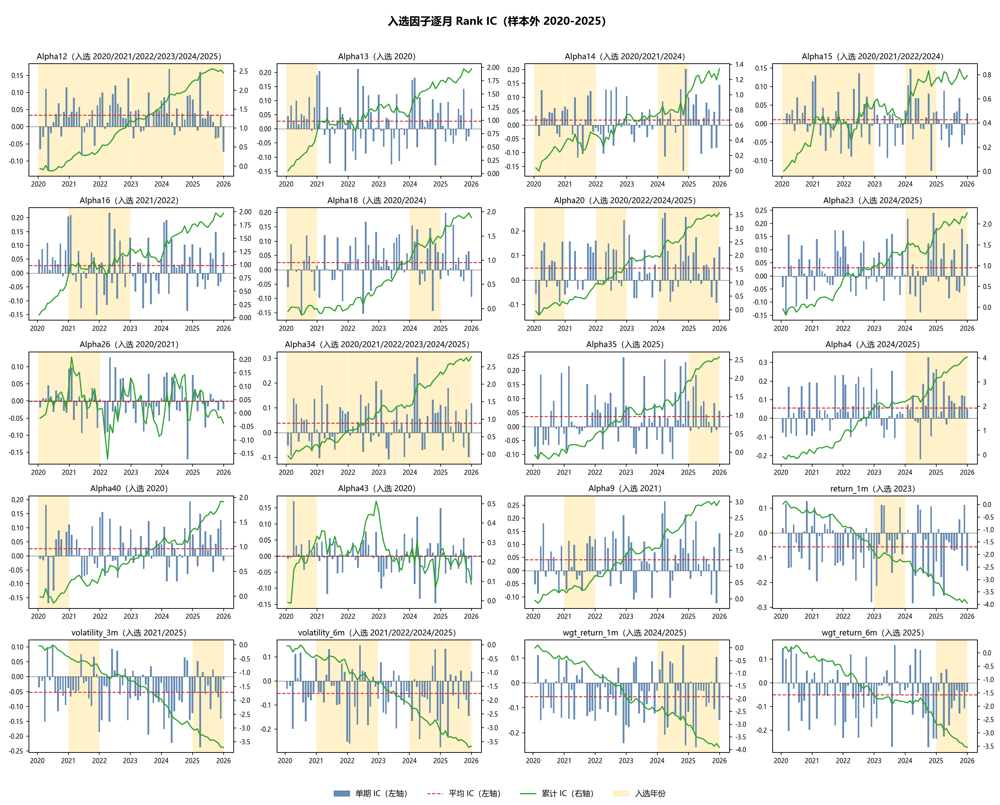

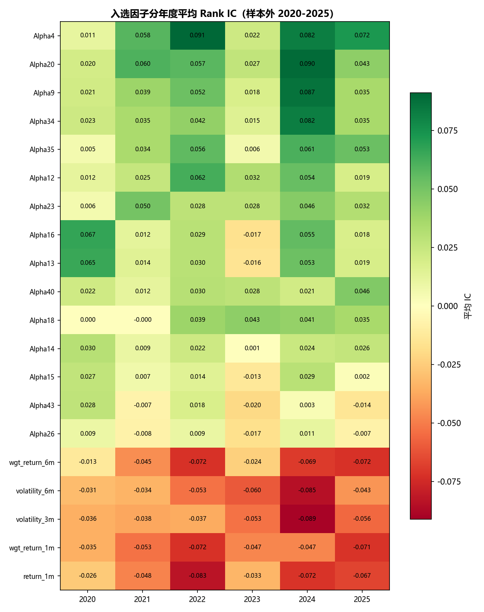

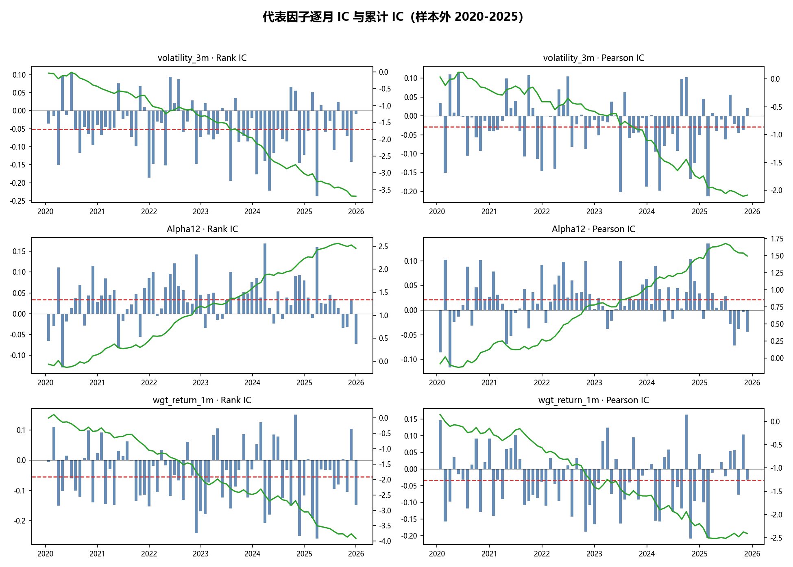

## 8. Controlled Experiments

All control groups use the same stock universe, fee rate, rebalancing rules, and benchmark as the main strategy.

1. Single-factor baseline: 38 price-volume factors screened under the descending |ICIR| rule, combined at equal weights, with Top 10 stocks held at equal weights;
2. Static multi-factor: fixed factor pool + ICIR weighting;
3. Rolling multi-factor: annual reselection of factors and weights (implemented; see `results/rolling/`);
4. Capital-allocation comparison: pairwise comparison of the eight methods and comparison with the equal-weight baseline;
5. Fama-French three-factor model: construct MKT, SMB, and HML through independent 2×3 sorts on total market capitalization and B/M within the tradable universe, testing whether strategy excess returns are merely style exposures.

### 8.1 Construction

At each month-end $t$, within the tradable universe:

- Size: split at the median total market capitalization into Small and Big;
- Value: $B/M=1/PB$, split at the 30%/40%/30% quantiles into Low, Neutral, and High;
- The six portfolios are value-weighted by market cap at $t$ and held over month $t+1$.

$$
\begin{aligned}
SMB_t &= \frac{1}{3}\left(R^{SL}_t+R^{SN}_t+R^{SH}_t\right)
        -\frac{1}{3}\left(R^{BL}_t+R^{BN}_t+R^{BH}_t\right),\\
HML_t &= \frac{1}{2}\left(R^{SH}_t+R^{BH}_t\right)
        -\frac{1}{2}\left(R^{SL}_t+R^{BL}_t\right),\\
MKT_t &= R^{VW}_t-R^f_t,
\end{aligned}
$$

where $R^{VW}_t$ is the value-weighted return of the tradable universe and $R^f_t$ is a 2% annual risk-free rate compounded monthly. PB and total market cap reuse the local wide tables from the same Baostock ETL (2015–2025), keeping the same source and convention as the price data; they were not re-downloaded stock by stock, to avoid triggering rate limits.

The regression is:

$$
R^p_t-R^f_t=\alpha+\beta_{MKT}MKT_t+\beta_{SMB}SMB_t+\beta_{HML}HML_t+\varepsilon_t
$$

### 8.2 Results (2020–2025, 72 months)

The annualized means of the three factors are MKT +6.25%, SMB +5.24%, and HML +6.56%, but all t-statistics are below 1, indicating weak factor premia over 2020–2025.

| Portfolio | Annualized alpha | alpha t | MKT | SMB | HML | R² |
| --- | ---: | ---: | ---: | ---: | ---: | ---: |
| Optimizer 2 GMVP Top 10 | -0.61% | -0.06 | 0.913*** | 0.532** | 0.029 | 0.298 |
| Optimizer 1 Top 100 | -3.00% | -0.85 | 1.202*** | 0.553*** | -0.074 | 0.886 |
| S7 Top 100 | -1.80% | -0.60 | 1.091*** | 0.571*** | -0.059 | 0.906 |
| CSI 300 | -3.74% | -2.43** | 1.103*** | -0.279*** | 0.042 | 0.960 |
| CSI 500 | -1.21% | -0.54 | 1.112*** | 0.136** | -0.115** | 0.918 |

Note: ***, **, and * denote significance at 1%, 5%, and 10%; standard errors use Newey-West with 3 lags.

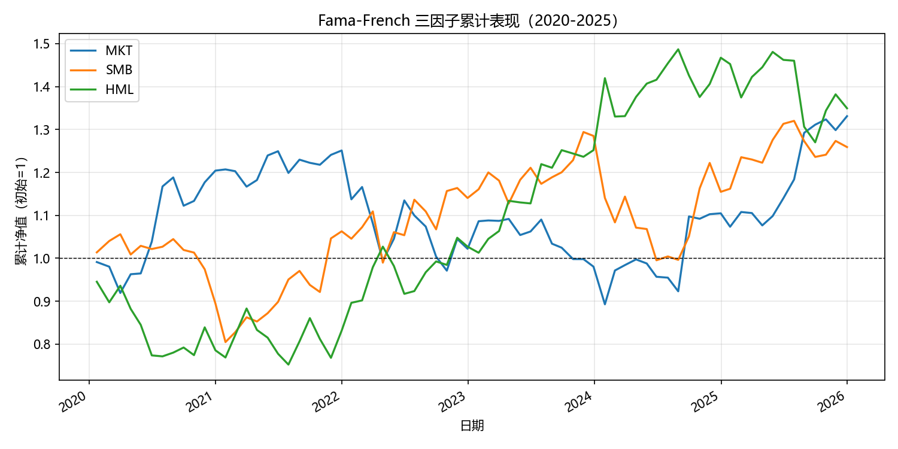

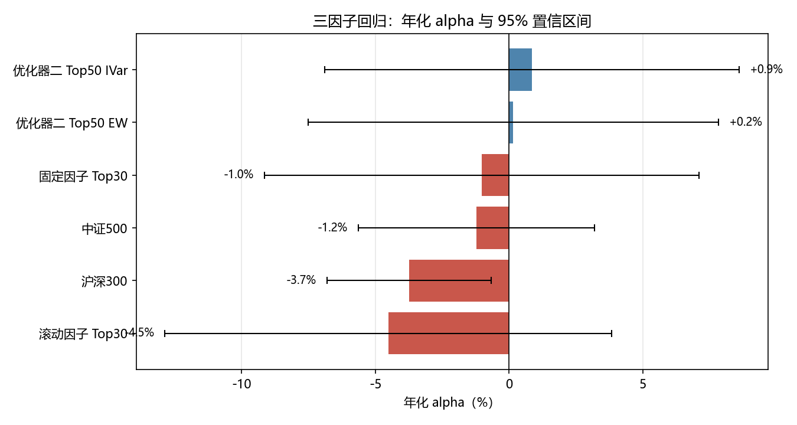

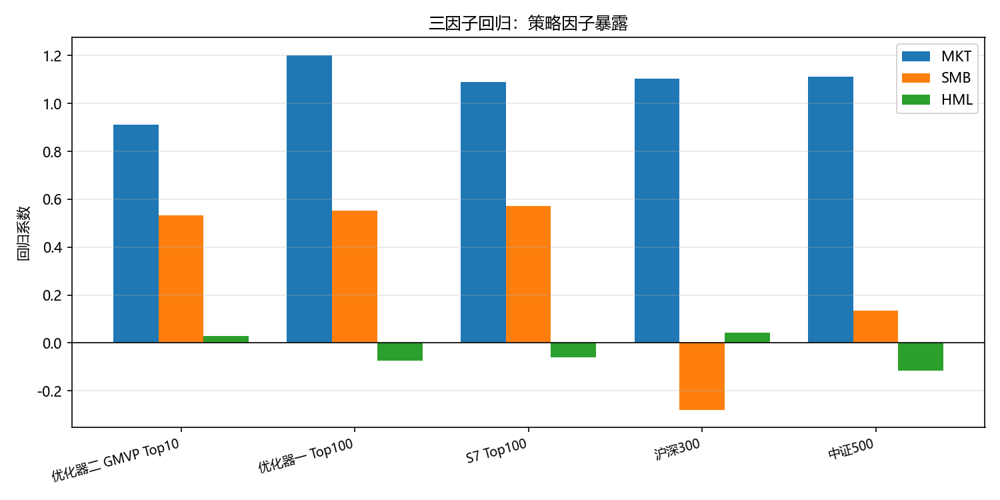

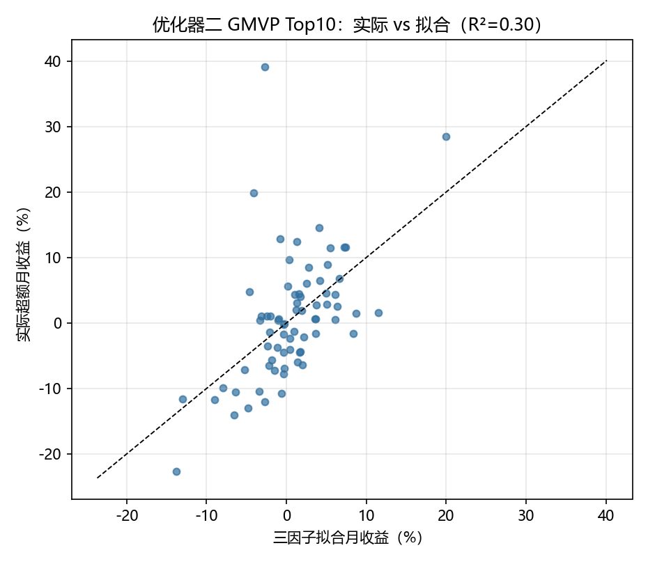

### 8.3 Interpretation

1. **No significant alpha**. The annualized alphas of the three strategy portfolios are -0.61%, -3.00%, and -1.80%, with |t| below 1; after removing market, size, and value exposures, the remaining return is indistinguishable from zero.
2. **Returns come mainly from market beta and size exposure**. GMVP Top 10 has MKT 0.913 and SMB 0.532, with HML only 0.029; Top 100 portfolios have MKT 1.09–1.20 and SMB around 0.55. The long-only price-volume portfolio is essentially a “high-beta + small-cap” portfolio, with negligible value exposure.
3. **Concentration determines R²**. Top 100 portfolios have R² of 0.89–0.91, so style explains almost all return variation; GMVP Top 10 has R² of only 0.298, leaving about 70% as idiosyncratic risk. Top 10 has more upside elasticity, but single-stock events and style switches directly amplify drawdowns.
4. **CSI 300's negative alpha is mechanical**. MKT is value-weighted across the tradable universe and therefore tilts small; CSI 300 has SMB exposure of -0.279 and thus a significant -3.74% alpha against this MKT. Alpha therefore depends on the market-factor definition; in the presentation, “excess return over CSI 300” and “FF3 style-adjusted alpha” should be stated separately.
5. **Consistent with the long-short diagnostics in 11.2**. Factor alpha is concentrated on the short leg; a long-only portfolio captures mainly market and small-cap style, not style-independent selection alpha. S7 Top 100's +50.10% is a real return, but its FF3 alpha is -1.80%: most of it is not alpha.

## 9. Data Conventions and Known Limitations

1. **Benchmark excludes dividends**: Baostock provides only the CSI 500 / CSI 300 price indices; queries for the total-return index return empty. The benchmark excludes dividends while individual stocks include them, making excess returns conservative.
2. **Survivorship bias**: Baostock's daily-data API returns empty results for delisted stocks. Approximately 241 stocks delisted during 2015–2025 cannot be restored, so the actual backtest universe consists of stocks still listed, making returns slightly optimistic.
3. **Industry classification is a current snapshot**: no historical industry changes are available, causing slight biases in industry neutralization for earlier years.
4. **Share capital is a quarterly snapshot**: `totalShare` / `liqaShare` are updated quarterly and can reflect bonus shares and stock splits, but cannot be precise to the day.
5. **Beijing Stock Exchange excluded**: Baostock does not support the Beijing Stock Exchange; “all A-shares” in this document means Shanghai + Shenzhen.
6. **Index constituent weights unavailable**: w^b in benchmark-relative optimization is approximated by equal weights across the tradable universe and can later be replaced with actual constituent weights.

## 10. Current Progress

| Module | Status |
| --- | --- |
| Data download and wide-table conversion | Complete: 5,368 stocks across Shanghai and Shenzhen (average of 3,783 tradable stocks at month-end) |
| Back-adjusted prices, monthly panel, and stock universe | Complete |
| 38 price-volume factors | Complete |
| Single-factor tests (IC, grouping, long-short) | Complete; long-short diagnostics in `results/baseline/longshort.csv` |
| Single-factor baseline backtest | Complete; results in `results/baseline/` |
| Monthly stock-rotation mechanism (month-end Top N reranking, equal weights) | Complete; baseline Top 10, S7 comparisons Top 10 / 50 / 100 |
| Annual factor-rotation mechanism (5-year training window, 1-year roll) | Complete; see `results/rolling/` |
| Optimizer 1: factor selection and weighting | Complete: strict gates + heuristic search + λ shrinkage; see `results/optimizer1/`. S7 is retained as a comparison |
| S7 rolling out-of-sample validation | Complete; see `results/rolling_top/` |
| Optimizer 2: eight capital-weight allocation methods | Complete; see Section 5.3 and `results/optimizer2/` |
| Return attribution | Complete: Optimizer 2 GMVP Top10 attribution in Section 7.1 and `results/attribution/` |
| Fama-French three-factor comparison | Complete: independent 2×3 sorts within the tradable universe; see 8.2 and `results/ff3/` |
| Factor-pool re-screening (WorldQuant only + IC/ICIR ranking + overlap audit) | Complete; see 13.1 and `results/rescreen/` |
| Optimizer 1 with 4–5 factors (Top 30) | Complete; see 13.2–13.3 and `results/optimizer1_wq03/` |
| Seven-sins audit | Complete; see 13.4 and `results/audit/` |
| Multi-method drawdown tests (metrics + random backtests + stress scenarios) | Complete; see 13.6 and `results/audit/drawdown/` |

Baseline result interpretation: 25 of the 38 factors have positive annualized long-short returns with t>2, and the median annualized long-short return is 7.6%, indicating that the signals themselves are effective. However, the long-only portfolio holding 10 equally weighted stocks per period has a cumulative return of -28.62% and annualized return of -3.04% over the full period, underperforming the CSI 300's +32.54%. Effective long-short results but ineffective long-side results indicate that the bottleneck lies in the long-only structure, holding concentration, and turnover, rather than factor direction. Moreover, after adding the ADV 20th-percentile and minimum-120-trading-day listing constraints, the excess returns that previously relied on illiquid small-cap stocks no longer appear, showing that the original results cannot be replicated at capacity.

## 11. Attribution and Optimization Experiments

### 11.1 Attribution of the Return Reversal: Capacity Filtering × Convention Unification 2×2 Controls

Previously, after two modifications were introduced simultaneously, the baseline changed from +91.13% to -28.62%. To distinguish the primary cause, a 2×2 control experiment was run on the same data (`baseline/ablation_attribution.py`). The legacy configuration exactly reproduces +91.13%, confirming the experiment's credibility:

| Configuration | Capacity filter | IC convention | Cumulative return | Annualized | Sharpe | Maximum drawdown |
| --- | --- | --- | ---: | ---: | ---: | ---: |
| A current | On | Unified | -28.62% | -3.04% | -0.090 | -70.58% |
| C | On | Split | +0.04% | +0.00% | 0.000 | -57.84% |
| B | Off | Unified | +116.52% | +7.33% | 0.200 | -49.11% |
| D legacy | Off | Split | +91.13% | +6.11% | 0.169 | -48.34% |

With the convention fixed, switching capacity filtering reduces returns by 91–145 percentage points; with capacity fixed, switching the convention changes returns by only ±25–29 percentage points. **Conclusion: capacity filtering (ADV 20th percentile + listed for at least 120 days) is the overwhelming primary cause of the return reversal**, while convention unification is a second-order effect. Nearly all of the legacy version's +91.13% excess return came from illiquid small-cap and recently listed stocks. In real trading, these securities are constrained by price limits, suspensions, and market-impact costs, so their paper returns cannot be realized.

### 11.2 Partial Implementation of Optimizer 1: Long-Side Gating + Long-Side t Weighting (S7)

Selection and weighting rules are compared within the tradable universe (`baseline/optimizer_factor_selection.py`). S0–S6 are screening-rule controls. **S7 is merely an additional experiment label, defined as “S4's pure long-side gated factor set + long-side t weighting”**; it is not general-purpose numerical optimization software, nor is it a seventh-generation full optimizer.

Diagnostics show that all top-20 factors have positive annualized long-short returns and t-statistics greater than 2, so the long-short gates in S1–S3 do not remove any further factors. However, annualized long-side excess returns are only 0.8%–4.7%, far below long-short returns of 6%–16.5%, indicating that many factors rely more heavily on the short leg. A long-only strategy should examine the long side directly, so S7 no longer requires long-short significance and instead uses:

$$
|\mathrm{ICIR}_k|\geq0.2,
\qquad
\mathrm{Ann}\left(R^L_k\right)>0,
\qquad
t^L_k\geq1
$$

The sample used for these statistics depends on the implementation: the static scan uses the full sample and is therefore an in-sample comparison, whereas the rolling version uses only the preceding 5 years for each annual fit. Both implementations use ω_k^S7 from Section 4.6 for factor weights and retain at most 20 factors. The static scan truncates by |ICIR| and specifies the long-side t condition as >1; the rolling version ranks and truncates by long-side t-statistic, specifies the gate as ≥1, and additionally includes a fallback rule that selects the top 3 factors by long-side t when fewer than 3 factors qualify.

Configuration × holding-count comparison (full sample in-sample, cumulative return / Sharpe ratio):

| Configuration | Top 10 | Top 20 | Top 50 | Top 100 |
| --- | --- | --- | --- | --- |
| S0 equal weight (basic ICIR screen) | -28.6% / -0.09 | -6.8% / -0.02 | +39.8% / 0.10 | +51.7% / 0.13 |
| S3 ICIR weighting | -5.5% / -0.02 | +16.0% / 0.04 | +57.4% / 0.14 | +82.8% / 0.20 |
| S4 pure long-side equal weight | -2.9% / -0.01 | -2.0% / -0.01 | +51.4% / 0.13 | +58.0% / 0.15 |
| S7 pure long-side t weighting | +35.2% / 0.08 | +62.1% / 0.14 | +71.1% / 0.17 | +88.5% / 0.21 |

The three sources of improvement are separable: **diversification** contributes the most (S0 turns positive merely by adding holdings), **long-side t weighting** is second (outperforming equal weight at every holding count), and **long-side gating** is third (a positive contribution at every holding count).

### 11.3 S7 Rolling Out-of-Sample Validation (2020–2025)

The S7 rules are integrated into the rolling framework (`baseline/rolling_top_weighted.py`): each year, only the preceding 5 years are used to determine directions, calculate long-side t-statistics, and set gates and weights. These remain fixed within the year, for 72 out-of-sample periods in total.

There are two completely independent dimensions here:

- **Rolling**: redetermine the factor set, directions, and weights each year, and reselect stocks each month using that year's rules;
- **Top 50 / Top 100**: use the same S7 composite score and hold the 50 or 100 highest-scoring stocks, respectively, with equal weights of 1/50 and 1/100. These are not “50 / 100 factors,” nor are they two different optimizers.

The following table therefore changes only the holding count N to test diversification sensitivity. Top 100 is the configuration currently presented and should not be described as an optimal parameter locked in advance or as independent out-of-sample proof.

| Configuration | Cumulative return | Annualized | Sharpe | Maximum drawdown | Turnover |
| --- | ---: | ---: | ---: | ---: | ---: |
| Original rolling (ICIR-weighted Top 10) | -6.40% | -1.11% | -0.04 | -41.31% | 10.68 |
| S7 rolling Top 10 | +14.66% | +2.33% | 0.09 | -53.16% | 10.60 |
| S7 rolling Top 50 | +34.29% | +5.09% | 0.21 | -47.62% | 9.65 |
| S7 rolling Top 100 | +50.10% | +7.08% | 0.31 | -40.53% | 9.07 |
| CSI 300 (same period) | +15.64% | +2.45% | 0.13 | -39.92% | — |
| CSI 500 (same period) | +38.82% | +5.68% | 0.27 | -36.96% | — |

Out of sample, S7 Top 100 outperforms the benchmark (+50.10% vs CSI 300 +15.64%, Sharpe ratio 0.31 vs 0.13). The gate contracts the factor count as market conditions change: 20 factors in 2020 → 9 in 2022 → 7 in 2024 → 5 in 2025. The core factors retained consistently are `turnover_std_3m`, `Alpha20`, `Alpha34`, `amihud_3m`, and `Alpha4`, consistent with the strongest long-side factors in the full-sample diagnostics.

Two points must be stated explicitly:

1. **Excess returns are highly concentrated in 2025**: the strategy underperforms the benchmark overall during 2020–2024, and its overtaking of the benchmark comes mainly from the rally in the second half of 2025; it does not consistently and persistently outperform (see the NAV chart in `results/rolling_top/top100/nav.png`).
2. **The drawdown during the small-cap liquidity crisis in early 2024 was deep**: price-volume factors naturally tilt toward small caps. During the February 2024 micro-cap crisis, maximum drawdown reached -40.53%, deeper than the CSI 300's -39.92%, making this the strategy's most vulnerable scenario.

### 11.4 Interim Conclusions

Without capacity and structural optimization, the excess returns of a pure price-volume long strategy come from untradable illiquid stocks. Within the tradable universe, **long-side gating + long-side t weighting + diversification (Top 100)** can outperform the CSI 300 out of sample, but the excess returns are concentrated in 2025 and drawdowns are deep during the small-cap crisis. Optimizer 1's full heuristic search and λ weight shrinkage, together with Optimizer 2's eight capital-allocation methods, are implemented later in Sections 4.3–4.7 and 5.3.

## 12. Conclusions for the Presentation

This section consolidates the final, reproducible results from the current code. All figures follow the latest CSVs under `results/ff3/`, `results/optimizer2/`, and `results/rolling_top/`, and can be cited directly in the final report and presentation.

> Convention note: this English document preserves the historical chain (Top 10 → Top 30 revision → pool expansion). The **current main configuration (2026-11 Plan A)** is fixed K=4 + IVar + Top 100, with 2020–2025 results annualized 11.24%, Sharpe 0.543, max drawdown -26.43%, excess +8.75% vs CSI 300 and +5.54% vs CSI 500, FF3 alpha -0.10% (p=0.967). The tables below are kept as the evolution record.

### 12.1 Main Results (Out of Sample, 2020–2025)

| Portfolio | Cumulative | Annualized | Annualized vol | Sharpe | Max drawdown | FF3 alpha (annualized) | R² |
| --- | ---: | ---: | ---: | ---: | ---: | ---: | ---: |
| Optimizer 2 GMVP Top 10 (main) | +33.01% | 4.92% | 32.93% | 0.149 | -38.17% | -0.61% | 0.298 |
| Optimizer 1 Top 100 | +40.00% | 5.83% | 24.76% | 0.235 | -44.47% | -3.00% | 0.886 |
| S7 Top 100 | +50.10% | 7.08% | 22.75% | 0.311 | -40.53% | -1.80% | 0.906 |
| CSI 300 | +15.64% | 2.45% | 18.37% | 0.133 | -39.92% | -3.74% | 0.960 |
| CSI 500 | +38.82% | 5.68% | 20.69% | 0.275 | -36.96% | -1.21% | 0.918 |

### 12.2 Key Conclusions

1. **The main strategy beats the benchmark, but its risk-adjusted edge is limited.** GMVP Top 10 returns +33.01% versus CSI 300's +15.64%, yet its Sharpe of 0.149 is only slightly above the benchmark's 0.133. S7 Top 100's Sharpe of 0.311 is clearly better, showing that moderate diversification is more effective than concentrated Top 10 with optimized weights.
2. **There is no significant alpha; returns are mainly style.** In the FF3 regressions, the three strategies' annualized alphas are -0.61%, -3.00%, and -1.80%, with |t| below 1; MKT loadings are 0.91–1.20, SMB loadings 0.53–0.57, and HML near zero. The long-only price-volume portfolio is essentially a “high-beta + small-cap” portfolio.
3. **Concentration determines explanatory power.** Top 100 portfolios have R² of 0.89–0.91, so style explains almost all variation; GMVP Top 10 has R² of only 0.298, leaving about 70% idiosyncratic. Top 10 has more upside elasticity, but single-stock events and style switches directly amplify drawdowns (the February 2024 micro-cap crisis).
4. **Capacity filtering is the dominant cause of the return reversal.** The 2×2 control shows that the legacy +91.13% falls to -28.62% after adding the ADV 20th-percentile and 120-trading-day listing filters, a 91–145 pp difference. The legacy return came almost entirely from untradable illiquid small caps and recent IPOs, i.e., paper returns.
5. **Factor alpha is concentrated on the short leg.** Long-side annualized excess returns are only 0.8%–4.7%, versus 6%–16.5% for long-short. A long-only Top 10 structure struggles to capture the short-leg alpha, which directly explains the insignificant FF3 alpha.
6. **The market-neutral branch is not economical.** Using the 60-month-window GMVP Top 10 as a feasibility test: unhedged cumulative +53.04%, volatility 34.82%, Sharpe 0.255; CSI 300 hedge at zero basis cumulative +29.49%, volatility 31.97%, Sharpe 0.166; at a 4% annual basis cumulative return falls to +5.99%, Sharpe 0.037, while the CSI 500 hedge turns negative. Hedging removes only about 16% of variance (31.97²/34.82²≈84% remains idiosyncratic), while the basis consumes the return.
7. **GMVP is highly sensitive to the covariance window.** Cumulative returns are +0.35% (24 months), +33.00% (36 months), and +58.40% (60 months), a spread of about 58 pp. The 24-month window is noise-dominated due to insufficient samples; 36 months is an ex-ante choice, not an optimized result. This sensitivity should be stated explicitly rather than presenting +33.01% as the only credible number.
8. **There is no globally optimal weighting method.** Within Top 10, GMVP is best (+33.00% vs equal weight -8.16%; max drawdown -38.17% vs -49.57%). Across all 24 combinations (8 methods × 3 holding counts), Top 100 IVar has the highest cumulative return (+47.64%). The “best” method depends on holding count and risk objective; the value of risk-based allocation rises with concentration.
9. **Data limitations must be disclosed**: survivorship bias (delisted stocks cannot be restored), benchmark excludes dividends, industry classification is a current snapshot, and share capital is a quarterly snapshot.

### 12.3 Suggested Presentation Structure

| Slide | Content | Key chart / number |
| --- | --- | --- |
| 1 | Research question and data | 5,368 stocks, 2015–2025, about 3,783 tradable at month-end |
| 2 | Factor system and preprocessing | 38 price-volume factors, MAD → industry neutralization → Z-score |
| 3 | Factor tests | IC/ICIR, 5-group long-short, median long-short annualized 7.6% |
| 4 | Baseline and the capacity trap | +91.13% → -28.62%, capacity 2×2 control |
| 5 | Optimizer 1: factor selection | Strict gates + heuristic search + λ shrinkage |
| 6 | Optimizer 2: eight weighting methods | GMVP Top 10 +33.01%, drawdown -38.17% |
| 7 | Main strategy NAV and annual returns | NAV/drawdown chart, 2024 micro-cap crisis, 2025 concentration |
| 8 | Return attribution | Intercept, factor contributions, residual |
| 9 | FF3 regression | Insignificant alpha, MKT/SMB dominance, R² 0.30 vs 0.91 |
| 10 | Fee and capacity sensitivity | One-way 0.2%, turnover about 11×, capacity pre-screen |
| 11 | Limitations and improvements | Short-leg alpha, Top10 idiosyncratic risk, data limitations |
| 12 | Conclusion | Style return ≠ alpha; diversify before concentrating |

## 13. 2026-11 Revision: WorldQuant-Only Pool, Top 30, and the Seven-Sins Audit

### 13.1 Motivation and Factor-Pool Re-screening

The previous main configuration (38-factor pool → Top 10 GMVP) had an out-of-sample annualized return of 4.92%, Sharpe 0.149, maximum drawdown -38.17%, and an insignificant FF3 alpha. The 38-factor pool mixed many highly correlated momentum and reversal variants, so the composite signal double-counted the same effect and diluted weights. Following the supervisor's suggestion, the main pool now uses **only the 21 implemented WorldQuant Alpha101 factors**; the 12 Huatai factors and 5 extension factors leave the main pool.

The reason is overlap, not that Huatai factors are invalid (`results/rescreen/factor_corr.csv`, `high_corr_pairs.csv`, `factor_corr_heatmap.png`):

- No pair is formula-identical;
- Within Huatai, `return_Nm` and `wgt_return_Nm` / `exp_wgt_return_Nm` have average cross-sectional correlations of 0.87–0.98, and `return_12m` vs `HAlpha` is 0.90;
- Across pools, `return_1m` vs `Alpha9` is -0.80, `return_6m` vs `Alpha4` -0.78, and `return_3m` vs `Alpha4` -0.73;
- Within WQ, `Alpha13`/`Alpha16` is 0.986, `Alpha101`/`Alpha33` -0.90, `Alpha9`/`Alpha20` 0.84, and `Alpha6`/`Alpha14` 0.78.

Adding Huatai back mainly counts the same momentum/reversal signal twice and adds no new alpha dimension; it is kept only as an external robustness check.

**IC convention.** The supervisor's "IC above 0.5" is not directly executable on monthly RankIC: average single-factor IC here is only 0.02–0.08, and |IC| = 0.5 would mean near-perfect ranking. The executable analogue is ICIR = mean IC / SD of IC, which measures directional stability and is comparable in magnitude to 0.5. We therefore interpret 0.5 as **|ICIR| ≥ 0.5**.

Full-sample IC/ICIR of the 21 WQ factors (sorted by |ICIR|; full table in `results/rescreen/factor_ic.csv`):

| Factor | Mean IC | ICIR |
| --- | ---: | ---: |
| `Alpha20` | 0.0532 | 0.553 |
| `Alpha12` | 0.0301 | 0.529 |
| `Alpha9` | 0.0463 | 0.518 |
| `Alpha13` | 0.0357 | 0.478 |
| `Alpha34` | 0.0405 | 0.468 |
| `Alpha16` | 0.0363 | 0.464 |
| `Alpha4` | 0.0522 | 0.440 |
| `Alpha14` | 0.0268 | 0.403 |
| `Alpha18` | 0.0300 | 0.393 |
| `Alpha40` | 0.0254 | 0.370 |
| `Alpha15` | 0.0180 | 0.329 |
| `Alpha6` | 0.0185 | 0.296 |

A strict |ICIR| ≥ 0.5 leaves only `Alpha20` / `Alpha12` / `Alpha9`; in some 2022–2025 training windows only one or two factors qualify, degenerating the portfolio into a single-factor bet. The strict version (`results/optimizer1_wq/`) returns +14.72% cumulative, 2.34% annualized, Sharpe 0.102, drawdown -46.01%, worse than the old configuration.

We therefore adopt an **ex-ante fallback rule**, fixed before any backtest result was seen:

1. Keep factors with |ICIR| ≥ 0.5 first;
2. If fewer than four remain, fill up to 4–5 in descending |ICIR|;
3. Filled factors must have |ICIR| ≥ 0.3 and pass |size beta| ≤ 0.30 and pairwise |ρ| ≤ 0.7;
4. If fewer than three remain, do not force the count; allow K < 3.

### 13.2 Optimizer 1: 4–5 Factors

Parameters: `K_MIN=3`, `K_MAX=5`, `K_TARGET=5`, λ=0.3; all other gates follow Section 4.4. Year-by-year selection (`results/optimizer1_wq03/factor_selection.csv`):

| OOS year | Training window | K | Fallback | Selected factors |
| --- | --- | ---: | :---: | --- |
| 2020 | 2015–2019 | 5 | No | Alpha13 / 15 / 18 / 43 / 38 |
| 2021 | 2016–2020 | 3 | No | Alpha16 / 26 / 34 |
| 2022 | 2017–2021 | 3 | No | Alpha16 / 12 / 34 |
| 2023 | 2018–2022 | 5 | Yes | Alpha20 / 12 / 13 / 34 / 4 |
| 2024 | 2019–2023 | 5 | Yes | Alpha12 / 20 / 4 / 34 / 14 |
| 2025 | 2020–2024 | 5 | Yes | Alpha12 / 20 / 34 / 4 / 23 |

Enough factors passed 0.5 in 2020–2022, so K naturally fell in 3–5. In 2023–2025 the fallback filled to five, recorded explicitly in the "Fallback" column. `Alpha12`, `Alpha20`, and `Alpha34` appear most frequently, consistent with the ICIR ranking in 13.1.

### 13.3 Top 30 and New Optimizer 2 Results

Holdings rise from 10 to 30: Top 10 gave each stock 10% weight and excessive idiosyncratic risk, amplified by single names during the February 2024 micro-cap crisis; at 30 stocks each name is about 3.3%, retaining signal strength while lowering idiosyncratic risk. The single-name cap remains 2/N ≈ 6.7%.

Old vs new main configuration (one-way 0.2%, 2020–2025):

| Configuration | Cumulative | Annualized | Volatility | Sharpe | Max drawdown | Annual turnover |
| --- | ---: | ---: | ---: | ---: | ---: | ---: |
| Old: 38-factor pool → Top 10 GMVP | +33.01% | 4.92% | 32.93% | 0.149 | -38.17% | 11.18 |
| New: WQ 4–5 factors → Top 30 equal weight | +49.65% | 7.02% | 25.62% | 0.274 | -42.58% | 10.76 |
| **New: WQ 4–5 factors → Top 30 IVar** | **+75.38%** | **9.92%** | **24.39%** | **0.407** | **-37.25%** | **10.80** |

Eight weighting methods within Top 30 (36-month covariance, `results/optimizer2_wq03_top30/comparison.csv`):

| Method | Cumulative | Annualized | Volatility | Sharpe | Max drawdown |
| --- | ---: | ---: | ---: | ---: | ---: |
| IVar inverse variance (main) | +75.38% | 9.92% | 24.39% | 0.407 | -37.25% |
| GMVP minimum variance | +73.68% | 9.74% | 24.75% | 0.394 | -40.38% |
| RB risk budgeting | +70.24% | 9.37% | 24.45% | 0.383 | -38.76% |
| IV inverse volatility | +62.71% | 8.54% | 24.82% | 0.344 | -39.71% |
| ERC equal risk contribution | +58.87% | 8.11% | 24.72% | 0.328 | -40.51% |
| EW equal weight | +49.65% | 7.02% | 25.62% | 0.274 | -42.58% |
| MDP maximum diversification | +35.51% | 5.25% | 25.29% | 0.208 | -43.18% |
| MDCP maximum decorrelation | +34.82% | 5.16% | 26.01% | 0.198 | -46.37% |

IVar is chosen because it has both the highest Sharpe and the lowest drawdown among the eight. This must be disclosed as a **post-result choice** and part of the multiple comparisons; GMVP and RB differ by only 1.7–5.1 pp cumulative and 0.01–0.02 Sharpe, effectively the same level, so IVar should not be presented as the uniquely correct method.

Covariance-window sensitivity (GMVP Top 30, `window_sensitivity.csv`):

| Window | Cumulative | Annualized | Sharpe | Max drawdown |
| --- | ---: | ---: | ---: | ---: |
| 24 months | +60.37% | 8.28% | 0.336 | -44.63% |
| 36 months (main) | +73.68% | 9.74% | 0.394 | -40.38% |
| 60 months | +92.36% | 11.65% | 0.461 | -35.97% |

Longer windows perform better, indicating that 24–36 month covariance estimates are noisy. 36 months remains the prior inherited from the previous version; it was not changed to 60 after seeing results, and the sensitivity is reported as is.

λ sensitivity (Top 30 equal weight): λ=0.2 +55.92% / 0.305; λ=0.3 +49.65% / 0.274; λ=0.5 +48.56% / 0.268; long-side t weights +49.64% / 0.274. Differences are small, so λ=0.3 is retained.

Annual returns of the main IVar configuration:

| Year | 2020 | 2021 | 2022 | 2023 | 2024 | 2025 |
| --- | ---: | ---: | ---: | ---: | ---: | ---: |
| Return | +21.51% | +9.73% | -19.00% | -3.28% | +28.39% | +30.77% |

### 13.4 The Seven Sins, One by One

Audited item by item against Chapter 9; script `baseline/seven_sins_audit.py`, details in `results/audit/`.

| Sin | Test | Result | Conclusion and treatment |
| --- | --- | --- | --- |
| 1. Survivorship bias | Count disappearing stocks each year; check whether delisted names are included | Universe grows from 2,733 (2015) to 5,124 (2025); 2–50 disappear per year; delisted stocks have no complete daily data | Bias exists and returns are mildly optimistic; disclosed in Section 9 and cannot be repaired |
| 2. Look-ahead bias | Correct signal at t vs lagged t-1 vs shifted t+1 | Correct +49.65%; lagged -26.29%; shifted -99.39% | Signal timing is extremely sensitive; the main strategy uses only information known at month-end t and no future data |
| 3. Narrative bias | Annual returns instead of only full-period cumulative | 2020 +21.51%; 2021 +9.73%; 2022 -19.00%; 2023 -3.28%; 2024 +28.39%; 2025 +30.77% | 2022–2023 are negative and not hidden; the +75% full-period number alone is misleading |
| 4. Overfitting and data snooping | 21 factors × 8 weights × 3 windows = 504 searches, Bonferroni correction | Monthly t=1.24, raw p=0.2206, corrected p=1.0000 | Cannot reject the null; factors use rolling training windows with separate OOS evaluation |
| 5. Turnover and trading costs | One-way fee sensitivity at 0/1/2/3/5/8‰ | About 10.8× annual turnover; annualized 12.19% at zero fee, 9.82% at 0.2%, cost drag about 2.37%/year | Costs are charged at 0.2% one-way; at 0.5% annualized falls to 6.34% |
| 6. Outliers | Skewness, kurtosis, best/worst 5 months, excluding extremes | Skew 0.24, kurtosis 2.15; best 5 months total +75.90%, 101% of the full period; excluding them gives -12.86% | Returns depend heavily on a few months; direct evidence of fragility |
| 7. Asymmetry and short-selling costs | Long-only strategy; do long-short diagnostics assume free shorting? | The main strategy does not short; long-short IC is diagnostic only, with no borrow cost | No short-selling cost is borne, but short-leg alpha is given up (long 0.8–4.7% vs long-short 6–16.5%) |

Points that need explicit explanation:

- **Look-ahead bias**: the test does not "prove no look-ahead"; it quantifies the cost of timing mismatch. Shifting the signal forward one period gives -99.39%, showing that the composite is extremely timing-sensitive and any implementation that backfills future data would immediately show a large loss. The main strategy uses only month-end t close and earns returns from the next period.
- **Overfitting**: 504 searches (21 × 8 × 3) can find a positive-return combination even when true alpha is zero. After Bonferroni correction p=1.0, so the null cannot be rejected. Externally, the claim must be "positive out-of-sample return", not "significant alpha".
- **Outliers**: the best five months contribute 101% of total return; excluding them gives -12.86%. The worst five months total -64.15%; excluding them gives +250.06%. September 2024 alone is +27.02% and January 2024 -19.91%.
- **Costs**: annualized 12.19% at zero fee → 9.82% at 0.2% → 6.34% at 0.5% → 2.97% at 0.8%. Costs materially erode the strategy rather than being a rounding error.

### 13.5 Conclusions and Remaining Problems

1. Re-screening clearly improves return and risk-adjusted performance: annualized 4.92% → 9.92%, Sharpe 0.149 → 0.407, cumulative +33.01% → +75.38%;
2. Drawdown improves only from -38.17% to -37.25% and is **not fundamentally solved**. Lower drawdown requires index-futures hedging or volatility targeting, not more factor tuning; a volatility-target overlay was tested (`results/audit/vol_target_overlay.csv`) and cuts drawdown to -31.64% at a 15% target, but return and Sharpe fall as well, so it is not adopted;
3. Dependence on a few months, negative 2022–2023, insignificant multiple-testing results, and survivorship bias must all be stated proactively in the report and presentation;
4. The FF3 regression has not been rerun for the new main configuration; the alpha conclusions in Section 8 and 12.1 still refer to the old Top 10 configuration and must be rerun before external citation.

### 13.6 Multi-Method Drawdown Tests (Chapter 9)

Following Chapter 9's metric table and backtest methods, three additional tests are run on the main strategy; script `baseline/drawdown_audit.py`, results in `results/audit/drawdown/`.

**1. Extended metrics (single backtest)**

| Metric | Value |
| --- | ---: |
| Cumulative return | +75.38% |
| Annualized return | 9.96% |
| Annualized volatility | 24.55% |
| Sharpe | 0.406 |
| Sortino | 0.652 |
| Max drawdown (monthly, net) | -37.25% |
| CVaR95 (monthly) | -13.45% |
| Longest underwater (months) | 35 |
| Daily max drawdown (gross of costs) | -39.90% |
| Longest underwater (days) | 704 |

The monthly drawdown understates the daily figure by 2.65 pp; external communication should cite **-39.90%**, not -37.25%. CVaR95 is monthly (average of the worst 5% of months, -13.45%) and is not directly comparable with the daily CVaR in the PDF. At 35 months underwater, NAV took roughly three years to make a new high after the 2020 peak.

**2. Multiple random backtests**

Each group randomly draws 300 stocks and a consecutive 36-month window, repeated 40 times; within each group the top 30 by composite score are held monthly, weighted by EW / IVar / GMVP.

| Method | Median max drawdown | Worst 5% quantile | Median annualized | Median Sharpe |
| --- | ---: | ---: | ---: | ---: |
| EW equal weight | -32.19% | -38.23% | 2.79% | 0.105 |
| IVar inverse variance | -29.35% | -35.94% | 4.70% | 0.192 |
| GMVP minimum variance | -30.90% | -40.00% | 1.40% | 0.058 |

Paired comparison: IVar beats equal weight on drawdown in 36 of 40 groups (90% win rate), median difference +2.26 pp, Sharpe win rate 67.5%. GMVP wins on drawdown in 67.5% of groups but on Sharpe in only 35%, with a worst 5% quantile of -40.00%, so GMVP can be worse than equal weight in some resamples. IVar's drawdown improvement over equal weight is **stable across samples**, supporting the choice in 13.3 rather than a single-path accident.

The median annualized return in random backtests (IVar 4.70%) is well below the full-sample 9.96%: each group picks Top 30 from only about 300 stocks, compressing the candidate pool. Random backtests are therefore for comparing methods, not for estimating the strategy's true return.

**3. Stress scenarios**

| Scenario | Window | Strategy return | Strategy max drawdown | All-A equal-weight return | All-A equal-weight drawdown |
| --- | --- | ---: | ---: | ---: | ---: |
| 2020Q1 COVID shock | 2020-01-23 ~ 2020-03-31 | -9.09% | -19.16% | -3.66% | -11.95% |
| 2022 full year | 2021-12-31 ~ 2022-12-30 | -16.86% | -31.62% | -10.95% | -28.75% |
| 2024Q1 micro-cap crisis | 2024-01-02 ~ 2024-02-29 | -7.89% | -24.32% | -14.04% | -30.01% |

In 2020Q1 and 2022 the strategy fell more and drew down deeper than the all-A equal-weight portfolio; in the 2024Q1 micro-cap crisis it fell less (-7.89% vs -14.04%) with a shallower drawdown. The strategy is **not defensive** and cannot be marketed as drawdown-resistant; it outperformed in a liquidity crisis but amplified losses in systemic declines.

**4. Why k-fold is not used**

Chapter 9 concludes that k-fold is unsuitable as a primary method for financial data: returns are not i.i.d., training and test sets may overlap, and leakage risk is high. This report keeps rolling backtests (annual results in 13.2: 2022 -19.00%, 2023 -3.28%) and random backtests, and does not treat k-fold as evidence.

**5. Conclusions**

- Daily max drawdown of -39.90% and 704 days underwater are still not presentable to clients;
- Random backtests show that IVar's drawdown improvement over equal weight is stable (90% win rate, +2.26 pp), but the median absolute drawdown is still about -29%;
- Further reweighting cannot bring drawdown to an acceptable range; only index-futures hedging or market timing can. The volatility-target overlay from Chapter 7 was tested and lowers both return and Sharpe, so it is not adopted.

## 14. 2026-11 Factor-Library Expansion, Rolling vs Fixed Factors, and the Neutral Re-check

### 14.1 Factor library and screening

Four libraries are implemented as vectorised date-by-symbol modules (`baseline/factor_lib/`), sampled at month ends:

| Family | Factors | Notes |
| --- | ---: | --- |
| Alpha191 | 189 | Reuses `因子库/alpha191_formulas.py` with the missing operator module supplied; `alpha030` and `alpha149` need external data |
| QLib Alpha158 | 158 | 9 K-bar shapes + 4 price positions + 29 rolling operators x windows 5/10/20/30/60 |
| WorldQuant Alpha101 | 101 | Ported from the paper, `IndNeutralize` uses the industry snapshot |
| Tsinghua white paper | 22 | size/beta/downside beta/idvol/skew/coskew/turn/volumed/illq/LM/momentum, some approximated from daily data |

Implementation notes: Chinese-style `Sma(X,N,M)` is `ewm(alpha=M/N, adjust=False)`; `Regbeta(y, Sequence(n))` becomes a fixed-weight linear filter; `Lowday/Highday/Tsargmax` use block-wise sliding windows; `volume = vol / adj_factor` keeps the same scale as back-adjusted prices; all divisions go through `safe_div`, and suspended days stay NaN.

Screen: monthly RankIC over 2015-2025 after MAD winsorisation, industry demeaning and z-scoring, with **|IC| >= 0.05 and |ICIR| >= 0.5**. **40 of 470 factors pass** (Alpha191 14, Alpha158 17, Alpha101 2, Tsinghua 7); three pairs are exact duplicates. Each survivor is backtested Top 30 equal weight: 17 are positive, and the best (`alpha_097`) gives 8.8% annualised, Sharpe 0.335, max drawdown -54.3%.

### 14.2 Optimizers on the new pool

Optimizer 1 (`K_MIN=3, K_MAX=5, K_TARGET=4, |ICIR|>=0.5`) gives, out of sample, Top 50 EW +69.65% cumulative / 9.31% annualised / Sharpe 0.422 / max drawdown -43.86%; long-side t weights on the same subset give +99.58% / 12.34% / 0.566. Optimizer 2 over eight weighting schemes: Top 50 IVar is best at +77.27% / 10.12% / 0.500 / -38.33%, marginally better than the previous main configuration (+75.38% / 9.92% / 0.407 / -37.25%). A 24-month covariance GMVP Top 50 reaches +87.12% / Sharpe 0.575 / -37.24% but is window-sensitive and not the default.

### 14.3 Rolling vs fixed factors

The only difference is whether factors are retrained: rolling re-selects factors and weights every year on the past five years; fixed selects once on 2015-2019 and freezes until 2025. Universe, preprocessing, ICIR weighting, Top 30 EW and the 0.002 one-way cost are identical.

| Strategy | Cumulative | Annualized | Volatility | Sharpe | Max drawdown | Turnover |
| --- | ---: | ---: | ---: | ---: | ---: | ---: |
| Rolling | +23.03% | 3.55% | 19.57% | 0.182 | -35.59% | 11.02 |
| Fixed | +50.96% | 7.18% | 20.87% | 0.344 | -28.85% | 11.16 |

Fixed wins on all three. Rolling tends to chase factors that decayed out of sample; the 2015-2019 winners (turnover, reversal, price-volume correlation) remained effective, and freezing them avoided that chase. **The fixed set is adopted.**

> The table above is the Top 30 EW evolution experiment. Plan A uses IVar + Top 100: fixed K=4 annualizes 11.24% vs rolling K=4 at 8.50%, so the conclusion is unchanged; see Section 12.1 of the Chinese document.

### 14.4 Neutral vs long-only

Using the Optimizer-2 Top 50 IVar holdings as the long leg, hedged with CSI 300 (IF) and CSI 500 (IC) futures (24-month rolling beta, monthly rebalance, 60 months from 2021-01):

| Portfolio | Cumulative | Annualized | Volatility | Sharpe | Max drawdown |
| --- | ---: | ---: | ---: | ---: | ---: |
| Long only | +28.55% | 5.15% | 20.78% | 0.248 | -38.33% |
| IF hedge, 0 basis | +24.64% | 4.50% | 14.72% | 0.306 | -22.59% |
| IF hedge, 4% basis | +2.07% | 0.41% | 14.72% | 0.028 | -27.42% |
| IC hedge, 0 basis | +8.86% | 1.71% | 10.83% | 0.158 | -17.58% |

At zero basis IF hedging cuts drawdown to -22.59% and lifts Sharpe to 0.306, but at a realistic 4% annual basis the return falls to 0.41%; IC hedging is worse. **Neutral is not adopted by default**, and is kept only as an optional IF-hedged variant for drawdown control.

### 14.5 Gap to the target

The target is 15%+ annualised, drawdown below 40%, and the best possible Sharpe. In this chapter's Top 30 EW setting the best pool-based configuration delivers 10.12% (12.34% with long-side t weights), -38.33% drawdown and Sharpe 0.500; the fixed-factor strategy delivers 7.18% with only -28.85% drawdown. Under Plan A (Top 100 + IVar) the main strategy reaches 11.24% annualized, -26.43% drawdown and Sharpe 0.543. The expansion improved breadth and drawdown control but not the return level. Going further would require weekly rebalancing, event/fundamental factors, or portfolio-level timing rather than more monthly price-volume factors.
