# A 股多因子选股与市场中性策略

## 1. 概述

策略以纯量价因子为 alpha 来源，组合层面分为主动管理与市场中性两条分支，共用同一套因子计算、因子检验与合成结果：

- **主动管理**：只做多，保留基准 Beta，以沪深 300 价格指数为主基准、中证 500 为对照基准，追求相对超额；
- **市场中性**：多头组合叠加股指期货空头，把净 Beta 压到 0 附近，只保留因子收益。

两条分支的区别只在组合构建与对冲，不在因子。因此因子有效性必须在分支之前单独检验，否则无法判断组合收益来自因子还是来自 Beta 暴露。

本仓库当前实现主动管理分支的数据管线、因子检验、单因子基线、滚动多因子（年频换因子 + 月频换股）、优化器一的完整启发式筛选与 λ 权重收缩，以及优化器二的八种资金权重配置。市场中性分支经可行性测算后未作为主策略：对冲只能压掉约 16% 的方差，在 4% 年化基差下收益被基差吞噬，详见 12.2。

策略因子只使用后复权 OHLCV、换手率与成交额；FF3 对照额外使用 PB 与总市值，但仅用于绩效归因，不进入选股。因子在每个月末都能用当时已知的行情重算，不存在财报披露滞后带来的前视问题。

核心设定：

| 项目 | 设定 |
| --- | --- |
| 股票池 | 沪深 A 股（不含北交所） |
| 回测区间 | 2015-01-01 ~ 2025-12-31 |
| 训练窗口 | 5 年，按年滚动 |
| 样本外区间 | 2020-2025，共 6 年 |
| 换因子频率 | 年频，每年首个调仓日 |
| 换股 / 调仓频率 | 月频，月末最后一个交易日 |
| 基准 | 沪深 300（sh.000300，主基准）；中证 500（sh.000905，对照基准） |
| 交易成本 | 单边 0.002 |
| 持仓方向 | 只做多 |
| 每期持仓数 | 主配置 30 只（2026-11 修订，见第 13 节）；历史对照：基线 10 只，S7 对照 10 / 50 / 100 只 |

开发顺序是先完成单因子基线，再叠加多因子合成、因子筛选与资金配置优化，每一步都与上一步做同环境对比，确认增量后再保留。单因子基线的结果见 `results/baseline/`。

2026-11 修订把主配置改为“WorldQuant Alpha101 单池 + IC/ICIR 排序 + 优化器一 4–5 因子 + Top30 + 优化器二”，上一版 Top10 结果保留为对照。修订动机、筛选口径与七宗罪逐条检验见第 13 节。

## 2. 数据与预处理

### 2.1 数据源

日频行情、复权因子、季度股本与辅助数据全部来自 Baostock：

| 数据 | 接口 | 用途 |
| --- | --- | --- |
| 不复权日线 OHLCV、turn、pctChg、isST | `query_history_k_data_plus` | 量价因子 |
| peTTM、pbMRQ | `query_history_k_data_plus` | 估值分组、中性化 |
| backAdjustFactor | `query_adjust_factor` | 后复权价格 |
| totalShare、liqaShare | `query_profit_data`（四个季度） | 市值 |
| ipoDate、outDate | `query_stock_basic` | 剔除次新股 |
| 行业分类 | `query_stock_industry` | 行业中性化 |
| 沪深 300 | `sh.000300` | 主基准 |
| 中证 500 | `sh.000905` | 对照基准 |

### 2.2 后复权价格

全策略只维护一套价格序列，因子计算、收益核算、净值计算共用同一口径：

$$
P^{adj}_{i,t} = close_{i,t} \times f_{i,t}
$$

其中 f_i,t 为 Baostock 返回的后复权因子。后复权以样本起点为基准向后调整，历史值不会因为新增数据而改变，滚动回测可复现。

前复权与后复权在同一区间内的两日收益率相同，因此不需要再维护一套前复权序列。真正需要避免的是两套价格交叉使用。

市值必须用**不复权**收盘价计算，否则会因复权因子被放大：

$$
MV_{i,t} = close_{i,t} \times totalShare_{i,t}
$$

### 2.3 个股波动率

不使用 EWMA、GARCH 等预测模型，直接用后复权日收益率的滚动标准差：

$$
σ_{i,t} = \sqrt{252} \times std\left(r_{i,t-19}, \dots, r_{i,t}\right)
$$

20 日与 60 日两个窗口都保留，分别用于资金配置与风险约束。

### 2.4 月频面板

每个月取最后一个交易日，把日频数据采样成月频面板，作为调仓决策时点。因子值在月末计算，下一个月持有，收益按下一月计算。

### 2.5 股票池

每个月末按以下条件过滤：

1. 非 ST（`is_st = 0`）；
2. 当日有成交（`volume > 0`）；
3. 上市满 120 个交易日，剔除次新股；
4. 有成交额（`amount > 0`，只确认未停牌）；
5. ADV 不低于当期横截面 20% 分位。

第 4 条不设资金规模门槛：策略不设初始资金，回测按权重计算净值，ADV 只承担流动性与容量约束的作用，与资金量无关。

容量筛选前置到数据清洗阶段，而不是回测完成后单独评估。每个月末计算过去 60 个交易日的平均成交额：

$$
ADV_{i,t} = \frac{1}{60}\sum_{k=1}^{60} amount_{i,t-k}
$$

剔除 ADV 位于当期横截面最低 20% 的股票。这样在因子检验与选股之前就消除了容量瓶颈，避免低流动性股票贡献虚假超额。

## 3. 因子体系

### 3.1 因子来源

候选因子来自两类公开量价因子：

- 华泰金工量价因子：动量、换手率加权动量、指数衰减换手率加权动量、HAlpha；
- WorldQuant Alpha101 与 World_Quant_Alphas 复现库：按经济逻辑先验选取与动量、反转相关的公式，未穷举 101 个。

两类因子都只依赖后复权 OHLC、成交量、成交额与换手率，Alpha101 需要的 vwap 与 adv 可由本地数据直接派生。

**窗口口径**：Alpha101 原公式的时间窗口以交易日为单位，本项目在月频面板上按月平移实现（1 月 ≈ 21 交易日），属于月频近似，不是原公式的逐日复现；同一批因子的窗口单位统一为“月”，不混用日/月口径。

#### 因子回看窗口

“窗口”在本策略里有三层，长度和更新频率都不同，不能混为一谈：

| 层级 | 长度 | 作用 | 更新频率 |
| --- | --- | --- | --- |
| 因子回看窗口 | 1–32 个月 | 计算单期因子值所用的历史区间，窗口长度固定 | 每月重算，窗口不变 |
| 训练窗口 | 5 年 | 估计 IC / ICIR、筛选因子、确定权重 | 每年滚动一次 |
| 调仓周期 | 1 个月 | 换股、重配个股权重 | 每月末 |

因子回看窗口按因子族分布如下：

| 因子族 | 回看窗口（月） | 说明 |
| --- | --- | --- |
| `return_Nm` | 1 / 3 / 6 / 12 | 简单区间收益 |
| `wgt_return_Nm` | 1 / 3 / 6 / 12 | 收益窗口 N + 换手率均值窗口 N |
| `exp_wgt_return_Nm` | 3 / 6 / 12 | 换手率指数衰减，衰减系数 e^-k/(N/4) |
| `HAlpha` | 12 | 滚动回归取截距，需满 12 期才输出 |
| `Alpha101` 精选 | 1–32 | 短端 1–3（Alpha12/14/15/20/33/34）、中端 5–10（Alpha4/6/9/13/16/18/26/38/40/53）、长端 16–32（Alpha30/35/43） |
| 量价扩展 | 3 / 6 | `volatility_3m/6m`、`turnover_mean_3m`、`turnover_std_3m`、`amihud_3m` |

窗口规则固定三条：

1. 所有窗口以月为单位，不出现日频窗口，避免月频面板上混用两套时间口径；
2. 窗口不足时不外推：只有在 `min_periods` 允许的最早月份才产生因子值，收益端也要求同时可得，缺失直接为 `NaN`，当期不参与截面排序，避免用不完整窗口的因子参与选股；
3. 窗口长度是因子定义的一部分，年频换因子时只换“用哪些因子、权重多少”，不回改单个因子的窗口长度，否则跨年比较失去意义。

由于长端因子最长需要 32 个月、`HAlpha` 需要 12 个月，2015 年的数据主要用于因子预热，因此训练窗口从 2015 年起算、样本外从 2020 年开始。

### 3.2 已实现因子

基线阶段实现 38 个量价因子，代码见 `baseline/price_volume_baseline.py`：

| 类别 | 数量 | 因子 |
| --- | ---: | --- |
| 区间收益 | 4 | `return_1m` / `3m` / `6m` / `12m` |
| 换手加权收益 | 4 | `wgt_return_1m` / `3m` / `6m` / `12m` |
| 指数衰减加权 | 3 | `exp_wgt_return_3m` / `6m` / `12m` |
| 基准回归 | 1 | `HAlpha` |
| Alpha101 精选 | 21 | `Alpha4` / `6` / `9` / `12` / `13` / `14` / `15` / `16` / `18` / `20` / `23` / `26` / `30` / `33` / `34` / `35` / `38` / `40` / `43` / `53` / `101` |
| 量价扩展 | 5 | `volatility_3m` / `6m`、`turnover_mean_3m`、`turnover_std_3m`、`amihud_3m` |

候选池共 38 个，落在 30–40 区间。`exp_wgt_return_1m` 与 `wgt_return_1m` 在 N=1 时权重退化相同，已去重。筛选规则为 `|ICIR| ≥ 0.2`，再按 |ICIR| 降序截断至 20 个。

### 3.3 因子预处理

横截面依次做三步，顺序固定：

1. MAD 去极值：以中位数为中心，超过中位数 ± 3 × 1.4826 × MAD 的值截断；
2. 行业中性化：减去当期同行业股票的横截面均值，等价于对行业哑变量回归取残差；无行业归属的股票归入同一组；
3. Z-score 标准化：减去横截面均值、除以横截面标准差。

先中性化再标准化，保证各因子合成时量纲一致。实现见 `utils/data_standardize.py`，行业归属来自 Baostock 的证监会行业快照。因子检验（IC、分组、多空）与合成使用同一版预处理后的因子，不再出现“用原始因子选、用中性化因子建组合”的口径分裂。

$$
z_{i,k} = \frac{x_{i,k} - μ_k}{σ_k}
$$

### 3.4 单因子检验：IC 与 ICIR

因子检验是整个策略的前置步骤，目的是在交易之前判断每个因子对下期收益有没有预测力、方向是正还是负、预测是否稳定。**IC 是相关性统计，不是回测；不涉及交易和成本。**

#### IC（Information Coefficient，信息系数）

每个月末 t，在当期可投股票池内，把因子值 f_i,t 与下一期个股收益 r_i,t+1 做横截面相关：

$$
IC_t = corr\left(f_{i,t},\ r_{i,t+1}\right)
$$

- IC_t 取值范围 [-1, 1]，绝对值越大表示因子对下期收益的解释力越强；
- 正负号表示因子方向：IC > 0 说明因子值越大收益越高（正向），IC < 0 说明因子值越大收益越低（反向，合成时需取反）；
- 实务中 |IC| 均值达到 0.05 即可用，0.10 以上属于很强的因子。

为了减弱极端值和非线性的影响，同时计算 **RankIC**：把因子值和收益都换成截面排名后再求相关，公式同上。RankIC 对异常值更稳健，是因子筛选的主要依据。

#### ICIR（Information Coefficient Information Ratio，信息系数的信息比）

把全样本（或训练窗口）的月度 IC 看成一个时间序列，ICIR 衡量 IC 的均值相对于其波动的稳定性：

$$
ICIR = \frac{\overline{IC}}{std(IC)} = \frac{\frac{1}{T}\sum_{t=1}^{T} IC_t}{\sqrt{\frac{1}{T-1}\sum_{t=1}^{T}(IC_t - \overline{IC})^2}}
$$

- ICIR 同时考虑了预测力（分子）和稳定性（分母），是比单看 IC 更稳健的因子质量指标；
- 因子入选的基础门槛为：

$$
| \mathrm{ICIR}_k | \geq 0.2
$$

- 原滚动模型用 | ICIR_k | 归一化确定因子权重；S7 只把 ICIR 用作初筛门槛，最终权重改用多头超额收益的 t 值，二者不能混为一谈。

### 3.5 单因子多空诊断与多头超额

除了 IC/ICIR，单因子检验还输出 IC 胜率、五分组收益、单调性、分年度表现、换手率，以及本节的多空与多头超额诊断。**这些诊断用于判断因子收益来自多头端还是空头端，不代表当前实际组合会做空。**

每个月末按预处理后的因子分数把股票分成五组，Q_1 为最低组、Q_5 为最高组，因子方向由 RankIC 均值的符号确定。静态实验 `optimizer_factor_selection.py` 使用全样本 RankIC，滚动版 `rolling_top_weighted.py` 每年只使用当年训练窗口的 RankIC：

$$
s_k = \mathrm{sign}\left(\overline{\mathrm{RankIC}}_k\right) \in \{-1,+1\}
$$

方向校准后的单因子多空收益为：

$$
R^{LS}_{k,t+1}
= s_k\left(\overline r_{Q_{5},t+1}-\overline r_{Q_{1},t+1}\right)
$$

只做多组合不能使用空头腿，因此另计算多头组相对当期全池等权收益的超额。若 s_k=+1，多头组为 Q_5；若 s_k=-1，多头组为 Q_1：

$$
Q^L_{k,t}=
\begin{cases}
Q_{5}, & s_k=+1,\\
Q_{1}, & s_k=-1,
\end{cases}
\qquad
R^L_{k,t+1}
= \overline r_{Q^L_{k,t},t+1}-\overline r_{𝓤_t,t+1}
$$

多头超额收益的 t 值按下式计算，S7 的门控与权重都来源于它：

$$
t^L_k = \frac{\overline R^L_k}{\mathrm{std}(R^L_k)}\sqrt{T}
$$

多空诊断不扣除实际融券成本，也不考虑融券可得性，只用于因子研究；当前回测组合始终是只做多、等权持有 Top N 股票。

结合本策略，**多空诊断回答“因子两端结合起来是否有效”，多头超额回答“实际能买入的一端是否跑赢股票池”**。假设某反转因子的 RankIC 均值为负，则 s_k=-1，实际多头组为原始 Q_1。若下月 Q_1 等权收益为 1%、Q_5 为 -8%、全池等权收益为 5%，则方向校准后的多空收益为 1%-(-8%)=9%，但多头超额仅为 1%-5%=-4%。这个因子的多空结果看似很强，收益却全部依赖 Q_5 下跌；纯多头组合无法获得这部分收益。若这种关系在样本期持续，S7 的多头门控就会将其剔除。

在静态脚本中，S1 在基础 ICIR 筛选上增加“多空年化 >0 且多空 t≥2”，S2 再增加“多头年化 >0 且多头 t>0”；S4/S7 不把多空显著性作为入选条件，而要求“多头年化 >0 且多头 t>1”，S7 与 S4 的区别仅在因子权重。换言之，多空诊断是因子研究和对照实验的一部分，不是当前 S7 组合的做空交易规则。

## 4. 优化器一：因子筛选与合成

### 4.1 定位与对象

优化器一的优化对象是**因子**，回答“用哪些因子、各给多少权重”。它的输出是一个入选因子集合和对应的因子权重，再用于合成个股预期收益。它和后面选股、资金配置是三层独立优化，变量和目标都不一样：

| 优化器 | 优化对象 | 回答的问题 |
| --- | --- | --- |
| 优化器一（本章） | 因子 | 用哪些因子、各给多少权重 |
| 选股（5.1） | 股票 | 买哪几只 |
| 优化器二（5.2） | 个股权重 | 每只配多少资金 |

候选因子池控制在 30–40 个，最终入选不超过 20 个，避免弱因子堆砌引入共线性与过拟合。

### 4.2 输入与输出

- **输入**：经过去极值、标准化、行业中性化后的因子暴露矩阵 Z（股票 × 时间 × 因子），各因子在训练窗口内的月度 IC/ICIR 与因子收益序列，当期基准收益；
- **输出**：入选因子集合 𝓚（K=|𝓚| 个），以及每个入选因子在合成分数中的权重 ω_k。

### 4.3 目标版损失函数（已实现）

目标版以合成因子的预测力和稳定性为优化目标，加入共线性、因子数量、方向取反的惩罚项。**该损失函数已在 `baseline/optimizer1_heuristic.py` 中数值求解，S7 仍只是固定规则对照。**

$$
𝓛=-α\overline{\mathrm{IC}}_{\mathrm{composite}}-β\mathrm{ICIR}_{\mathrm{composite}}+γ\max_{i\lt j}|ρ_{ij}|+δ| K-K_{\mathrm{target}}|+η N_{\mathrm{flip}}
$$

其中合成因子在第 t 期的 IC 为：

$$
\mathrm{IC}_{\mathrm{composite},t}
= \mathrm{corr}\left(S_{i,t},r_{i,t+1}\right),
\qquad
S_{i,t}=\sum_{k\in𝓚}ω_k
\mathrm{sign}(\mathrm{IC}_k)z_{i,k,t}
$$

各项含义：

| 项 | 作用 | 调参方向 |
| --- | --- | --- |
| -IC_composite | 合成因子平均 IC 越大越好（取负号纳入最小化） | α > 0 |
| -ICIR_composite | 合成因子 IC 越稳定越好 | β > 0 |
| max_{i<j} 且 ρ_{ij} | 入选不同因子两两相关系数的最大值，惩罚共线性；不包含 i=j 的自相关 | γ > 0 |
| ‖K - K_target‖ | 因子数量偏离目标值（如 K_target=10）的惩罚 | δ > 0 |
| N_flip | 需要方向取反的因子个数，惩罚过多取反 | η ≥ 0 |

### 4.4 目标版约束与参数取值（已实现）

目标版优化器一在以下四条约束内搜索因子集合：

1. 入选因子数 K≥3，过少无法分散；
2. 单因子历史收益波动率不超过设定阈值，剔除波动过大的不稳定因子；
3. 风格、规模等因子暴露不超过上限（主动管理 V1 不设行业暴露约束）；
4. 因子两两相关系数不超过阈值，共线因子只保留 ICIR 更高的一个。

约束与惩罚项的具体取值按“数据驱动定初值、样本外敏感性分析定终值”确定：

| 约束 / 参数 | 推荐取值 | 取值依据 |
| --- | --- | --- |
| 入选因子数 K_target | 10（下限 3，上限 20） | K<5 分散不足，K>20 共线难控、边际 IC 递减 |
| 单因子多空收益年化波动上限 | 候选池 70% 分位数（A 股量价因子约 25%） | 取候选池分布的分位数，剔除尾部不稳定因子 |
| 两两相关系数上限 max_{i<j} ρ_{ij} | 0.7 | 文献惯例，ρ>0.7 为高度共线、>0.8 为严重共线 |
| 风格 / 规模暴露上限 | 中性化后 \|β\|≤0.30 | 逐月横截面回归，斜率即标准化暴露；每期约 3000 只股票时 t 值几乎必然显著，故以经济幅度 β 为准，t 值仅作诊断 |
| 预测力与稳定性权重 α,β | 1、1 | 两项先标准化到相近量级 |
| 共线 / 数量 / 取反惩罚 γ,δ,η | 0.1–0.5 起步 | 逐项开启，用样本外表现判断边际贡献 |

取值遵循三条原则：

1. **分布型阈值看候选池统计**：波动率上限取候选池分位数，不拍脑袋；
2. **结构性阈值引文献惯例**：共线 0.7、暴露 | t|<2 均为常用标准；
3. **终值靠样本外敏感性分析**：比较样本外夏普与最大回撤，取稳定区间的中点而非表现最优点，避免选到过拟合尖峰。目标网格写为：

$$
K_{\mathrm{target}}\in\{5,10,15,20\},
\qquad
ρ_{\max}\in\{0.6,0.7,0.8\}
$$

五个惩罚系数 α,β,γ,δ,η 不建议一次性同调。目标流程应先以 ICIR 初筛和共线剔除作为基线，再逐项开启约束；当前已实现的基础 ICIR 门槛单独写为：

$$
|\mathrm{ICIR}_k|\geq0.2
$$

**当前代码与上述原则的对应关系如下，以 `baseline/optimizer1_heuristic.py` 为准；`optimizer_factor_selection.py` 是全样本静态规则对照，`rolling_top_weighted.py` 是 S7 固定规则对照：**

| 原则 / 组件 | 当前实现状态 |
| --- | --- |
| ICIR 初筛 | 已实现：\|ICIR_k\|≥0.2 |
| 因子数量控制 | 已实现：3≤K≤20，K_target=10，损失函数含 δ\|K-K_target\| |
| 波动率 70% 分位数上限 | 已实现：单因子多空年化波动 ≤ 候选池 70% 分位 |
| 共线阈值 0.7 | 已实现：训练窗口平均截面相关，搜索中硬约束 max ρ≤0.7 |
| 风格 / 规模暴露 | 已实现：逐月横截面回归，\|β\|≤0.30，t 值输出作诊断 |
| 完整损失函数与启发式搜索 | 已实现：α=β=1，γ=δ=0.1，η=0.05；add/remove/swap 局部搜索 |
| K_target 网格 | 未实现：当前固定 10，K∈[3,20]；0.6/0.7/0.8 相关网格亦未展开 |
| 5 年训练窗、年度滚动样本外验证 | 已在 `optimizer1_heuristic.py` 与 `rolling_top_weighted.py` 实现 |

### 4.5 目标版求解方法（已实现）

因子子集选择是组合优化问题，优化器一采用启发式迭代：

1. **初始化**：通过全部门控的因子按训练窗口内 |ICIR| 降序贪心加入，遇到与已选因子 |ρ|>0.7 则跳过，得到不超过 K_target 的初始集合；
2. **扰动**：每轮随机尝试增加一个因子、删除一个因子或替换一个因子，重新计算损失函数；候选集合必须满足 3≤K≤20 且 max|ρ|≤0.7；
3. **接受准则**：只有新集合损失严格更低才接受，不设概率接受；记录历史最优；
4. **终止**：迭代达到 200 轮或连续 40 轮无改进，输出最优因子集合。

目标版若求解失败或候选因子不足，降级为：先保留 |ICIR|≥0.2 与 |规模暴露|≤0.30，按多头 t 降序、共线剔除并截断到 K_target；若仍不足 3 个，再逐步放宽 ICIR 与规模约束，保证至少 3 个因子。**2024、2025 两年的训练窗口内通过全部严格门控的因子不足 3 个，实际触发了该降级分支。**

### 4.6 当前因子权重与合成分数

当前代码有四种明确的因子加权口径：静态基线等权、原滚动模型 ICIR 加权、S7 多头 t 加权、优化器一 λ 收缩加权：

$$
ω_k^{EW}=\frac{1}{K},
\qquad
ω_k^{ICIR}
=\frac{|\mathrm{ICIR}_k|}
{\sum_{j\in𝓚}|\mathrm{ICIR}_j|},
\qquad
ω_k^{S7}
=\frac{t^L_k}{\sum_{j\in𝓚}t^L_j},
\qquad
ω_k^{opt1}
=(1-λ)ω_k^{ICIR}+\frac{λ}{K}
$$

优化器一主配置取 λ=0.3，并在 0.2 / 0.3 / 0.5 以及多头 t 权重上做敏感性对照。

四种口径共用同一个方向校准与合成公式：

$$
S_{i,t}
=\sum_{k\in𝓚}ω_k s_k z_{i,k,t},
\qquad
s_k=\mathrm{sign}\left(\overline{\mathrm{RankIC}}_k\right)
$$

s_k=-1 的因子先取反，使合成方向统一为“分数越高，预期收益越高”。S_i,t 是个股排序分数，不是对收益率数值的无偏预测。所有权重只由训练窗口统计量确定，不使用 AR、VAR、EWMA、GARCH、LSTM 等模型预测因子收益。

因此，**S7 不是专门测试单因子 IC 的工具**：IC/RankIC 是上游诊断和方向输入，S7 的任务是筛选多个因子、分配因子权重并生成多因子合成分数。

### 4.7 正则化与过拟合控制

当前因子权重不是回归拟合得到的，经典 Ridge / Lasso 尚未使用。过拟合控制需要区分已实现的结构约束与目标版权重收缩。

**第一层：结构约束（已实现）**

候选池固定为 38 个因子、入选数量限制在 3–20 个，并通过年度滚动样本外验证降低过拟合。优化器一已加入共线硬约束 |ρ|≤0.7、δ|K-K_target| 数量惩罚与规模暴露约束；这些结构约束的作用类似稀疏正则，但并不等于实际求解 L_1 优化问题。

**第二层：目标版权重收缩（已实现）**

纯 ICIR 权重可能集中在样本内偶然高 ICIR 的少数因子上。优化器一把权重向等权收缩：

$$
ω_k^{\mathrm{reg}}
=(1-λ)ω_k^{ICIR}+λ\frac{1}{K},
\qquad λ\in[0,1]
$$

λ=0 退化为纯 ICIR 权重，λ=1 退化为完全等权。与上式一致的目标函数为：

$$
\min_{ω}\;
(1-λ)\sum_{k\in𝓚}
\left(ω_k-ω_k^{ICIR}\right)^2
+λ\sum_{k\in𝓚}
\left(ω_k-\frac{1}{K}\right)^2
$$

对 ω_k 求一阶条件即可得到前一式的收缩权重。λ 越大，权重越接近等权，但不能直接保证换手一定下降。主配置取 λ=0.3，并在 0.2 / 0.3 / 0.5 上做敏感性检验，另用同一子集的多头 t 权重作对照；S7 不使用 λ。

**第三层：滚动重训 + 样本外验证（已实现）**

当前优化器一与 S7 的因子集合、方向和权重都只在训练窗口内确定，测试年份不参与当年因子拟合（见 4.8 节）。λ 也只能在训练窗口内选择。

若将来改用截面回归直接拟合因子权重，即 min_ω r-Zω^2，才使用标准 Ridge 或 Lasso，并且与 ICIR / 多头 t 归一化方案二选一，不叠加两种权重来源。

### 4.8 滚动重训

因子集合与权重按年滚动更新，训练窗口 5 年、步长 1 年：

| 训练窗口 | 样本外 |
| --- | --- |
| 2015–2019 | 2020 |
| 2016–2020 | 2021 |
| 2017–2021 | 2022 |
| 2018–2022 | 2023 |
| 2019–2023 | 2024 |
| 2020–2024 | 2025 |

每一轮只用当期训练窗口内的数据重新做因子检验、筛选与加权，测试年份完全不参与。

### 4.9 月频换股、年频换因子

全策略只有两层决策频率，各管一件事：

| 层级 | 频率 | 换什么 | 依据 |
| --- | --- | --- | --- |
| 因子层 | 年频 | 因子集合 𝓚 与权重 ω_k | 过去 5 年的 IC / ICIR；S7 另用多头超额 |
| 组合层 | 月频 | 持仓的 N 只股票与个股权重 | 当期因子值 × 当年固定权重 |

具体规则：

1. **年频换因子**：每年首个调仓日，用过去 5 年重做因子检验，重新筛选因子集合、重算权重与方向；原滚动模型使用 ICIR 权重，S7 使用多头 t 权重，一年内保持固定；
2. **月频换股**：每月末用当期因子值乘当年固定权重得到 S_i，重排取前 N 只，当前各版本均等权配置；
3. 因此一年内“只换股票、不换因子”，只有跨年切换点才同时换因子和股票；
4. 切换点只用切换日之前的数据，测试年份不参与因子选择，与 4.8 节一致。

以 2020、2021 两个样本外年份为例：

| 时点 | 因子集合与权重 | 选股与调仓 |
| --- | --- | --- |
| 2019-12 末 | 用 2015–2019 完成重训 | — |
| 2020-01 末 | 切换到 2015–2019 的因子集 | 用新因子集算分、建仓 |
| 2020-02 ~ 2020-12 末 | 保持不变 | 每月只重算分数、换股 |
| 2021-01 末 | 用 2016–2020 重训后切换 | 用新因子集算分、换股 |
| 2021-02 ~ 2021-12 末 | 保持不变 | 每月只重算分数、换股 |

分开两层的理由是：IC / ICIR 是低频统计量，月频重选因子会把噪声当成信号，并在年末集中换仓推高换手；而个股层面的价格与量能变化是月频的，需要月频换股来承接。因子决定“看什么”，月度数据决定“选谁”。

当前实现状态：两层频率均已落地，脚本为 `baseline/rolling_multifactor.py`，输出在 `results/rolling/`。

- 年频重训：6 折（2015–2019→2020、2016–2020→2021 … 2020–2024→2025），每折只用训练窗口内的 RankIC 估 ICIR，按 |ICIR|≥0.2 筛选、上限 20 个、下限 3 个，权重取 |ICIR| 归一化，方向取平均 IC 的符号；每折入选 20 个因子，逐年因子集与权重都不同，记录见 `factor_selection.csv`；
- 月频换股：每月末用当年确定的因子集与权重重算 S_i，重排取前 10 只等权持有；
- 样本外 72 期（2020-01-23 ~ 2025-12-31）：累计 -6.40%、年化 -1.11%、年化波动 26.38%、夏普 -0.042、最大回撤 -41.31%、年化换手 10.68 倍；同期沪深 300 累计 +15.64%、夏普 0.134、最大回撤 -39.92%（中证 500 为 +38.82% / 0.273 / -36.96%）；
- 基线脚本 `price_volume_baseline.py` 保持全样本一次性选因子，作为静态对照组保留。加入容量约束（ADV 最低 20% 分位、上市满 120 个交易日）并把检验与合成统一到同一版中性化因子后，基线全区间（2015–2025）累计 -28.62%、年化 -3.04%、夏普 -0.090、最大回撤 -70.58%，跑输同期基准 +32.54%；滚动版只覆盖样本外 2020–2025，两段区间不同，不能直接比数值。
- 优化器一脚本 `optimizer1_heuristic.py` 同样采用年频换因子、月频换股；区别只在因子层：每年在训练窗口内先过门控，再用启发式搜索最小化 4.3 节损失函数，权重按 λ=0.3 向等权收缩。每月持仓同时导出为 `holdings.csv`（调仓日 / 股票代码 / 权重）、`holdings_wide.csv`（每月一行）与 `holdings.xlsx`，结果目录为 `results/optimizer1/top10|top50|top100/`。

### 4.10 优化器一样本外结果（2020–2025）

主配置 λ=0.3，Top N 等权，单边费率 0.002：

| 持仓数 | 累计收益 | 年化收益 | 年化波动 | 夏普比率 | 最大回撤 | 年化换手 |
| --- | --- | --- | --- | --- | --- | --- |
| Top10 | +16.96% | 2.67% | 28.51% | 0.094 | -44.67% | 11.01 |
| Top50 | +22.43% | 3.47% | 25.11% | 0.138 | -47.42% | 10.34 |
| Top100 | +41.26% | 5.99% | 24.71% | 0.242 | -44.33% | 9.83 |

同为 Top100 的权重敏感性（因子子集不变，只换权重口径）：

| 权重口径 | 累计收益 | 年化收益 | 夏普比率 | 最大回撤 |
| --- | --- | --- | --- | --- |
| λ=0.2 | +45.90% | 6.57% | 0.265 | -44.00% |
| λ=0.3（主配置） | +41.26% | 5.99% | 0.242 | -44.33% |
| λ=0.5 | +42.38% | 6.13% | 0.247 | -44.00% |
| 多头 t 权重 | +38.48% | 5.63% | 0.228 | -44.54% |
| S7 对照 | +50.10% | 7.08% | 0.311 | -40.53% |

结论：加入严格门控、共线约束、数量惩罚与 λ 收缩后，优化器一的样本外表现仍未超过 S7。主要原因是 2024、2025 两年的训练窗口内通过全部门控的因子不足 3 个，触发降级；严格门控也剔除了部分多头端表现较强的因子。敏感性结果显示，λ=0.2（+45.90%）优于 λ=0.3 与 λ=0.5，说明当前因子池下 milder shrinkage 更合适；多头 t 权重反而最弱（+38.48%），因为降级年份的候选子集本身多头 t 偏低，按多头 t 加权无法恢复信号。逐年 K、损失与入选因子见 `results/optimizer1/selection_summary.csv` 与 `factor_selection.csv`。

## 5. 组合构建

组合构建分两步串行执行：先用合成分数确定持仓名单（选股），再在已入选的股票内确定个股权重（优化器二）。两步目标独立，不合并成一个优化问题。

### 5.1 选股：确定买哪几只股票

选股的唯一输入是优化器一输出的个股预期收益排序分数 S_i。

月频只做换股，不做换因子：当年使用的因子集合与权重由 4.8 / 4.9 节在年度切换点确定，月内不变；每月末只重算当期因子值和 S_i，在当期可投股票池（已按 2.5 节过滤：非 ST、非停牌、上市满 120 个交易日、ADV 达标）内：

1. 对每只股票计算当期合成分数 S_i；
2. 按 S_i 从高到低排序，取前 N 只作为当期持仓名单；
3. 输出 N 只股票代码，交优化器二确定权重；等权（EW）作为基准方法保留。

**Top N 指持股数量，不是因子数量，也不是滚动窗口长度。** 基线使用 N=10；全样本扫描比较 N=10 / 20 / 50 / 100，S7 滚动样本外比较 N=10 / 50 / 100。N 越小组合越集中、单票影响越大；N 越大越分散，但边际信号会被稀释。

### 5.2 优化器二：资金权重配置（每只配多少）

优化器二的优化对象是**入选股票的权重**，回答“N 只股票各配多少资金”。在选股给出的固定名单内，用课程讲义的八种权重分配方法分别生成个股权重，在相同训练窗口、相同协方差矩阵、相同样本外区间下对比。已实现，脚本为 `baseline/optimizer2_weights.py`，输出在 `results/optimizer2/`；名单直接读取优化器一的 `composite_factor.csv`，与其回测口径一致。

#### 输入与约束

- **输入**：N 只入选股票的后复权日收益率序列、个股历史滚动波动率（2.3 节）、训练窗口内估计的协方差矩阵 Σ；
- **约束**：满仓 Σ_iw_i=1、只做多 w_i≥0；原 Top 10 设计另设单票权重上限 20%，即不超过等权的 2 倍。

#### 八种方法

| 方法 | 权重规则 | 说明 |
| --- | --- | --- |
| EW 等权 | w_i = 1/N | 基准方法 |
| IV 逆波动率 | w_i ∝ 1/σ_i | 波动小的配更多 |
| IVar 逆方差 | w_i ∝ 1/σ_i^2 | 对波动差异更敏感 |
| GMVP 全局最小方差 | min w^ Σ w | 最小化组合方差 |
| ERC 等风险贡献 | 各股票风险贡献相等 RRC_i = 1/N | 用完整协方差矩阵 |
| RB 风险预算 | RRC_i = b_i，b_i 按市值或逆波动率设定 | ERC 是 b_i=1/N 的特例 |
| MDP 最大分散化 | 最大化分散化比率（加权平均波动率 / 组合波动率） | 转化为二次规划 |
| MDCP 最大去相关 | min w^ C w，C 为相关矩阵 | C=I 时退化为等权 |

ERC / RB 通过风险预算凸优化求解：

$$
\min_x \ \tfrac{1}{2} x^\top \Sigma x - \sum_i b_i \log x_i,
\qquad b_i = \frac{1}{N} \ (\text{ERC})
$$

求解后归一化 w = x / 1^ x。带约束的方法（GMVP、MDP、MDCP、RB）统一用 `scipy.optimize.minimize`（SLSQP）求解，所有方法共用同一训练期协方差矩阵，保证可比。

#### 选择标准与 V1 约定

选择标准在看结果之前固定：在相同样本外区间上，**期末净值最高且最大回撤最低**的方法胜出。

实现细节（V1）：

- 名单读取优化器一 `results/optimizer1/composite_factor.csv`，每月取分数最高的 N 只，不做二次筛选；
- 协方差 Σ 用调仓日前 36 个月的月收益估计，缺失收益按 0 处理，并向对角矩阵收缩 0.2（避免 N=100 > T=36 时矩阵奇异）；
- 单票上限取 2/N：Top10 即 20%，Top50/100 分别为 4%/2%，与“不超过等权 2 倍”一致；
- 全部方法共用同一 Σ 与同一名单，只替换权重生成函数，上层选股、回测、归因接口不变。

样本外对比结果见 5.3 节。

### 5.3 优化器二样本外结果（2020–2025）

按 5.2 预先固定的选择标准，**GMVP Top10** 在 8 种方法 × 3 种持股数共 24 组配置中胜出，且“期末净值最高”与“最大回撤最低”两项同时第一。

Top10 明细（同一份名单，只换权重）：

| 方法 | 累计收益 | 年化收益 | 年化波动 | 夏普比率 | 最大回撤 | 年化换手 |
| --- | --- | --- | --- | --- | --- | --- |
| EW 等权 | +16.96% | 2.67% | 28.51% | 0.094 | -44.67% | 11.01 |
| IV 逆波动率 | +31.76% | 4.75% | 28.34% | 0.168 | -37.61% | 10.98 |
| IVar 逆方差 | +47.71% | 6.79% | 28.70% | 0.237 | -33.07% | 10.98 |
| **GMVP 最小方差** | **+65.05%** | **8.80%** | 32.63% | **0.270** | **-28.69%** | 11.15 |
| ERC 等风险贡献 | +27.57% | 4.19% | 29.27% | 0.143 | -40.46% | 11.01 |
| RB 风险预算 | +43.20% | 6.23% | 29.41% | 0.212 | -35.36% | 11.00 |
| MDP 最大分散化 | +14.88% | 2.36% | 32.63% | 0.072 | -46.60% | 11.26 |
| MDCP 最大去相关 | -0.07% | -0.01% | 33.69% | -0.000 | -52.05% | 11.25 |

其余持股数：

- **Top50**：等权最好（+22.43%），八种风险配置方法全部跑输；分散后个股波动差异被平均，36 个月协方差估计的噪声反而占上风。
- **Top100**：IVar 最好（+52.88%、夏普 0.318、回撤 -41.30%），IV（+47.50%）与 RB（+44.06%）也跑赢等权（+41.26%），但最大回撤仍在 -41% 附近。

相对等权基线的累计收益增量：Top10 为 IV +14.80pp、IVar +30.75pp、GMVP +48.09pp、ERC +10.61pp、RB +26.25pp、MDP -2.08pp、MDCP -17.03pp；Top50 全部为负；Top100 仅 IV +6.23pp、IVar +11.61pp、RB +2.79pp 为正。

结论：

1. **持仓越集中，风险配置价值越大**。GMVP 不改变名单，只压低高波动股票的权重，最大回撤从 -44.67% 降到 -28.69%，累计收益从 +16.96% 升到 +65.05%。
2. **分散到 50 只后等权已接近风险平价**，任何基于 36 个月窗口的协方差估计误差都会损伤收益。
3. **MDP / MDCP 一贯最差**：它们只处理相关性，不利用分数排序中的预期收益信息，等于主动削弱 alpha。
4. **GMVP 会给出零权重**。2025-12 这期实际只有 9 只有效持仓，前 3 只各顶到 20% 上限，组合集中度 60%，仍受单票上限约束。
5. **口径限制**：协方差主配置固定 36 个月窗、向对角收缩 0.2；窗口敏感性见下节，收缩强度仍固定 0.2，未做敏感性。

**协方差窗口敏感性（GMVP Top10）**

| Σ 估计窗口 | 累计收益 | 年化收益 | 年化波动 | 夏普比率 | 最大回撤 | 年化换手 |
| --- | ---: | ---: | ---: | ---: | ---: | ---: |
| 24 个月 | +27.52% | 4.18% | 30.01% | 0.139 | -44.55% | 11.06 |
| 36 个月（主配置） | +65.05% | 8.80% | 32.63% | 0.270 | -28.69% | 11.15 |
| 60 个月 | +115.47% | 13.80% | 32.85% | 0.420 | -25.36% | 11.21 |

36 个月一行与主表完全一致，可作为口径校验。三点判断：

1. **24 个月明显失效**（+27.52%、回撤 -44.55%，与等权接近）：窗口太短，协方差由噪声主导，GMVP 的权重几乎随机。
2. **结果随窗口单调改善**：60 个月最好（+115.47%、夏普 0.420、回撤 -25.36%），说明 GMVP 依赖的是“慢变”的波动结构，而不是近期波动。
3. **但敏感性极大**：24→60 个月，累计收益从 +27.52% 到 +115.47%，跨度 88pp。因此不能宣称“窗口不敏感”；36 个月是先验设定值而非择优结果（它比 60 个月差），主表 +65.05% 相对保守，但 GMVP 的结论必须附上这条敏感性说明，不能当作唯一可信数字。

**分年度收益（%）**

| 年份 | 24 个月 | 36 个月 | 60 个月 |
| --- | ---: | ---: | ---: |
| 2020（自 1 月末起） | 3.96 | -1.21 | 13.35 |
| 2021 | 12.19 | 4.64 | 7.38 |
| 2022 | -6.35 | -0.94 | 5.23 |
| 2023 | -11.70 | 2.28 | 2.06 |
| 2024 | 32.02 | 51.91 | 51.69 |
| 2025 | 0.15 | 3.73 | 8.66 |

分年度看，24 个月的拖累**不在 2024**，而在 2022–2023 的风格切换期：2023 年 -11.70%，同期 36/60 个月分别为 +2.28%/+2.06%，单年差约 14pp；2022 年也比 60 个月少 11.6pp。另一个必须说明的问题：2024 年三个窗口都大幅盈利（+32.0%/+51.9%/+51.7%），36 个月全期 +65.05% 中有 51.91pp 来自 2024 一年，结论对单一年份依赖很强，不能只报全期累计。

最终主配置取 **GMVP Top10**，对应的收益归因见 7.1 节。

### 5.4 组合过程与权重图（`results/optimizer2/extras/`）

全部由 `python baseline/report_extras.py` 生成，只读 `results/optimizer2` 下的月频收益缓存与持仓表，不重算因子（秒级）。

| 文件 | 内容 | 对应课件 |
| --- | --- | --- |
| `nav_drawdown.png` | 策略/双基准净值 + 最大回撤区间阴影 + 回撤曲线 | 净值与回撤 |
| `rebalance_counts.png` | 每月买入/卖出股票只数 | 净值与持仓调整（下半） |
| `weight_heatmap.png` | 日期 × 股票 权重热力图，72 期权重一图看完 | 权重随时间变化 |
| `weights_latest.png` | 最新一期 GMVP 与等权权重对比条形图 | “最优”目标不同，权重也不同 |
| `weights_rolling.gif` | 每月权重条形图滚动动画（主要持仓 12 只） | 权重的逐月变化 |
| `perf_bars.png` | 年化收益 / 年化波动 / 夏普 三面板（8 种方法） | 参考结果三柱图 |
| `efficient_frontier.png` | 末期名单 36 个月估计的随机组合散点 + GMVP / 等权位置 | 均值–方差与有效前沿 |

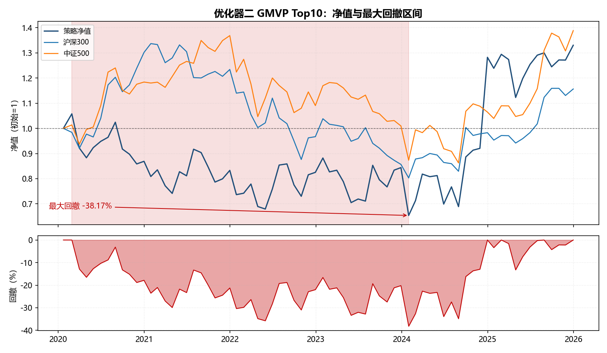

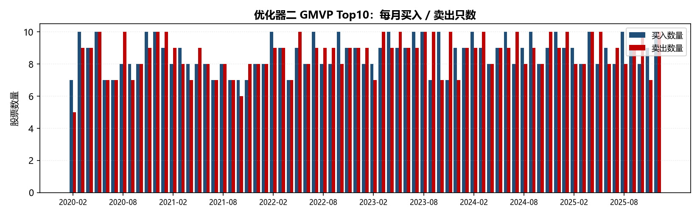

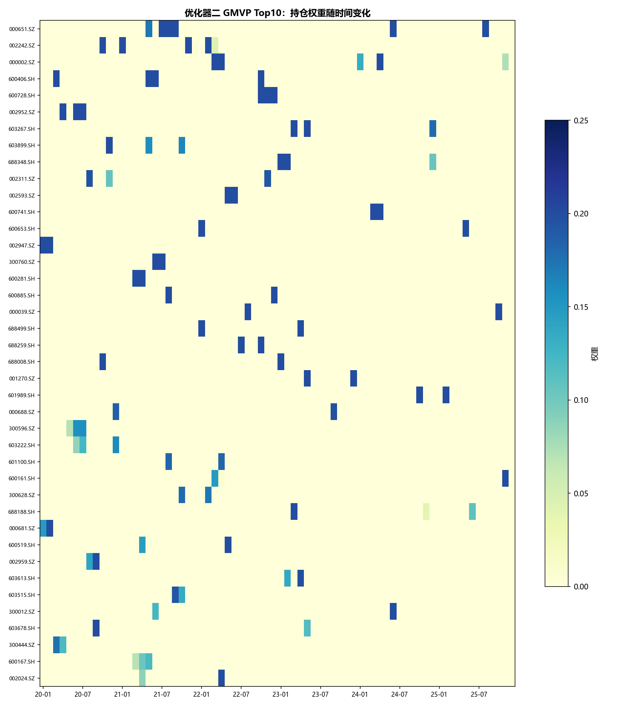

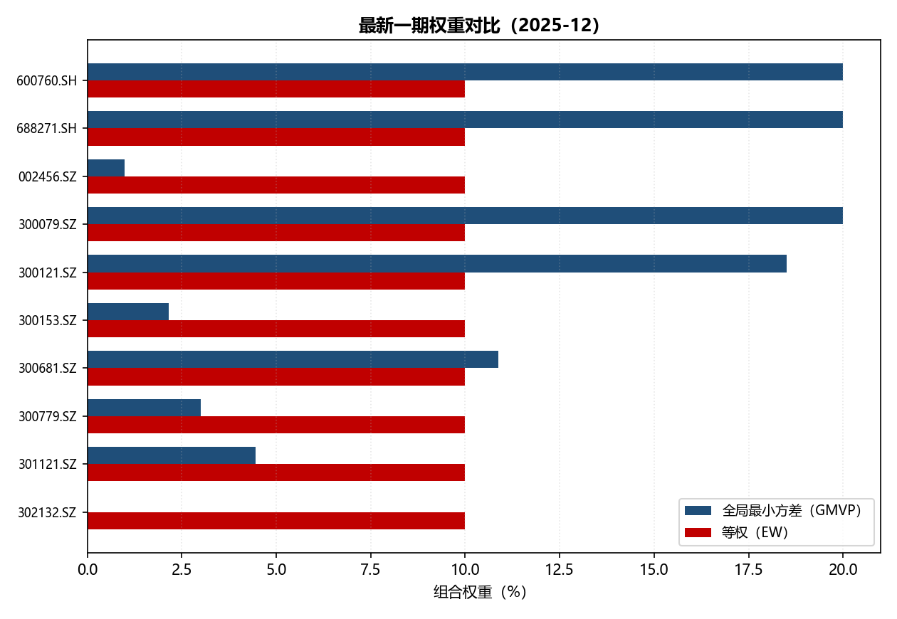

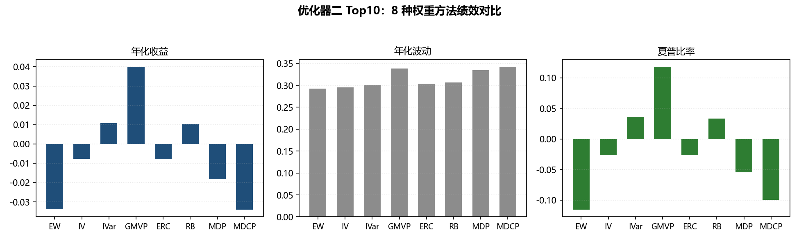

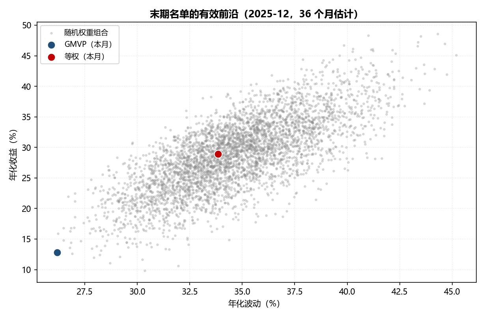

三点读图提示：

1. 最大回撤区间落在 2021-02 至 2024-01，净值从 1.02 一路磨到 0.82，这段是策略最脆弱的长区间；2024 年后净值抬升到 1.65。
2. `weights_latest.png` 里 `302132.SZ` 的 GMVP 权重为 0、等权为 10%，直观显示最小方差会把高波动股票清零；同时三只票顶到 20% 上限。
3. `efficient_frontier.png` 中 GMVP 落在随机组合散点的左下边缘，等权在中部——这是“最小方差”定义本身的直观验证，但不代表样本外一定更优。

**基准口径说明**：`data/benchmark.csv` 实际是中证 500（sh.000905，2015-01-05 收盘 5417、2020-12-31 收盘 6367），此前的图和文档曾误写为沪深 300。现按报告与仓库口径，**以 `data/csi300_daily.csv` 的真实沪深 300（sh.000300）为主基准**，中证 500 保留为对照基准：策略净值图与所有 `nav.png` 只画沪深 300，`nav_drawdown.png` 与下表并列两条基准。

| 组合 | 累计收益 | 年化收益 | 年化波动 | 夏普 | 最大回撤 |
| --- | ---: | ---: | ---: | ---: | ---: |
| 策略（GMVP Top10） | +65.05% | 8.71% | 32.63% | 0.267 | -28.69% |
| 沪深300（主） | +15.64% | 2.45% | 18.24% | 0.134 | -39.92% |
| 中证500（对照） | +38.82% | 5.62% | 20.55% | 0.273 | -36.96% |

分年度收益（%）：

| 年份 | 策略 | 沪深300 | 中证500 |
| --- | ---: | ---: | ---: |
| 2020（自 1 月末起） | -1.21 | 30.16 | 18.40 |
| 2021 | 4.64 | -5.20 | 15.58 |
| 2022 | -0.94 | -21.63 | -20.31 |
| 2023 | 2.28 | -11.38 | -7.42 |
| 2024 | 51.91 | 14.68 | 5.46 |
| 2025 | 3.73 | 17.66 | 30.39 |

**必须说明的集中度问题**：2024-12 单月收益 +39.28%，其中 `000759.SZ`（中百集团）权重 20%、当月上涨 215.94%，单项贡献 43.19pp。**剔除这一只股票当月的贡献后，全期累计从 +65.05% 降到约 +13.8%，年化约 2.2%，夏普约 0.10**。也就是说，相对两个基准的超额几乎全部来自一次个股事件（2024 年 12 月的商业零售行情），不能当作可重复的策略能力；同时说明 Top10 加 20% 单票上限的结构对个股黑天鹅的双向敏感度都很高。

## 6. 回测设定

### 6.1 交易成本

单边费率 0.002，只在净值核算阶段扣除：

$$
C_t = 0.002 \times TO_t
$$

### 6.2 持仓漂移

两次调仓之间不交易，权重随价格自然漂移。下一期交易前的权重为：

$$
w^-_{i,t} = \frac{w_{i,t-1}(1 + r_{i,t})}{1 + \sum_j w_{j,t-1} r_{j,t}}
$$

交易量与单边换手率按漂移后权重计算，而不是直接相减两期目标权重：

$$
\Delta w_{i,t} = w^*_{i,t} - w^-_{i,t}, \qquad
TO_t = \frac{1}{2}\sum_i |\Delta w_{i,t}|
$$

首次建仓 w^- = 0，按整仓计成本。若直接用上期目标权重相减，会把这部分被动权重变化误算成主动交易，换手率与成本都会虚高。

### 6.3 基准

主基准为沪深 300 价格指数，对照基准为中证 500 价格指数，均不含分红再投；个股使用后复权收益，含分红再投。这属于偏保守的口径，超额收益不会被高估。

### 6.4 换因子与换股时点

每月最后一个交易日为调仓日，其中每年首个调仓日额外执行因子重训：

| 时点 | 动作 |
| --- | --- |
| 每年首个调仓日（2020-01、2021-01 … 2025-01） | 先用过去 5 年重训因子集合与权重，再算当期分数，再换股 |
| 其余月末 | 沿用当年因子集合与权重，只重算分数、换股 |
| 每个调仓日 | 按 6.2 节漂移后权重结算换手与成本 |

执行顺序固定为：重训因子 → 计算当期因子值 → 合成 S_i → 选股 → 配置权重 → 结算成本。重训只用调仓日之前的数据，不允许使用当期及之后的行情。

## 7. 收益归因

每个月末用因子标准化暴露对下一月个股收益做横截面回归：

$$
r_{i,t+1} = α_t + \sum_k β_{k,t} f_{i,k,t} + ε_{i,t}
$$

用持仓权重加权得到组合暴露，再把组合月收益拆成截距项、各因子贡献与残差：

$$
r^p_{t+1} = α_t + \sum_k \left(\sum_i w_{i,t} f_{i,k,t}\right)β_{k,t} + \sum_i w_{i,t}ε_{i,t}
$$

全样本汇总各部分的均值与累计值，判断超额收益主要来自哪些因子、残差占比是否过高。

### 7.1 优化器二 GMVP Top10 归因结果（2020–2025）

71 期，平均持股 8.5 只，逐期拆分误差上限 5.55e-17，权重覆盖率 100%，组合毛收益（月度算术累加）累计 +93.45%。

| 项目 | 累计贡献 | 累计占比 | t 值 |
| --- | ---: | ---: | ---: |
| 截距 | +69.31% | 74.2% | 1.28 |
| 因子合计 | +63.14% | 67.6% | — |
| 残差 | -39.01% | -41.7% | -0.58 |

主要正贡献：Alpha12 +19.80%（t=3.87）、Alpha20 +12.49%（t=1.54）、Alpha13 +11.07%（t=6.60）、wgt_return_1m +10.60%（t=2.87）、volatility_6m +7.62%（t=0.95）、return_1m +6.09%（t=1.73）、wgt_return_6m +4.00%（t=2.25）。主要负贡献：Alpha26 -6.73%（t=-3.16）、Alpha16 -5.68%（t=-1.32）、Alpha23 -4.09%（t=-1.22）、Alpha35 -3.27%（t=-2.00）。

解读：

1. 截距仍占 74.2%，但 t 值仅 1.28，不显著——组合收益的大部分无法由“买入并持有的因子暴露”解释，来自名单选择与 GMVP 权重结构本身。
2. 因子合计 +63.14%，与截距同量级，说明因子暴露确实贡献了收益；相比等权 Top100（因子合计 +51.48%），GMVP 权重放大了有效因子的暴露，Alpha12 从 +14.98% 升到 +19.80%，Alpha13 从 +10.15% 升到 +11.07%。
3. 残差从 -56.51%（t=-3.69，显著为负）收窄到 -39.01%（t=-0.58，不显著），说明压低高波动股票权重后，特异性波动的拖累明显下降，回归模型对组合的解释力改善。
4. 截距主导的结构没有改变：收益仍主要落在因子之外，归因只能说明“钱被谁赚走了”，不能证明因子模型具备稳定的样本外预测力。

明细见 `results/attribution/monthly_attribution.csv` 与 `summary.csv`。

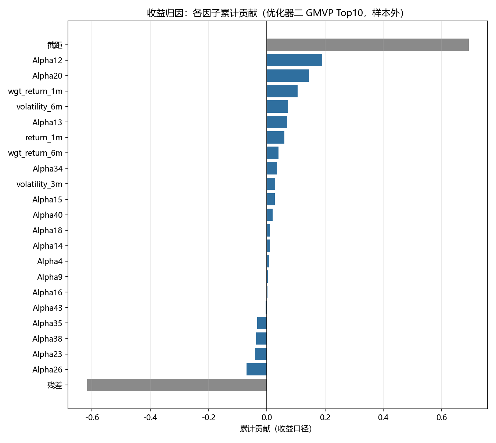

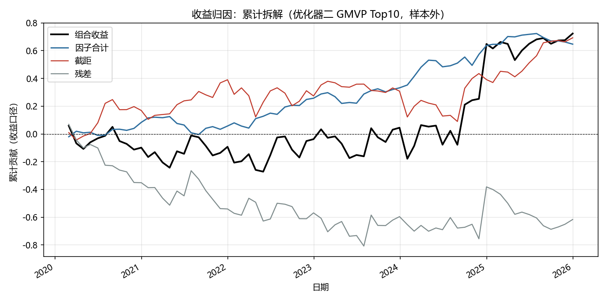

**因子暴露（`exposure_heatmap.png`）**

组合对某因子的暴露 = 持仓权重加权的截面标准化因子值，正数表示超配高因子值股票，负数表示超配低因子值股票；灰格表示该年未入选，不是零暴露。

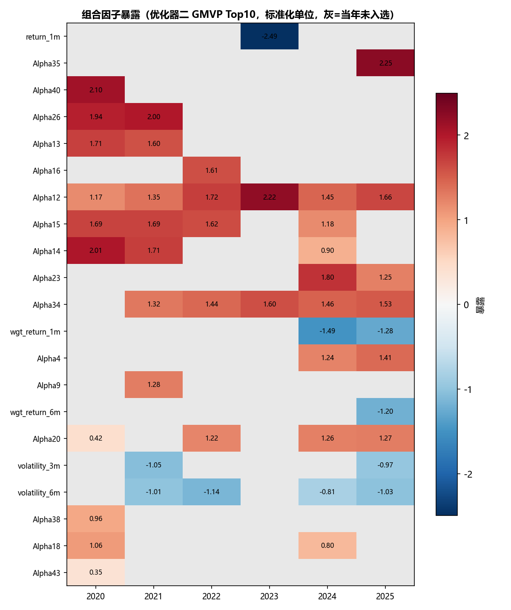

四点读图结论：

1. **整体画像是“低波动 + 前期跌得多”**。`volatility_6m` 在 2021/2022/2024/2025 的暴露为 -1.00、-1.14、-0.81、-1.03，`volatility_3m` 为 -1.06、-0.97；`return_1m` 在 2023 年 -2.49。组合系统性超配低波动、且近期跌幅大的股票，这与 §7.2 里这几个因子 IC 为负、方向被反转使用一致。
2. **`Alpha12` 与 `Alpha34` 是唯一的稳定正暴露**。`Alpha12` 从 1.03 升到 2.22 再回落到 1.66，`Alpha34` 稳定在 1.06–1.60；两者是六年全部入选的因子，也是正贡献的主要来源。
3. **暴露随因子集大幅切换**。2020、2022 年各 6 个因子，2021 年 9 个，2023 年只剩 3 个（`Alpha12`、`Alpha34`、`return_1m`），2024/2025 各 10 个。因子集逐年重选，暴露结构也随之整体重排，2023 年整行空白正是降级到 K=3 的结果。
4. **暴露量级 1–2.2 个标准差，集中度很高**。这意味着组合相对全市场在若干维度上偏离两个标准差以上，与 Top10 的窄持仓一致，也解释了单票事件为何能左右净值（见 5.4 的 000759 说明）。

### 7.2 因子 IC 对比（2020–2025）

因子是每个月都在算的数据字段，不存在“只属于某一年的因子”；逐年变化的只是优化器一选中哪些因子、方向和权重。因此 IC 在样本外全区间连续计算（72 期，IC 记在 t+1），再用年份底纹标注该因子在哪些年份被选中。

入选因子并集 20 个，按 |ICIR| 排序的前 8：

| 因子 | 平均 IC | ICIR | IC>0 占比 | 入选年份 |
| --- | ---: | ---: | ---: | --- |
| volatility_3m | -5.13% | -0.67 | 23.6% | 2021 / 2025 |
| Alpha12 | +3.41% | +0.61 | 73.6% | 2020–2025 全部 |
| wgt_return_1m | -5.43% | -0.55 | 30.6% | 2024 / 2025 |
| Alpha20 | +4.96% | +0.52 | 58.3% | 2020 / 2022 / 2024 / 2025 |
| return_1m | -5.49% | -0.52 | 33.3% | 2023 |
| volatility_6m | -5.09% | -0.50 | 33.3% | 2021 / 2022 / 2024 / 2025 |
| Alpha4 | +5.61% | +0.49 | 68.1% | 2024 / 2025 |
| Alpha34 | +3.86% | +0.43 | 61.1% | 2020–2025 全部 |

解读：

1. **方向分化符合 A 股经验**：Alpha 系列平均 IC 为正，需要正暴露；`volatility_3m/6m`、`wgt_return_1m/6m`、`return_1m` 平均 IC 为负，说明低波动、低换手、短期反转有效，优化器给出的方向为 -1。
2. **只有 Alpha12 与 Alpha34 六年全入选**，是模型的稳定骨架；`Alpha13`、`Alpha40`、`Alpha43` 只在 2020 年入选，`Alpha16` 只在 2021–2022 年入选。`Alpha13` 与 `Alpha16` 在 2023 年平均 IC 均转负（-1.6% / -1.7%），此后基本被排除在因子集之外。
3. **IC 与归因互相印证**：Alpha12 的累计 IC 单调上升，在 7.1 中也是最大正贡献（+19.80%）；`wgt_return_1m` 平均 IC 最负且持续走负，对应归因中 +10.60% 的正贡献（方向为 -1）。
4. **2024 年是 IC 大年**：Alpha4 当年平均 IC 达 +8.2%，`volatility_3m` 达 -8.9%，与 2024 年单年 +51.9% 的收益一致；这也说明收益集中度问题在因子层面同样存在。
5. **明确弱点**：`Alpha26` 平均 IC ≈ 0（-0.05%）、|ICIR| 仅 0.009，却在 2020 / 2021 年被选中，说明当年在 ICIR 与非共线约束下可用因子不足，优化器只能“矮子里拔将军”。

图与表见 `results/factor_ic/`：`factor_ic_grid.png`（20 个入选因子的单期 IC + 平均 IC + 累计 IC 小图矩阵）、`factor_ic_yearly_heatmap.png`（因子 × 年份 平均 IC）、`ic_panels_top3.png`（|ICIR| 前三因子的 Rank / Pearson 双联图，版式对齐课件）、`factor_ic_summary.csv`（全部统计）。

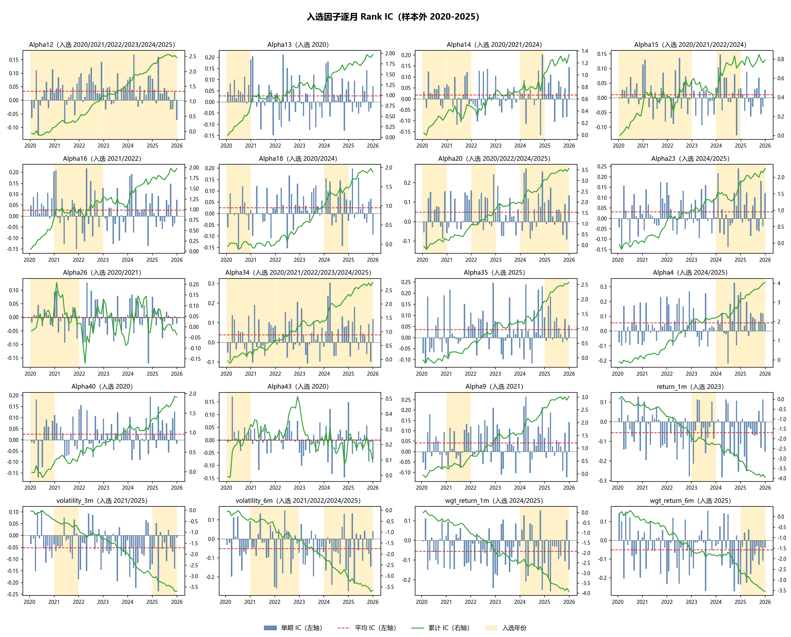

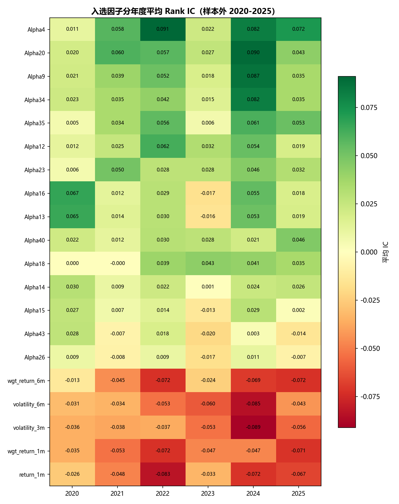

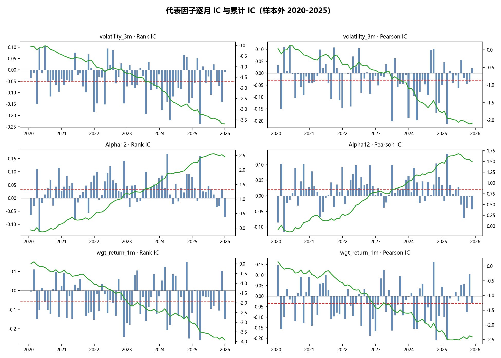

## 8. 对照实验

所有对照组与主策略保持相同股票池、相同费率、相同调仓规则与相同基准。

1. 单因子基线：38 个量价因子按 |ICIR| 降级规则筛选后等权合成，Top 10 等权持有；
2. 静态多因子：固定因子池 + ICIR 加权；
3. 滚动多因子：按年重新筛选因子与权重（已实现，见 `results/rolling/`）；
4. 资金配置对比：八种方法两两比较，以及与等权基线比较；
5. Fama-French 三因子：在可交易池内按总市值与 B/M 做 2×3 独立双重排序，构造 MKT、SMB、HML，检验策略超额是否只是风格暴露。

### 8.1 三因子构造

每个月末 $t$，在可交易池内执行：

- 规模：总市值高于/低于中位数，分 Small、Big；
- 价值：$B/M=1/PB$，按 30%/40%/30% 分 Low、Neutral、High；
- 六个组合按 $t$ 月末总市值加权，持有 $t+1$ 月收益。

$$
\begin{aligned}
SMB_t &= \frac{1}{3}\left(R^{SL}_t+R^{SN}_t+R^{SH}_t\right)
        -\frac{1}{3}\left(R^{BL}_t+R^{BN}_t+R^{BH}_t\right),\\
HML_t &= \frac{1}{2}\left(R^{SH}_t+R^{BH}_t\right)
        -\frac{1}{2}\left(R^{SL}_t+R^{BL}_t\right),\\
MKT_t &= R^{VW}_t-R^f_t,
\end{aligned}
$$

其中 $R^{VW}_t$ 为可交易池市值加权收益，$R^f_t$ 按年化 2% 折算为月度复利。PB 与总市值复用同一套 Baostock ETL 的本地宽表（2015–2025），与行情数据同源同口径；为避免重复逐股下载触发限流，未重新拉取。

回归方程：

$$
R^p_t-R^f_t=\alpha+\beta_{MKT}MKT_t+\beta_{SMB}SMB_t+\beta_{HML}HML_t+\varepsilon_t
$$

### 8.2 回归结果（2020–2025，72 期）

三因子年化均值分别为 MKT +6.25%、SMB +5.24%、HML +6.56%，但 t 值均小于 1，说明 2020–2025 年三因子溢价整体偏弱。

| 组合 | 年化 alpha | alpha t 值 | MKT | SMB | HML | R² |
| --- | ---: | ---: | ---: | ---: | ---: | ---: |
| 优化器二 GMVP Top10 | -0.61% | -0.06 | 0.913*** | 0.532** | 0.029 | 0.298 |
| 优化器一 Top100 | -3.00% | -0.85 | 1.202*** | 0.553*** | -0.074 | 0.886 |
| S7 Top100 | -1.80% | -0.60 | 1.091*** | 0.571*** | -0.059 | 0.906 |
| 沪深300 | -3.74% | -2.43** | 1.103*** | -0.279*** | 0.042 | 0.960 |
| 中证500 | -1.21% | -0.54 | 1.112*** | 0.136** | -0.115** | 0.918 |

注：***、**、* 分别表示 1%、5%、10% 显著性；标准误采用 Newey-West（3 阶）。

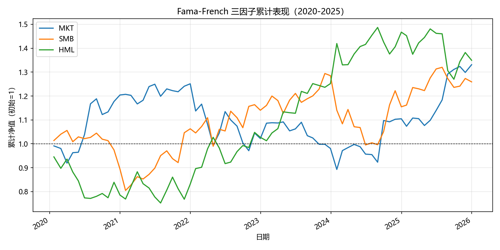

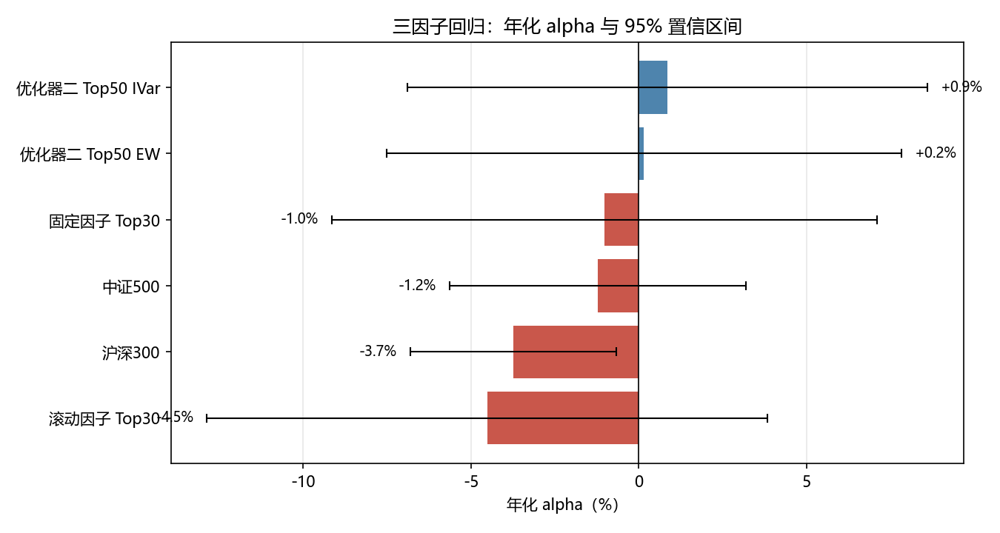

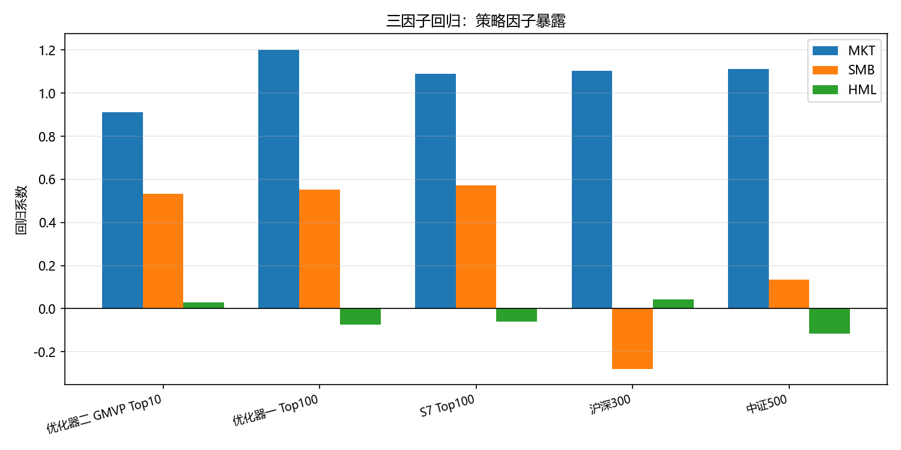

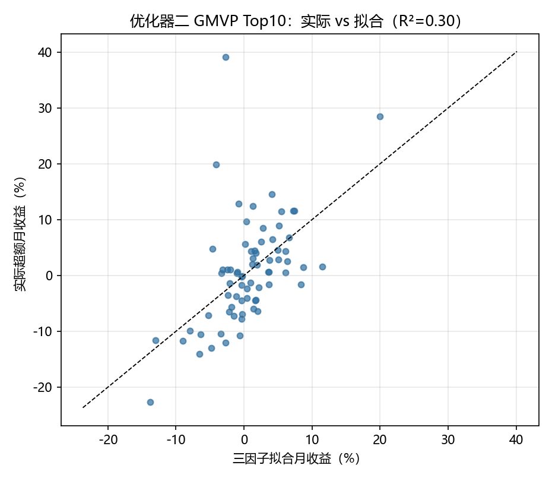

### 8.3 解读

1. **策略没有显著 alpha**。三个策略组合的年化 alpha 分别为 -0.61%、-3.00%、-1.80%，t 值绝对值都小于 1；扣除市场、规模、价值暴露后，剩余收益与 0 无法区分。
2. **收益主要来自市场 beta 与小盘暴露**。GMVP Top10 的 MKT 为 0.913、SMB 为 0.532，HML 仅 0.029；Top100 的 MKT 升到 1.09–1.20、SMB 仍在 0.55 左右。量价多头本质上是“高 beta + 小盘”组合，价值暴露可以忽略。
3. **集中度决定 R²**。Top100 的 R² 为 0.89–0.91，风格几乎解释了全部收益波动；GMVP Top10 的 R² 只有 0.298，约 70% 是特异性波动。Top10 的收益弹性更大，但单票事件与风格切换会直接放大回撤。
4. **沪深300 的负 alpha 是市场因子口径造成的**。MKT 由可交易全池市值加权，天然偏小盘，沪深300 的 SMB 暴露为 -0.279，因此相对该 MKT 呈现 -3.74% 的显著负 alpha。这说明 alpha 的定义依赖市场因子；答辩时应把“相对沪深300的超额”与“FF3 风格调整后的 alpha”分开表述。
5. **与 11.2 的多空诊断一致**。因子 alpha 主要集中在空头端，纯多头组合只能赚到市场与小盘风格，难以获得独立于风格的选股收益。S7 Top100 的 +50.10% 是真实收益，但在 FF3 口径下 alpha 为 -1.80%，主要不是 alpha。

## 9. 数据口径与已知限制

1. **基准不含分红**：Baostock 只能取中证 500 / 沪深 300 价格指数，全收益指数返回空。基准不含分红、个股含分红，超额偏保守。
2. **幸存者偏差**：Baostock 对已退市股票的日线接口返回空，2015–2025 年退市的约 241 只股票无法补齐，回测股票池实际为在市股，收益会略偏乐观。
3. **行业分类是当期快照**：没有历史行业变更，早期年份的行业中性化存在轻微偏差。
4. **股本为季度快照**：`totalShare` / `liqaShare` 按季度更新，能反映送转股，但无法精确到日。
5. **不含北交所**：Baostock 不支持北交所，本文的「全 A」指沪市 + 深市。
6. **指数成分股权重缺失**：基准相对优化中的 w^b 用可交易股票池等权近似，后续可替换为真实成分股权重。

## 10. 当前进度

| 模块 | 状态 |
| --- | --- |
| 数据下载与宽表转换 | 完成，沪深共 5368 只（月末平均可交易 3783 只） |
| 后复权价格、月频面板、股票池 | 完成 |
| 38 个量价因子 | 完成 |
| 单因子检验（IC、分组、多空） | 完成，多空诊断见 `results/baseline/longshort.csv` |
| 单因子基线回测 | 完成，结果见 `results/baseline/` |
| 月频换股机制（月末重排 Top N、等权） | 完成；基线 Top 10，S7 对照 Top 10 / 50 / 100 |
| 年频换因子机制（5 年训练窗、1 年滚动） | 完成，见 `results/rolling/` |
| 优化器一：因子筛选与加权 | 完成：严格门控 + 启发式搜索 + λ 收缩，见 `results/optimizer1/`；S7 保留为对照 |
| S7 滚动样本外验证 | 完成，见 `results/rolling_top/` |
| 优化器二：八种资金权重配置 | 完成，见 5.3 与 `results/optimizer2/` |
| 收益归因 | 完成：优化器二 GMVP Top10 归因见 7.1 与 `results/attribution/` |
| Fama-French 三因子对比 | 完成：可交易池内 2×3 双重排序，回归见 8.2 与 `results/ff3/` |
| 因子池重筛（WorldQuant 单池 + IC/ICIR 排序 + 重叠度审计） | 完成，见 13.1 与 `results/rescreen/` |
| 优化器一 4–5 因子版本（Top30） | 完成，见 13.2–13.3 与 `results/optimizer1_wq03/` |
| 七宗罪逐条审计 | 完成，见 13.4 与 `results/audit/` |
| 回撤多方法检验（指标 + 随机回测 + 压力情景） | 完成，见 13.6 与 `results/audit/drawdown/` |

基线结果说明：38 个因子中 25 个多空年化为正且 t>2，多空年化中位数 7.6%，信号本身有效；但只做多、每期 10 只等权的组合在全区间累计 -28.62%、年化 -3.04%，跑输沪深 300 的 +32.54%。多空有效而多头无效，说明瓶颈在只做多结构、持仓集中度与换手，而不是因子方向。此外，加入 ADV 20% 分位与上市满 120 个交易日的约束后，此前依赖低流动性小盘股的超额不再出现，说明原结果不可按容量复制。

## 11. 归因与优化实验

### 11.1 收益转负归因：容量过滤 × 口径统一 2×2 对照

此前同时加入两项修改后基线由 +91.13% 转为 -28.62%。为区分主因，在同一份数据上跑 2×2 对照（`baseline/ablation_attribution.py`），旧版配置精确复现 +91.13%，实验可信：

| 配置 | 容量过滤 | IC 口径 | 累计收益 | 年化 | 夏普 | 最大回撤 |
| --- | --- | --- | ---: | ---: | ---: | ---: |
| A 当前 | 开 | 统一 | -28.62% | -3.04% | -0.090 | -70.58% |
| C | 开 | 分裂 | +0.04% | +0.00% | 0.000 | -57.84% |
| B | 关 | 统一 | +116.52% | +7.33% | 0.200 | -49.11% |
| D 旧版 | 关 | 分裂 | +91.13% | +6.11% | 0.169 | -48.34% |

固定口径切换容量过滤，收益降幅 91–145 个百分点；固定容量切换口径，仅 ±25–29 个百分点。**结论：容量过滤（ADV 20% 分位 + 上市满 120 日）是收益转负的绝对主因**，口径统一是二阶影响。旧版 +91.13% 的超额几乎全部来自低流动性小盘与次新股，这些标的在真实交易中受涨跌停、停牌与冲击成本限制，纸面收益无法兑现。

### 11.2 优化器一部分实现：多头门控 + 多头 t 加权（S7）

在可交易池内比较筛选与加权规则（`baseline/optimizer_factor_selection.py`）。S0–S6 是筛选规则对照，**S7 只是新增的实验编号，定义是“S4 的纯多头门控因子集合 + 多头 t 加权”**，不是一个通用数值优化软件，也不是第七代完整优化器。

诊断显示 top-20 因子多空年化全为正、t 全大于 2，因此 S1–S3 的多空门控没有进一步删掉因子；但多头端年化超额仅 0.8%–4.7%，远低于多空端 6%–16.5%，说明不少因子的收益更依赖空头腿。只做多策略应直接考察多头端，因此 S7 不再要求多空显著，而使用：

$$
|\mathrm{ICIR}_k|\geq0.2,
\qquad
\mathrm{Ann}\left(R^L_k\right)>0,
\qquad
t^L_k\geq1
$$

上述统计量的样本范围取决于实现：静态扫描使用全样本，因此属于样本内对照；滚动版每年只使用过去 5 年的数据。两种实现的因子权重都使用 4.6 节的 ω_k^S7，最多保留 20 个。静态扫描按 |ICIR| 截断，且多头 t 条件写为 >1；滚动版按多头 t 值排序截断，门控写为 ≥1，另有不足 3 个因子时按多头 t 取前 3 个的兜底规则。

配置 × 持仓数对照（全样本内，累计收益 / 夏普）：

| 配置 | Top 10 | Top 20 | Top 50 | Top 100 |
| --- | --- | --- | --- | --- |
| S0 等权（基础 ICIR 筛选） | -28.6% / -0.09 | -6.8% / -0.02 | +39.8% / 0.10 | +51.7% / 0.13 |
| S3 ICIR 加权 | -5.5% / -0.02 | +16.0% / 0.04 | +57.4% / 0.14 | +82.8% / 0.20 |
| S4 纯多头等权 | -2.9% / -0.01 | -2.0% / -0.01 | +51.4% / 0.13 | +58.0% / 0.15 |
| S7 纯多头 t 加权 | +35.2% / 0.08 | +62.1% / 0.14 | +71.1% / 0.17 | +88.5% / 0.21 |

三个改善来源可分离：**分散化**贡献最大（S0 仅增加持仓即转正），**多头 t 加权**次之（各持仓数下均优于等权），**多头门控**再次（各持仓数下均为正贡献）。

### 11.3 S7 滚动样本外验证（2020–2025）

S7 规则接入滚动框架（`baseline/rolling_top_weighted.py`）：每年仅用过去 5 年定方向、算多头 t、做门控与权重，年内固定，样本外共 72 期。

这里有两个完全独立的维度：

- **滚动（rolling）**：每年重新确定因子集合、方向与权重，每月沿用当年规则重新选股；
- **Top 50 / Top 100**：使用同一份 S7 合成分数，分别持有得分最高的 50 只或 100 只股票，等权权重分别为 1/50 与 1/100。它们不是“50 / 100 个因子”，也不是两个不同的优化器。

因此下表只改变持股数 N，用于检验分散化敏感性；Top 100 是当前展示配置，不应表述为事先锁定的最优参数或独立样本外证明。

| 配置 | 累计收益 | 年化 | 夏普 | 最大回撤 | 换手 |
| --- | ---: | ---: | ---: | ---: | ---: |
| 原 rolling（ICIR 加权 Top 10） | -6.40% | -1.11% | -0.04 | -41.31% | 10.68 |
| S7 rolling Top 10 | +14.66% | +2.33% | 0.09 | -53.16% | 10.60 |
| S7 rolling Top 50 | +34.29% | +5.09% | 0.21 | -47.62% | 9.65 |
| S7 rolling Top 100 | +50.10% | +7.08% | 0.31 | -40.53% | 9.07 |
| 沪深 300（同区间） | +15.64% | +2.45% | 0.13 | -39.92% | — |
| 中证 500（同区间） | +38.82% | +5.68% | 0.27 | -36.96% | — |

样本外 S7 Top 100 跑赢基准（+50.10% vs 沪深300 +15.64%，夏普 0.31 vs 0.13）。门控随市况收缩因子数：2020 年 20 个 → 2022 年 9 个 → 2024 年 7 个 → 2025 年 5 个，稳定留存的核心因子为 `turnover_std_3m`、`Alpha20`、`Alpha34`、`amihud_3m`、`Alpha4`，与全样本诊断中多头端最强的因子一致。

必须如实标注的两点：

1. **超额收益高度集中在 2025 年**：2020–2024 策略整体跑输基准，反超主要靠 2025 下半年的拉升，并非稳定持续跑赢（净值图见 `results/rolling_top/top100/nav.png`）。
2. **2024 年初小盘流动性危机回撤深**：量价因子天然偏小盘，2024 年 2 月微盘股危机时最大回撤 -40.53%，深于沪深 300 的 -39.92%，是策略最脆弱的场景。

### 11.4 阶段性结论

纯量价多头策略在不做容量与结构优化时，超额来自不可交易的低流动性股票；在可交易池内，通过**多头门控 + 多头 t 加权 + 分散化（Top 100）**，样本外可跑赢沪深 300，但超额集中于 2025 年、小盘危机期回撤深。优化器一的完整启发式搜索、λ 权重收缩见 4.3–4.7 与 4.10，优化器二八种资金配置见 5.3。

## 12. 答辩用结论清单

本节汇总当前代码可复现的最终口径，数字以 `results/ff3/`、`results/optimizer2/`、`results/rolling_top/` 下的最新 CSV 为准，供期末报告与答辩 PPT 直接引用。

> 口径提示：2026-11 修订后主配置已改为 Top30（第 13 节），12.1 的 Top10 表保留为上一版对照。对外介绍请以 13.3 的新结果为准。

### 12.1 主结果一览（2020–2025 样本外）

| 组合 | 累计收益 | 年化 | 年化波动 | 夏普 | 最大回撤 | FF3 alpha（年化） | R² |
| --- | ---: | ---: | ---: | ---: | ---: | ---: | ---: |
| 优化器二 GMVP Top10（主策略） | +33.01% | 4.92% | 32.93% | 0.149 | -38.17% | -0.61% | 0.298 |
| 优化器一 Top100 | +40.00% | 5.83% | 24.76% | 0.235 | -44.47% | -3.00% | 0.886 |
| S7 Top100 | +50.10% | 7.08% | 22.75% | 0.311 | -40.53% | -1.80% | 0.906 |
| 沪深300 | +15.64% | 2.45% | 18.37% | 0.133 | -39.92% | -3.74% | 0.960 |
| 中证500 | +38.82% | 5.68% | 20.69% | 0.275 | -36.96% | -1.21% | 0.918 |

### 12.2 关键结论

1. **主策略跑赢基准，但风险调整后优势有限**。GMVP Top10 累计 +33.01%，高于沪深300 的 +15.64%；夏普 0.149 仅略高于基准的 0.133。S7 Top100 的夏普 0.311 明显更好，说明在可交易池内“适度分散”比“集中 Top10 + 优化权重”更有效。
2. **策略没有显著 alpha，收益主要是风格**。FF3 回归中三个策略的年化 alpha 分别为 -0.61%、-3.00%、-1.80%，t 值绝对值都小于 1；MKT 暴露 0.91–1.20、SMB 暴露 0.53–0.57、HML 接近 0。量价多头本质上是“高 beta + 小盘”组合。
3. **集中度决定收益的解释力**。Top100 的 R² 为 0.89–0.91，风格几乎解释全部波动；GMVP Top10 的 R² 仅 0.298，约 70% 是特异性波动。Top10 的收益弹性更大，但单票事件与风格切换会直接放大回撤（2024 年 2 月微盘危机）。
4. **容量过滤是收益转负的绝对主因**。2×2 对照显示，旧版 +91.13% 在加入 ADV 20% 分位 + 上市满 120 日后降到 -28.62%，收益差 91–145pp；旧收益几乎全部来自不可交易的低流动性小盘与次新股，属于纸面收益。
5. **因子 alpha 主要集中在空头端**。多头年化超额只有 0.8%–4.7%，多空年化为 6%–16.5%；只做多 Top10 的结构难以捕捉空头端的因子收益，这是策略 alpha 不显著的直接原因。
6. **市场中性分支不经济**。以 60 个月窗口的 GMVP Top10 做可行性测算：不对冲累计 +53.04%、波动 34.82%、夏普 0.255；沪深300 零基差对冲后累计 +29.49%、波动 31.97%、夏普 0.166；按 4% 年化基差则累计只剩 +5.99%、夏普 0.037，中证500 对冲为负。对冲只压掉约 16% 的方差（31.97²/34.82²≈84% 仍是特异性波动），收益却被基差吞噬。
7. **GMVP 对协方差窗口高度敏感**。24 个月累计 +0.35%、36 个月 +33.00%、60 个月 +58.40%，跨度约 58pp；24 个月窗口样本不足、噪声主导，36 个月是先验设定而非择优结果。答辩时应主动说明这一敏感性，不能把 +33.01% 当作唯一可信数字。
8. **不存在全局最优的权重方法**。Top10 内 GMVP 最好（+33.00% vs 等权 -8.16%，回撤 -38.17% vs -49.57%）；但 8 种方法 × 3 种持股数共 24 组中，Top100 的 IVar 累计最高（+47.64%）。“最优方法”取决于持股数与风险目标，风险配置的价值随持仓集中度上升而上升。
9. **数据限制需如实说明**：幸存者偏差（退市股无法补齐）、基准不含分红、行业分类为当期快照、股本为季度快照。

### 12.3 答辩 PPT 建议结构

| 页 | 内容 | 关键图表/数字 |
| --- | --- | --- |
| 1 | 研究问题与数据 | 5368 只股票、2015–2025、月末可交易约 3783 只 |
| 2 | 因子体系与预处理 | 38 个量价因子、MAD 去极值 → 行业中性 → Z-score |
| 3 | 因子检验 | IC/ICIR、5 分组多空、多空年化中位数 7.6% |
| 4 | 基线结果与容量陷阱 | +91.13% → -28.62%，容量过滤 2×2 对照 |
| 5 | 优化器一：因子筛选 | 严格门控 + 启发式搜索 + λ 收缩 |
| 6 | 优化器二：八种权重 | GMVP Top10 +33.01%，回撤 -38.17% |
| 7 | 主策略净值与分年 | 净值/回撤图、2024 微盘危机、2025 集中收益 |
| 8 | 收益归因 | 截距、因子贡献、残差三分法 |
| 9 | FF3 回归 | alpha 不显著、MKT/SMB 主导、R² 0.30 vs 0.91 |
| 10 | 费率与容量敏感性 | 单边千二、换手约 11 倍、容量前置筛选 |
| 11 | 局限与改进 | 空头端 alpha、Top10 特异性风险、数据限制 |
| 12 | 结论 | 风格收益 ≠ alpha；分散化优先于集中优化 |

## 13. 2026-11 修订：WorldQuant 单池、Top30 与七宗罪审计

### 13.1 修订动机与因子池重筛

上一版主策略（全池 38 因子 → Top10 GMVP）的核心问题：样本外年化 4.92%、夏普 0.149、最大回撤 -38.17%，FF3 alpha 不显著；38 个因子里混入了大量高度相关的动量/反转变体，合成信号被重复计数、权重被稀释。按导师建议，主池改为**只用 WorldQuant Alpha101 的 21 个已实现因子**，华泰 12 个与量价扩展 5 个暂时退出主池。

理由不是华泰因子无效，而是重叠（`results/rescreen/factor_corr.csv`、`high_corr_pairs.csv`、`factor_corr_heatmap.png`）：

- 没有任何一对因子的公式完全相同；
- 华泰内部 `return_Nm` 与 `wgt_return_Nm` / `exp_wgt_return_Nm` 的平均截面相关达 0.87–0.98，`return_12m` 与 `HAlpha` 为 0.90；
- 跨池 `return_1m` 与 `Alpha9` 为 -0.80，`return_6m` 与 `Alpha4` 为 -0.78，`return_3m` 与 `Alpha4` 为 -0.73；
- WQ 内部 `Alpha13`/`Alpha16` 为 0.986，`Alpha101`/`Alpha33` 为 -0.90，`Alpha9`/`Alpha20` 为 0.84，`Alpha6`/`Alpha14` 为 0.78。

把华泰加回池子，主要是把同一组动量/反转信号再计一次，不会带来新的 alpha 维度；因此主池只用 WQ，华泰留作外部稳健性对照。

**IC 口径**。导师说的“IC 大于 0.5”在月频 RankIC 上不可直接执行：本项目单因子平均 IC 只有 0.02–0.08，|IC| = 0.5 接近完美排序，现实中不存在。可执行的口径是 ICIR = 平均 IC / IC 标准差，衡量方向稳定性，量级与 0.5 可比。因此把 0.5 解释为 **|ICIR| ≥ 0.5**。

21 个 WQ 因子的全样本 IC/ICIR（按 |ICIR| 排序，完整表见 `results/rescreen/factor_ic.csv`）：

| 因子 | 平均 IC | ICIR |
| --- | ---: | ---: |
| `Alpha20` | 0.0532 | 0.553 |
| `Alpha12` | 0.0301 | 0.529 |
| `Alpha9` | 0.0463 | 0.518 |
| `Alpha13` | 0.0357 | 0.478 |
| `Alpha34` | 0.0405 | 0.468 |
| `Alpha16` | 0.0363 | 0.464 |
| `Alpha4` | 0.0522 | 0.440 |
| `Alpha14` | 0.0268 | 0.403 |
| `Alpha18` | 0.0300 | 0.393 |
| `Alpha40` | 0.0254 | 0.370 |
| `Alpha15` | 0.0180 | 0.329 |
| `Alpha6` | 0.0185 | 0.296 |

严格 |ICIR| ≥ 0.5 只剩 `Alpha20` / `Alpha12` / `Alpha9` 三个；在 2022–2025 的滚动训练窗内，部分年份只有 1–2 个因子达标，组合会退化成单因子押注。实测（`results/optimizer1_wq/`）累计 +14.72%、年化 2.34%、夏普 0.102、回撤 -46.01%，比旧版更差。

因此设定**先验降级规则**（在任何回测结果之前确定，不是按结果调参）：

1. 优先保留 |ICIR| ≥ 0.5 的因子；
2. 不足 4 个时，按 |ICIR| 从高到低补足到 4–5 个；
3. 补入因子必须 |ICIR| ≥ 0.3，且通过规模暴露 |β| ≤ 0.30、两两相关 |ρ| ≤ 0.7；
4. 仍不足 3 个时不再硬凑，允许 K < 3。

### 13.2 优化器一：4–5 个因子

参数：`K_MIN=3`、`K_MAX=5`、`K_TARGET=5`、λ=0.3，其余门控与 4.4 节一致。逐年入选结果（`results/optimizer1_wq03/factor_selection.csv`）：

| 样本外年份 | 训练窗口 | K | 降级 | 入选因子 |
| --- | --- | ---: | :---: | --- |
| 2020 | 2015–2019 | 5 | 否 | Alpha13 / 15 / 18 / 43 / 38 |
| 2021 | 2016–2020 | 3 | 否 | Alpha16 / 26 / 34 |
| 2022 | 2017–2021 | 3 | 否 | Alpha16 / 12 / 34 |
| 2023 | 2018–2022 | 5 | 是 | Alpha20 / 12 / 13 / 34 / 4 |
| 2024 | 2019–2023 | 5 | 是 | Alpha12 / 20 / 4 / 34 / 14 |
| 2025 | 2020–2024 | 5 | 是 | Alpha12 / 20 / 34 / 4 / 23 |

2020–2022 有足够因子通过 0.5 门槛，K 自然落在 3–5；2023–2025 训练窗内合格因子不足，按 0.3 补足 5 个，并用“降级”列显式记录，未隐藏。跨年出现频率最高的是 `Alpha12`、`Alpha20`、`Alpha34`，与 13.1 的 ICIR 排序一致。

### 13.3 Top30 与优化器二新结果

持股数从 10 改为 30：Top10 单票 10%，特异性风险过大，2024 年 2 月微盘危机时被单票放大；30 只时单票约 3.3%，在保留信号强度的同时降低特异性风险。单票上限仍为 2/N ≈ 6.7%。

新旧主配置对比（单边千二，2020–2025）：

| 配置 | 累计收益 | 年化收益 | 年化波动 | 夏普 | 最大回撤 | 年换手 |
| --- | ---: | ---: | ---: | ---: | ---: | ---: |
| 旧：全池 38 → Top10 GMVP | +33.01% | 4.92% | 32.93% | 0.149 | -38.17% | 11.18 |
| 新：WQ 4–5 因子 → Top30 等权 | +49.65% | 7.02% | 25.62% | 0.274 | -42.58% | 10.76 |
| **新：WQ 4–5 因子 → Top30 IVar** | **+75.38%** | **9.92%** | **24.39%** | **0.407** | **-37.25%** | **10.80** |

Top30 内八种权重方法（36 个月协方差，`results/optimizer2_wq03_top30/comparison.csv`）：

| 方法 | 累计收益 | 年化 | 波动 | 夏普 | 最大回撤 |
| --- | ---: | ---: | ---: | ---: | ---: |
| IVar 逆方差（主配置） | +75.38% | 9.92% | 24.39% | 0.407 | -37.25% |
| GMVP 最小方差 | +73.68% | 9.74% | 24.75% | 0.394 | -40.38% |
| RB 风险预算 | +70.24% | 9.37% | 24.45% | 0.383 | -38.76% |
| IV 逆波动率 | +62.71% | 8.54% | 24.82% | 0.344 | -39.71% |
| ERC 等风险贡献 | +58.87% | 8.11% | 24.72% | 0.328 | -40.51% |
| EW 等权 | +49.65% | 7.02% | 25.62% | 0.274 | -42.58% |
| MDP 最大分散化 | +35.51% | 5.25% | 25.29% | 0.208 | -43.18% |
| MDCP 最大去相关 | +34.82% | 5.16% | 26.01% | 0.198 | -46.37% |

主配置取 IVar 的理由：在八种方法中夏普与回撤同时最优。必须披露这是**看到结果后的选择**，属于多重比较的一部分；GMVP 与 RB 的结果仅差 1.7–5.1 个百分点累计收益、夏普差 0.01–0.02，可视为同一水平，不应把 IVar 说成唯一正确的方法。

协方差窗口敏感性（GMVP Top30，`window_sensitivity.csv`）：

| 窗口 | 累计收益 | 年化 | 夏普 | 最大回撤 |
| --- | ---: | ---: | ---: | ---: |
| 24 个月 | +60.37% | 8.28% | 0.336 | -44.63% |
| 36 个月（主配置） | +73.68% | 9.74% | 0.394 | -40.38% |
| 60 个月 | +92.36% | 11.65% | 0.461 | -35.97% |

窗口越长结果越好，说明 24–36 个月的协方差估计噪声较大；36 个月是沿用上一版的先验设定，没有按结果改成 60 个月，敏感性如实保留。

λ 敏感性（Top30 等权）：λ=0.2 +55.92% / 0.305；λ=0.3 +49.65% / 0.274；λ=0.5 +48.56% / 0.268；多头 t 权重 +49.64% / 0.274。差异不大，λ=0.3 维持不变。

主配置 IVar 的分年度收益：

| 年份 | 2020 | 2021 | 2022 | 2023 | 2024 | 2025 |
| --- | ---: | ---: | ---: | ---: | ---: | ---: |
| 年度收益 | +21.51% | +9.73% | -19.00% | -3.28% | +28.39% | +30.77% |

### 13.4 七宗罪逐条检验

对照第九章的七宗罪逐条审计，脚本 `baseline/seven_sins_audit.py`，明细在 `results/audit/`。

| 罪项 | 检验方法 | 结果 | 结论与处理 |
| --- | --- | --- | --- |
| 1. 幸存者偏差 | 统计每年消失股票数；数据源是否含退市股 | 股票池 2015 年 2733 只 → 2025 年 5124 只；每年消失 2–50 只；退市股无完整日线 | 存在偏差，收益略偏乐观；已在第 9 节披露，无法补齐退市样本 |
| 2. 前视偏差 | 正确 t 信号 vs 滞后 t-1 vs 前移 t+1 对照 | 正确 +49.65%；滞后 -26.29%；前移 -99.39% | 信号时点极其敏感；主策略只用 t 月末已知信息，因子不含未来数据 |
| 3. 叙事偏差 | 不看全期累计，改看分年度 | 2020 +21.51%；2021 +9.73%；2022 -19.00%；2023 -3.28%；2024 +28.39%；2025 +30.77% | 2022–2023 为负，未隐藏；不能只讲全期 +75% |
| 4. 过拟合与数据窥探 | 21 因子 × 8 权重 × 3 窗口 = 504 次搜索，Bonferroni 修正 | 月度 t=1.24，原始 p=0.2206，修正 p=1.0000 | 不能拒绝零假设；因子用滚动训练窗，样本外单独评估 |
| 5. 换手与交易成本 | 0/1/2/3/5/8‰ 单边费率敏感性 | 年换手约 10.8 倍；零费率年化 12.19%，千二年化 9.82%，成本拖累约 2.37%/年 | 已按单边千二扣除；费率升到 5‰ 年化只剩 6.34% |
| 6. 异常值 | 偏度、峰度、最好/最差 5 个月、剔除极端月份 | 偏度 0.24、峰度 2.15；最好 5 个月合计 +75.90%，占全期 101%；剔除后累计 -12.86% | 收益高度依赖少数月份，是策略脆弱性的直接证据 |
| 7. 非对称模式与卖空成本 | 策略为纯多头；多空诊断是否假设免费做空 | 主策略不做空；多空 IC 仅用于诊断，未计融券成本 | 不承担卖空成本，但放弃空头端 alpha（多头 0.8–4.7% vs 多空 6–16.5%） |

几条需要展开讲清楚的：

- **前视偏差**：检验不是“证明没有前视”，而是量化时点错配的代价。把信号前移一期后累计 -99.39%，说明该合成分数对时点极其敏感，任何“用未来数据回填”的实现都会立刻暴露为巨额亏损；主策略的信号只用到 t 月末收盘，收益从下一期开始计。
- **过拟合**：21 个因子 × 8 种权重 × 3 个协方差窗口共 504 次搜索，即使真实 alpha 为零，也能挑出正收益组合；Bonferroni 修正后 p=1.0，统计上不能拒绝零假设。因此对外只能表述为“样本外正收益”，不能表述为“显著 alpha”。
- **异常值**：最好 5 个月贡献 101% 的总收益，剔除后累计 -12.86%；最差 5 个月合计 -64.15%，剔除后累计 +250.06%。收益与风险都集中在少数月份，2024 年 9 月单月 +27.02%、2024 年 1 月单月 -19.91%。
- **成本**：零费率年化 12.19% → 千二 9.82% → 5‰ 6.34% → 8‰ 2.97%，成本对策略是实质性侵蚀，不是小数。

### 13.5 修订后的结论与仍未解决的问题

1. 重筛后收益与风险调整表现明显改善：年化 4.92% → 9.92%，夏普 0.149 → 0.407，累计 +33.01% → +75.38%；
2. 回撤只从 -38.17% 改善到 -37.25%，**没有根本解决**。若要求更低回撤，需要股指期货对冲或波动率目标，而不是继续调因子；波动率目标 overlay 已测试（`results/audit/vol_target_overlay.csv`），目标 15% 时回撤降到 -31.64%，但收益与夏普同步下降，暂不作为主方案；
3. 收益依赖少数月份、2022–2023 为负、多重检验不显著、存在幸存者偏差，这四点必须在报告与答辩中主动说明；
4. 新主配置的 FF3 回归尚未重跑，第 8 节与 12.1 的 alpha 结论仍对应旧 Top10 配置，对外引用前需补跑。

### 13.6 回撤的多种检验（第九章）

按第九章的指标表与回测方法，对主策略补做三类检验；脚本 `baseline/drawdown_audit.py`，结果在 `results/audit/drawdown/`。

**1. 指标扩展（单次回测）**

| 指标 | 数值 |
| --- | ---: |
| 累计收益 | +75.38% |
| 年化收益 | 9.96% |
| 年化波动 | 24.55% |
| 夏普 | 0.406 |
| Sortino | 0.652 |
| 最大回撤（月频净收益） | -37.25% |
| CVaR95（月度） | -13.45% |
| 最长水下月数 | 35 |
| 日频最大回撤（未计成本） | -39.90% |
| 日频最长水下天数 | 704 |

月频回撤比日频少 2.65 个百分点，对外介绍应引用 **-39.90%**，而不是 -37.25%。CVaR95 为月度口径（最差 5% 月份平均 -13.45%），与 PDF 的日频 CVaR 不可直接比较。35 个月水下意味着从 2020 年高点算起，净值约三年没有创新高。

**2. 多次随机回测**

每组随机抽 300 只股票、连续 36 个月，重复 40 组；组内每月按合成分数取 Top30，分别用 EW / IVar / GMVP 配权。

| 方法 | 最大回撤中位数 | 最差 5% 分位 | 年化收益中位数 | 夏普中位数 |
| --- | ---: | ---: | ---: | ---: |
| EW 等权 | -32.19% | -38.23% | 2.79% | 0.105 |
| IVar 逆方差 | -29.35% | -35.94% | 4.70% | 0.192 |
| GMVP 最小方差 | -30.90% | -40.00% | 1.40% | 0.058 |

配对比较：IVar 在 40 组中有 36 组回撤优于等权（胜率 90%），差值中位数 +2.26pp，夏普胜率 67.5%；GMVP 回撤胜率 67.5%，但夏普胜率只有 35%，最差 5% 分位 -40.00%，说明 GMVP 在部分重抽样里反而不如等权。IVar 相对等权的回撤改善是**跨样本稳定**的，这也支持 13.3 选 IVar 不是单条路径的偶然。

随机回测的年化收益中位数（IVar 4.70%）明显低于全样本 9.96%：每组只从约 300 只股票中选 Top30，候选池被压缩。因此随机回测用于比较方法优劣，不代表主策略的真实收益。

**3. 压力情景**

| 情景 | 区间 | 策略收益 | 策略区间最大回撤 | 全A等权收益 | 全A等权回撤 |
| --- | --- | ---: | ---: | ---: | ---: |
| 2020Q1 疫情冲击 | 2020-01-23 ~ 2020-03-31 | -9.09% | -19.16% | -3.66% | -11.95% |
| 2022 全年 | 2021-12-31 ~ 2022-12-30 | -16.86% | -31.62% | -10.95% | -28.75% |
| 2024Q1 微盘危机 | 2024-01-02 ~ 2024-02-29 | -7.89% | -24.32% | -14.04% | -30.01% |

2020Q1 与 2022 年，策略跌幅和回撤都深于全A等权；2024Q1 微盘危机中策略跌幅小于等权（-7.89% vs -14.04%），回撤也更浅。结论是：策略**不是防御型**，不能宣称抗跌；它在微盘流动性危机中相对抗跌，但在系统性下跌中放大损失。

**4. 为什么不做 k 折**

第九章对 k 折的结论是：金融数据非 i.i.d.、训练与测试可能重叠、存在泄漏风险，因此不适合作为主方法。本报告保留滚动回测（13.2 的分年结果：2022 年 -19.00%、2023 年 -3.28%）与随机回测，不把 k 折结果当作证据。

**5. 结论**

- 日频最大回撤 -39.90%、最长水下 704 天，仍未达到可向客户介绍的水平；
- 随机回测证明 IVar 相对等权的回撤改善是稳定的（90% 胜率、+2.26pp），但绝对回撤中位数仍约 -29%；
- 继续换权重无法把回撤降到可接受区间，下一步只能靠股指期货对冲或择时；第七章的波动率目标 overlay 已测试，会同步压低收益与夏普，暂不采用。

## 14. 2026-11 因子库扩容、滚动/固定因子对比与中性复核

### 14.1 因子库与初筛

把四个因子库统一实现为向量化模块（`baseline/factor_lib/`），全部按「日期 × 股票」宽表计算、取月末截面：

| 家族 | 因子数 | 说明 |
| --- | ---: | --- |
| Alpha191 | 189 | 直接复用 `因子库/alpha191_formulas.py`，补齐缺失算子模块；`alpha030`、`alpha149` 依赖外部数据，无法计算 |
| QLib Alpha158 | 158 | 9 个 K 线形态 + 4 个价格位置 + 29 个滚动算子 × 窗口 5/10/20/30/60 |
| WorldQuant Alpha101 | 101 | 按论文公式向量化移植，`IndNeutralize` 用行业快照去均值 |
| 清华白皮书量价子集 | 22 | size/beta/下行 beta/idvol/skew/coskew/turn/volumed/illq/LM/动量等，部分口径用日频行情近似 |

实现要点：`Sma(X,N,M)` 用中国式递推 `ewm(alpha=M/N, adjust=False)`；`Regbeta(y, Sequence(n))` 化为固定权重线性滤波；`Lowday/Highday/Tsargmax` 用滑动窗口按列分块；`volume=vol/adj_factor` 与后复权价格保持同一尺度；所有除法经 `safe_div`，停牌 NaN 不填充。

初筛口径：2015-2025 月频 RankIC，因子先做 MAD 缩尾 + 行业去均值 + Zscore，门槛 **|IC| ≥ 0.05 且 |ICIR| ≥ 0.5**。共 **470 个因子中 40 个达标**（Alpha191 14、Alpha158 17、Alpha101 2、清华 7），3 组为公式完全重复。达标因子逐个做 Top30 等权基线回测，17 个年化为正，最好的 `alpha_097` 年化 8.8%、夏普 0.335、最大回撤 -54.3%。

### 14.2 新因子池上的优化器结果

优化器一：`K_MIN=3, K_MAX=5, K_TARGET=4, |ICIR|≥0.5`，逐年重训。样本外（2020-2025）Top50 等权累计 +69.65%、年化 9.31%、夏普 0.422、最大回撤 -43.86%；同一子集改用多头 t 权重后累计 +99.58%、年化 12.34%、夏普 0.566。

优化器二：在优化器一合成分数上逐月求解 8 种权重。Top50 IVar 最优：累计 +77.27%、年化 10.12%、夏普 0.500、最大回撤 -38.33%，略优于旧主配置（+75.38%、9.92%、0.407、-37.25%）。协方差窗口敏感性：24 个月 GMVP Top50 累计 +87.12%、夏普 0.575、回撤 -37.24%，但该组合对窗口较敏感，不作为默认。

### 14.3 滚动 vs 固定因子

两套策略唯一区别是因子是否重训：滚动每年用过去 5 年重选因子与权重；固定只用 2015-2019 选一次，2020-2025 冻结。其余口径（股票池、预处理、ICIR 加权、Top30 等权、单边费率 0.002）完全一致。

| 策略 | 累计 | 年化 | 波动 | 夏普 | 最大回撤 | 年换手 |
| --- | ---: | ---: | ---: | ---: | ---: | ---: |
| 滚动 | +23.03% | 3.55% | 19.57% | 0.182 | -35.59% | 11.02 |
| 固定 | +50.96% | 7.18% | 20.87% | 0.344 | -28.85% | 11.16 |

固定因子三项全胜。原因：滚动窗口选出的因子在样本外衰减较快，2016-2020 等窗口会把权重分给短期有效但随后失效的因子；2015-2019 选出的换手、反转、价量相关性类因子在 2020-2025 依旧有效，冻结反而避免了追高。结论：**采用固定因子方案**。

### 14.4 中性 vs 非中性

以优化器二 Top50 IVar 持仓为多头，用沪深300(IF) 与中证500(IC) 对冲，口径见 `baseline/market_neutral.py`（24 个月滚动 beta，月度调仓，2021-01 起 60 个月）：

| 组合 | 累计 | 年化 | 波动 | 夏普 | 最大回撤 |
| --- | ---: | ---: | ---: | ---: | ---: |
| 多头不对冲 | +28.55% | 5.15% | 20.78% | 0.248 | -38.33% |
| IF 对冲·0 基差 | +24.64% | 4.50% | 14.72% | 0.306 | -22.59% |
| IF 对冲·4% 基差 | +2.07% | 0.41% | 14.72% | 0.028 | -27.42% |
| IC 对冲·0 基差 | +8.86% | 1.71% | 10.83% | 0.158 | -17.58% |

0 基差下 IF 对冲能把回撤压到 -22.59%、夏普提到 0.306，但按 4% 年化基差计，年化只剩 0.41%；IC 对冲因中小盘基差更深，效果更差。结论：**默认不加入中性策略**，仅在需要控制回撤时作为可选的 IF 对冲版本。

### 14.5 与目标的差距

目标年化 ≥15%、最大回撤 <40%、夏普尽量高。当前最好的因子池组合为年化 10.12%（多头 t 权重 12.34%）、回撤 -38.33%、夏普 0.500；固定因子方案年化 7.18% 但回撤仅 -28.85%。扩容提升了因子广度与回撤控制，但没有把年化推到 15%，后续若要继续提升，方向是更高频调仓（周频）、加入事件/基本面因子，或在组合层做择时，而不是继续在月频量价因子里加密。
